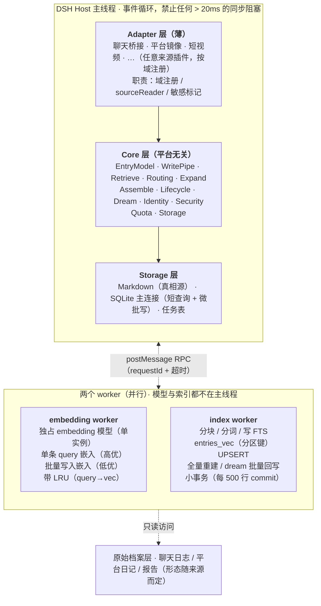

# DSH 通用记忆插件：HLD 与 LLD（v4.11）

> 面向实现者的工程文档，**活文档**——随实现与评审滚动更新（v4.11 起修订史外置 CHANGELOG.md，设计定稿未实现在 DESIGN-NEXT.md）。
>
> **⚠ 文档状态（2026-10-31）**：本卷正文冻结为 **v4.11 基线参照**。v4.12 起的全部修订、R-127 起的新增编号、以及最新验收（223/223 绿）一律以 **CHANGELOG.md** 为准；未实现项与架构增补提案（R-152~R-157）见 **DESIGN-NEXT.md**。下文三处表述已过时、勿按正文执行：①"127 测试全绿"；②"现行待修问题 R-121~R-126"（已于 2026-10-28 全部关闭）；③"设计定稿未实现：情感雷达 / 对话流水 / 成对隐私"（均已落地，v4.14/v4.18/v4.21/v4.29）。
>
> **已落地契约**（189 测试全绿）：四路召回 + 加权 RRF、四分类/取代链、冲突治理（同义折叠/字面兜底/回滚）、待定池对账 + uncertain 实体锚定（R-119）、入嵌剥日期（R-92）、headless 维度安全（R-94）、两根管道、会话开关、lexvec 词向量后端、外部导入器、LLM 接入开关 + 三档 transport（R-127~R-130）、**情感雷达 P-a + 对话流水层 + 全域检索 + 成对隐私硬过滤 + 承诺记忆（R-131~R-135）**、**内存精确索引（R-137）**、**设置页动态域（R-138）**、**内心活动 + 日记层（R-139）**、**原话向量路（R-141）**、**情绪日志层（R-142）**——明细见 CHANGELOG.md（R-92~R-142 全录，踩坑集中版在 DESIGN-NEXT.md）。
>
> **现行待修问题**：**无**——R-121~R-126 已于 2026-10-28 全部关闭（四条代码 bug 修复 + 两条文档级收口），见 CHANGELOG v4.13 与附录 A 的结项说明。
>
> **设计定稿未实现**：R-113 多平台 adapter（等 bridge 通道）、R-114 风格档案消费端（等多说话人语料）、importanceWeight 真实数据校准（等 confirmGate 跑出数据）——全在**等条件**，无"现在该做而没做"；清单见 DESIGN-NEXT.md。R-63 记忆对用户可见已于 v4.28 落地（设置页检索面板 + GUIDE 来源档次条款）。
>
> **冲突治理四期方案**收于附录 C（通用化，适用于任何来源插件）；同步副本在仓库 `docs/conflict-resolution-plan.md`。
>
> 分期标记：`[P0]` `[P1]` `[P2]` `[P3+]`。数字均为起步默认值，P2 评测集上重新校准。

---

# Part I — HLD（高层设计）

## 1. 定位与不可违反的约束

**一句话**：一个平台无关的 DSH 插件，为任意桥接项目提供主动写入、分层存储、多路检索、身份稳定的记忆能力。

| 编号  | 约束                                        | 说明                            |
| --- | ----------------------------------------- | ----------------------------- |
| C1  | 原项目存储只读                                   | 只通过 Adapter 的 sourceReader 读取 |
| C2  | Markdown 是真相源，SQLite 可重建                  | **含生命周期状态**，见 §9.3 `[R-1]`    |
| C3  | 同步路径零 LLM 调用                              | 嵌入不算 LLM，但也必须离开主线程            |
| C4  | Core 无平台专有名词                              | 平台概念只出现在 Adapter              |
| C5  | 不做短期/长期静态二分                               | 用连续持久度 + 冷存阈值                 |
| C6  | 单进程；主线程单连接池，worker 线程各自独占连接 `[R-5]`       | 不引入第二进程                       |
| C7  | 低信任域签名覆盖 provenance                       | 证明来源与未篡改，不证明内容可信              |
| C8  | `trust` 为 logit 后验，仅外部信号更新                | 命中不更新 trust                   |
| C9  | 索引任务的前提是 Markdown 已落盘                     | indexer 执行前二次校验               |
| C10 | 派生层全部由 worker 显式维护，不使用 FTS5 自动触发器 `[R-3]` | 避免无意重写，且支持中文分词                |

## 2. 架构总览



<details>
<summary>纯文本版（编辑器不支持 Mermaid 时看这个）</summary>

```text
DSH Host 主线程（事件循环，禁止任何 > 20ms 的同步阻塞）
├─ Adapter 层（薄）
│    聊天桥接 · 平台镜像 · 短视频 · …（任意来源插件，按域注册）
│    职责：域注册 / sourceReader / 敏感标记
├─ Core 层（平台无关）
│    EntryModel · WritePipe · Retrieve · Routing · Expand
│    Assemble · Lifecycle · Dream · Identity · Security
│    Quota · Storage
└─ Storage 层
     Markdown（真相源） · SQLite 主连接（短查询 + 微批写） · 任务表

        ↕  postMessage RPC（requestId + 超时）

两个 worker（并行；各自独占连接，模型与索引都不在主线程）
├─ embedding worker：独占模型（单实例） · 单条 query 嵌入（高优） · 批量写入嵌入（低优） · LRU
└─ index worker：分块/分词/写 FTS · entries_vec（分区键）UPSERT · 全量重建 / dream 回写 · 小事务（每 500 行）

        ↑ 只读

原始档案层（聊天日志 / 平台日记 / 报告——形态随来源而定）
```

</details>

**为什么嵌入必须独立成 worker** `[R-2]`：主线程需要 `embed(query)` 才做向量召回，但模型常驻约 600MB；若主线程和 index worker 各加载一份，内存逼近 1.5GB 上限。因此模型只存在于 embedding worker，主线程通过 RPC 拿向量，单次往返 20–40ms，计入 500ms 检索预算。

## 3. 模块职责

| 模块         | 职责                                  | 明确不做         |
| ---------- | ----------------------------------- | ------------ |
| Adapter    | 域注册、sourceReader、敏感标记               | 不写记忆、不做检索决策  |
| EntryModel | 结构校验、序列化、从 Markdown 解析              | 无业务逻辑        |
| WritePipe  | 抽取→效用→四分类→一致性→签名→配额→落盘              | 不阻塞同步路径      |
| Retrieve   | 四路召回→加权 RRF→准入→排序→取原文               | 不调 LLM       |
| Routing    | 域路由、意图路由、向量跳过、自包含短路（**唯一判定点**）      | 不做排序         |
| Expand     | subject 单跳扩展，取 max 不叠加              | 不递归、不建显式图    |
| Assemble   | 静态 guide + 稳定段 + 动态段（含历史剥离 `[R-4]`） | 不改写用户原话      |
| Lifecycle  | 惰性衰减、floor 按 γ 缩放、激活回报、冷存判定         | 无定时器         |
| Dream      | 空闲或巩固信号触发；快照走 git `[R-6]`           | 不处理快照时间之后的条目 |
| Identity   | 硬指标采集、告警                            | P1 不自动再对齐    |
| Security   | 签名验证、logit 后验更新                     | 不做 LLM 判断    |
| Quota      | 每日写入上限 + pending 暂存                 | 可配置覆盖        |
| Storage    | 原子写、文件锁、事务、派生层重建                    | 不做业务判断       |

## 4. 关键数据流

**写入流（异步）**

```
session/event → 域路由 → 投递 extract 任务
  → [extract worker] 取上下文 → 嵌入(批量 RPC) ∥ LLM 抽取
  → 效用预判(规则)
  → 四分类(entry_triples 查表优先 → 向量兜底)
  → 一致性检查 → 签名(低信任域) → 配额检查
     ├ 配额满 → 写 pending_candidates，不投索引
     └ 配额足 → Markdown 原子落盘(文件锁) → 投 index 任务
  → [index worker] 分块/分词 → 单事务 UPSERT entries + entry_triples
                                  + entries_fts + entries_vec + files.sha256
```

**检索流（同步，预算 500ms）**

```
agent/pre-step → isSelfContained（唯一一次）
  → 意图路由 → 四路召回（向量经 embedding worker RPC）
  → 加权 RRF（rank 融合，不做分数归一化 `[R-7]`）
  → subject 单跳扩展（仅 relational，取 max）
  → 批量取 Entry（含验签所需全字段 `[R-8]`）
  → 准入（身份/共享/敏感/冷存/min_persistence）→ 验签
  → 持久度 × trust 调制排序 → top-k
  → 回读复核（仅 top-k，异步并发，按证据可复现比例降权）
  → 记激活事件 + 检索日志（不改 trust、不改 persistence）
```

**组装流（同步）**

```
system prompt:
  [静态 guide（字节恒定）]
  [稳定段：身份区 + 技能 + 跨域共享身份（低频变，带 bytesHash 缓存）]
当前 user 消息 content:
  [<memory_context> 动态段：工作记忆 + 本轮检索结果 </memory_context>]
  [用户原话]
每轮组装前：剥离所有历史 user 消息中的 <memory_context> 段 `[R-4]`
压缩事件：下外审强制重建稳定段 + 动态段
```

**巩固流（异步，dream）**

```
触发：空闲 ≥ idleMs，或巩固信号累积 ≥ 阈值
  → 峰时抑制检查 → snapshotTs 冻结
  → git commit 前置快照 `[R-6]`
  → 计算新状态（纯内存，不落盘）
  → Markdown 状态同步（真相源先落，仅变化条目所在分片）`[R-1][R-40]`
  → [index worker] SQLite 状态回写（仅 Markdown 已落盘的条目，小事务）
  → 事件表清理（跳过未落盘条目的激活事件）
  → 一致性修复（sha256 比对 + files 行差集 + 手工编辑回流）
  → pattern 提炼（P3+，LLM，独立配额）
  → 冷存归档 → 派生层增删 → 身份指标采集
  → 消费巩固信号 → 写 audit
```

> 顺序上"Markdown 在前"不是风格选择：C2 规定 Markdown 是真相源，那么**落盘顺序也必须按真相源优先**。反过来（派生层先落）一旦真相源写失败，rebuild 就会把状态静默退回上外审，且 sha 比对认为"文件未变"永不重试——这是静默丢数据，比报错难查得多。

## 5. 架构决策（ADR）

| #      | 决策                                                  | 理由                                                                                                                                          | 代价                                |
| ------ | --------------------------------------------------- | ------------------------------------------------------------------------------------------------------------------------------------------- | --------------------------------- |
| ADR-1  | Markdown 真相源 + SQLite 派生                            | 可审计、可手改、可重建                                                                                                                                 | 需保证状态同步（§9.3）                     |
| ADR-2  | 单进程 + 两个 worker（嵌入 / 索引）                            | 不阻塞事件循环；模型单实例                                                                                                                               | RPC 往返 + 超时处理                     |
| ADR-3  | 读时惰性衰减                                              | 无调度器                                                                                                                                        | 每次检索一次浮点运算                        |
| ADR-4  | 半衰期 + 类型豁免                                          | 可观测、调参面小                                                                                                                                    | 失去关联激活精细度                         |
| ADR-5  | **加权 RRF（rank 融合）** `[R-7]`                         | 免疫分数分布差异；无需归一化、无需分词算 IDF                                                                                                                    | 需维护意图权重表                          |
| ADR-6  | 三元组查表替代 embedding 阈值                                | 四分类从"调不准"变"查表"                                                                                                                              | 抽取需输出三元组                          |
| ADR-7  | 每日写入配额兜底                                            | 最粗门控                                                                                                                                        | 可能丢弃候选                            |
| ADR-8  | 静态 / 稳定 / 动态三段分离                                    | 稳定段参与 prefix cache，动态段不破坏前缀                                                                                                                 | 组装分两处 + 历史剥离                      |
| ADR-9  | **向量路自带内存精确索引**，不依赖上游 ANN `[R-137]` | rescore 索引上游至今无发布版；精确 SIMD 在 8 万条 × 300 维下 8ms、召回 100%，而 HNSW 只有 88%（聚类）/ 11%（均匀分布）却要 16s 建索引 | 常驻内存 = 向量数 × 维度 × 4B（8 万条 300 维 ≈ 92MB） |
| ADR-10 | P0/P1 只用 better-sqlite3                             | node:sqlite 无 FTS5                                                                                                                          | 依赖原生模块                            |
| ADR-11 | trust 仅外部信号更新                                       | 避免命中→trust↑→更易命中的正反馈                                                                                                                        | trust 响应变慢                        |
| ADR-12 | **命中回报体现在 persistence 而非 trust** `[R-9]`            | 保留"常用记忆不易被遗忘"，同时不污染排序权重                                                                                                                     | 需 activation_events 窗口聚合          |
| ADR-13 | 签名覆盖 provenance + 组装标签 + 回读复核                       | 三层防御，威胁模型明确                                                                                                                                 | 回读有延迟成本                           |
| ADR-14 | 旧值 γ 加速，floor 按 γ 缩放                                | 低分区也生效                                                                                                                                      | floor 语义略复杂                       |
| ADR-15 | Dream 用 **git commit** 做快照 `[R-6]`                  | 增量、压缩、自带 diff；目录硬拷贝会随日增长爆盘                                                                                                                  | 需初始化 repo                         |
| ADR-16 | 冷存保留 FTS、移出 vec0                                    | 冷存召回有路径                                                                                                                                     | 冷存语义检索按需重算                        |
| ADR-17 | 配额满写 pending_candidates                             | 避免无源条目                                                                                                                                      | 需 staging 表 + TTL                 |
| ADR-18 | **单张 vec0 表 + `domain_id PARTITION KEY`** `[R-17]`  | KNN 在分区内做，语义等价每域一表，但不引入动态表名管理；`k` 语义正确                                                                                                      | 需 sqlite-vec ≥ 0.1.6；分区过碎时固定开销占比高 |
| ADR-19 | **standalone FTS5 + 应用层 bigram 分词** `[R-3]`         | ①`unicode61` 对无空格中文会把整句当一个 token；②external-content + `AFTER UPDATE` 触发器会让 dream 的**纯状态回写**（`persistence_at_decay` 等）也逐条触发 FTS delete+insert | 索引由 worker 显式维护；需定期 `optimize`    |
| ADR-20 | **动态段放进 user 消息并逐轮剥离历史** `[R-4]`                    | 不增加消息数、不产生 role 混淆、不累积膨胀                                                                                                                    | 剥离逻辑 + 上外审消息字节变化                  |
| ADR-21 | **Markdown 状态块必须写**                                 | 否则重建后所有条目"复活"，违反 C2                                                                                                                         | dream 期有写放大                       |
| ADR-22 | **`tripleSearch` 只做词表内精确匹配，不做自由三元组抽取** `[R-18]`     | 自由抽取必须引入 NER/关系抽取，延迟与失败率不可控且无法计入 500ms 预算                                                                                                   | relational 意图召回偏保守，靠扩展补           |
| ADR-23 | **`isSelfContained` 用白名单，其他一律不短路** `[R-19]`         | 通用分类器误判的代价是"该检索时没检索"，比多检索一次贵得多                                                                                                              | 会多一些无谓检索                          |
| ADR-24 | **写入端约束 `text ≤ 200 字`，注入端不截断** `[R-20]`            | 截断发生在注入端必然切掉三元组语境；约束在抽取 prompt + 校验层更彻底                                                                                                     | 抽取需要二次压缩长文本                       |
| ADR-25 | **dream 落盘顺序 = 真相源优先**（Markdown 先、SQLite 后）`[R-40]` | 派生层领先真相源时，rebuild 会静默回退状态且 sha 比对永不重试；反之则自愈                                                                                                 | 需要先纯内存算出全部新状态再落盘，dream 峰值内存略增     |
| ADR-26 | **"满即切"的判定必须在文件锁内，允许换 path 重试** `[R-38]`            | 锁外判定 + 锁内使用是并发漏洞的通用形态；分片阈值只有在锁内才成立                                                                                                          | 写入路径多一层循环；极端并发下可能触发超限降级           |
| ADR-27 | **极端情况降级为"超限写入"而不是抛异常** `[R-38]`                    | 超限只是文件变大（可后续迁移），丢条目是不可恢复的记忆损失                                                                                                               | 需要 `part-overflow.log` 监控         |

**ADR-9 现状核验与改判（2026-10-28）`[R-136]` `[R-137]`**：ADR-9 原文说「P0/P1 不绑 rescore，上游未稳定」——核验后发现**上游至今没有任何发布版可用**，而且即便可用也不划算：

| 事实 | 验证方式 |
|---|---|
| `INDEXED BY rescore(quantizer=…, oversample=…)` 在 **v0.1.9（npm latest）与 v0.1.10-alpha.4 都报 `could not parse table option`** | 试建临时表（旧 `openDatabase` 的 `canAnn` 探测就是这么写的） |
| `rescore integer` **能建表但不是 ANN 索引**：它是普通元数据列，`INSERT ... rowid` 报 `Only integers are allowed for primary key values` | 同上；**只看「能建表」就以为支持 rescore 会踩这个坑** |
| 即便能力可用，**300 维下量化+重排的收益也是负的**：bit 量化要 95% 召回需 58.7ms（pool=3000），精确扫描 67.9ms —— 只快 13%，还丢 5% 召回 | 8 万条合成向量实测 |
| usearch HNSW 同样不划算：1.28ms 但召回 **88%**（聚类）/ **11%**（随机均匀），建索引 16.6s / 37s | 同上 |

**第一次改判（R-136）：不做配置开关**。死旋钮判据 R-43/M4 —— 没有消费方的旋钮不进 UI，放一个点了没反应的开关比不放更糟。当时改成 `/status` 的能力诊断块。

**第二次改判（R-137）：连那套诊断和死代码一起删掉，改做内存精确索引**。理由：诊断清楚「rescore 不可用」只是让人反复来问「那怎么办」，而真正的瓶颈根本不是缺 ANN，是**每次查询都把域内向量从 SQLite 搬进进程**（2 万条 × 300 维实测 283ms，而算余弦只要 8ms）。搬运算掉之后，8 万条的精确扫描只要 8~10.6ms、召回 100%，比任何 ANN 都更值。实现见 LLD §13.2.4。

**清理范围**：`retrieve.vectorStrategy`（含 `ann` 档）、`retrieve.ann.quantizer`/`oversample`、`openDatabase` 的 `canAnn` 试建探测、`vecTableDdl` 的 `INDEXED BY rescore(...)` 分支、`test/ann.test.js`、`eval/run.js` 的 `annEval` 整节。旧库若残留 rescore 建表子句，空表在启动时换掉、非空表留给 `rebuild` 换（`hasRescoreClause` 判据）。


## 6. 非功能要求

| 维度                             | 目标                                                                                                    |
| ------------------------------ | ----------------------------------------------------------------------------------------------------- |
| 检索附加延迟（P95，不含 LLM）             | < 500ms（含 embedding RPC 30–60ms）；**不含 `include_cold`**（见 §6.1）                                        |
| 主线程单次 SQLite 查询                | < 20ms                                                                                                |
| 主线程单次 SQLite 写                 | < 5ms（微批 ≤ `cfg.write.microBatchRows`，默认 500 行）                                                       |
| 向量跳过生效时                        | 再省 ~40ms                                                                                              |
| 内存                             | < 1.5GB（嵌入模型单实例 ~600MB + LLM 云端）                                                                      |
| **冷启动（可服务）** `[R-54]`          | **< 2s**：骨架 + 索引就绪。`就绪标志` 只等这一档                                                                       |
| **冷启动（embedding 可用）** `[R-54]` | 单独计时并上报（600MB 级模型 mmap 冷读 + 初始化约 1–2s，目标 < 5s）。**不阻塞就绪标志**：期间向量路自动降级为三路，日志标 `vec:not-ready`           |
| 可恢复性                           | 删 SQLite 可从 Markdown 完全重建（含生命周期状态）                                                                    |
| Markdown 写放大                   | 仅在 dream 期，量级 O(当日变更条目数)。**R-121 已修**：状态落盘加量化门槛（`dream.stateWriteEpsilonP`=0.01 / `stateWriteMaxStaleDays`=14），Δp 未达门槛且未过期就不落，承诺自此成立 |
| 平台                             | Windows / Linux / macOS                                                                               |

### 6.1 两个规模量级：热区 vs 总量 `[R-64]`

上面那张表里的 **500ms 检索目标**只在"热区有界"的前提下成立（写入的 5ms 是单次写入代价，与总量无关，不在此列）。这个前提散落在各处实现里，从没写成一条，所以先写死：

**① 线上检索的扫描量 ≈ 热区大小，不是总条目数。** 四路召回各自有界：向量路扫的是 `entries_vec` 的域内分区（冷存条目在 §17.2 第 8 步已移出）、FTS 路扫热表 `entries_fts`（冷条目在 `entries_fts_cold`）、三元组路只走 `entry_triples`（冷存时已删）、时间窗走 `idx_observed` 且带 limit。**所以"总共有多少条记忆"不进入检索路径的复杂度**——这是 C5（连续持久度而非静态二分）在性能上的回报。

**② `entries` 主表随总量线性增长，但它只吃磁盘不吃延迟。** 检索拿到的永远是有限 id 集合（top-k + over-read），后续是主键点查；没有任何线上路径对 `entries` 做全表扫描。总量从 10 万涨到 1000 万，检索延迟不变。

**③ 冷存 = 热区控制阀，不是遗忘开关。** 这是本节最要紧的一句：调 `coldThreshold` / `coldIdleMs`，调的**不是"忘掉什么"，是"热检索池多大"**。`include_cold=true` 仍然能取回冷条目，"冷"的含义只是"移出高频扫描结构"，不是"删除"。把它当遗忘开关，就会做出"为了省空间把阈值调高"这种反向操作。

**由此推出一条诊断纪律**：`重建` / 全量 `reconcileShardCounts` / `probeNextPart` 的 readdir 是 **O(总量) 运维操作**，与线上 O(热区) 无耦合。**P2 评测时"重建慢"和"检索慢"必须分开归因**——前者是运维预算，后者才是设计问题。混在一起会得出"记忆系统天生慢"的错误结论。

**`include_cold=true` 不在 500ms 预算内** `[R-66]`：它要扫冷表，扫描量随总量线性增长，这是语义决定的，无法用索引消掉。处理方式不是限频（会挡住"查三年前的记忆"这种真实需求），而是**显式标价**：该路径不计入检索延迟目标，结果附加 `cold_scan_ms`，文档与工具描述里标为"运维级查询，非常规检索"。与"回读只对 k+4 条做"同一个思路——把慢路径隔离出去并标价，而不是假装它不存在。


## 7. 分期与验收

| Phase                             | 范围                                                                                                                                                                                                                                                                                                             | 验收                                                                                                                                                                                                                                                                                                                                                                                         |
| --------------------------------- | -------------------------------------------------------------------------------------------------------------------------------------------------------------------------------------------------------------------------------------------------------------------------------------------------------------- | ------------------------------------------------------------------------------------------------------------------------------------------------------------------------------------------------------------------------------------------------------------------------------------------------------------------------------------------------------------------------------------------ |
| **P0-0** `[R-53]` `[R-58]`        | 附录 B 的纯函数与断言（无 IO、无时钟、无随机）：`tokenizeBigram` / `weightedRRF` / `containsNormalized` / `isSelfContained` / `trimToBudget` / `estimateTokens` / `parsePartPath` / **`classifyIntent`** / **`needsTrustLabel`** / **`mergeFtsRoutes`** / `tripleSearch` 的匹配逻辑                                                                             | 附录 B 全部断言绿；**接 SQLite 之前就能跑**。这一档的意义是把"纯逻辑对不对"与"接线对不对"彻底分开                                                                                                                                                                                                                                                                                                                                 |
| **P0a** `[R-53]`                  | 单进程 + 双 worker 骨架；Entry；Markdown 真相源（文件锁 + 状态块 + 分片 + sha 单点刷新）；SQLite 全量 schema；vec0 单表 + `domain_id` 分区键；standalone FTS + bigram；加权 RRF；单个来源域 Adapter（只读 sourceReader，示例：一个群聊来源）。**输入是手写 `EntryCandidate` JSON，直接走 `new` 分支、绕过 `classifyNovelty`**，但 **embedding 必须真实调用**（索引阶段要写 `entries_vec`，否则 P0 的核心资产一条都没验到） | 手写候选进入后 Markdown 与 SQLite 均可见；`memory_search` 返回正确条目；中文两字查询可命中；**手工往 `entries_vec` 插 30 条 `domain_id='synthetic-small'` 向量、`vec_shards.vector_count` 同步写 30，路径 B 仍能取满 k**；崩溃后从 Markdown 完整重建（状态不丢）；**排序桩生效**：P0 阶段 `p ≡ 1`、`trust_posterior_logit ≡ 0`，公式退化为 `rrf × 0.5`（等价纯 RRF 排序）`[R-55]`                                                                                               |
| **P0b** `[R-53]`                  | 接真实 `llmExtract` + `prefetchEmbedding` + `classifyNovelty` 四分类 + 配额 + pending 消费                                                                                                                                                                                                                               | 群消息进入后 Markdown 与 SQLite 均可见；重复消息被 `redundant` 拦下（不新增条目）；配额满 → pending → 次日消费；抽取结果抽样人工通过率达标                                                                                                                                                                                                                                                                                                |
| **P1** `[R-59]` `[R-60]` `[R-61]` | 三段组装 + 历史剥离 + 压缩重注入；惰性衰减 + γ/floor；**激活回报**；签名；dream **开 1/2/3/4/5/6/8/9b/9c 步**（关 9a/10/11，见 `cfg.dream.steps`）；**trust 只留结构**（`verifiedEnabled=false`，后验恒 0）；回读复核 **shadow**（硬失败排除生效、两档降权只记录）；私聊来源域 Adapter。**已从 P1 移出**：`verified` 检测（→P2）、身份指标采集（→P2）、FTS optimize（→P2）、三档降权生效（→P2 校准后）               | 稳定段字节一致；常用记忆 persistence 不单调下降；**Windows 上单次 dream 的 git 操作 < 1s**；签名失败被排除；**`retrieval_log` / `activation_events` 行数不随时间单调增长**；**`vec_shards.vector_count` 与 `COUNT(*) FROM entries_vec` 差值恒为 0**（本轮触达域每轮对账 + 每 20 轮全量）；**回读复核 p95 < 100ms**，且 shadow 日志里能算出"打开降权时会有多少条跨档跌出 top-k"；**并发写同一天时无分片超限（除非已写 `part-overflow.log`）**；**`p` 换成真函数后排序结构不变**；**第 4 步某批失败后重跑 dream，`hits` 不丢**（R-57） |
| **P2** `[R-52]` `[R-59]` `[R-61]` | 50–100 条评测集 + 参数校准（**单参数敏感度扫描，不做网格搜索**）；**路径 B 的 over-fetch 放大代价（R-122 已修：小分区改走域内内存余弦扫描，不再依赖全表 KNN；此处只剩"大分区降级路"的性能观测量**；`verified` 检测上线（误报率 < 5%）；身份指标采集；FTS optimize；回读降权打开                                                                                                                                                                                        | 加权 RRF vs 等权 RRF、意图权重（含 `classifyIntent` 的判定准确率）、alpha、rrfK、配额、半衰期、γ、激活回报参数的校准报告；**over-fetch 放大倍数（`k × knnOversample × 2^0..2^3`）在不同域占比下的浪费程度，据此决定 `minPartitionVectors` 取值**；`rereadPenalty` 阈值据 shadow 分布定档后打开                                                                                                                                                                          |
| **P3+**                           | dream 巩固信号触发 + pattern 提炼 + 扩展一跳 + 内容平台/短视频 Adapter + 人工确认式再对齐 + cross-encoder + 差分衰减 A/B                                                                                                                                                                                                             | 逐项灰度，各附评测对比                                                                                                                                                                                                                                                                                                                                                                                |


**为什么 P0 要拆三段** `[R-53]`：`runExtractTask` 一条链上同时挂着 LLM 抽取、embedding RPC、四分类、配额、落盘、索引投递。这条链一旦跑不通，**你无法区分是抽取质量差、RPC 没就绪、还是分片写入的并发逻辑有 bug**——症状会表现为"检索有时准有时不准"，而这类症状在本设计的历史里已经反复出现（R-45 的"记忆时灵时不灵"）。所以 P0a 的输入用**手写 `EntryCandidate` JSON 直接走 `new` 分支**，把判定链摘掉；但 embedding 不能摘——索引阶段必须写 `entries_vec`，否则 P0 要验的 `vec0 + 分区键` 一条都没验到。"绕过 `classifyNovelty`"和"绕过 embedding"是两件事，别合并。

**P0a 通过后、P0b 开始前：先交付三张函数级调用图** `[R-63]`。不是文档，是开工产物：§17.2 dream、§13.5 retrieve、§12.3 index pipeline 各一张，每个节点标 **输入 → 输出 → 失败语义 → 谁消费**。

这一步的价值在于它会把"步骤之间的隐含契约"逼出来——R-57 那个 bug（第 3 步成功、第 4 步某批失败、第 5 步仍删了事件）本质上就是图上一条画不出箭头的边：`landed` 集合在第 3 步产生、第 4 步消费，而事件清理却引用了一个不同的集合（`pendingMdStateWrites`），两者的差集就是漏掉的路径。`landed` 生命周期、`pendingMdStateWrites` 精确语义这类问题，画图时自己会浮出来。

**P0 阶段的排序桩** `[R-55]`：§13.5 的 `score = rrf × (1-α+α·p) × sigmoid(trust_logit)` 里，`lazyPersistence`（惰性衰减）与 `trust_posterior_logit` 都是 **P1** 的活。P0 若不显式约定，实现者要么发明一个"P0 版"公式（P1 接衰减时得改结构），要么把 P1 的活提前做（P0 范围膨胀）。约定：**P0 阶段 `p ≡ 1`、`trust_posterior_logit ≡ 0`**，公式结构按最终版写死，参数留桩 —— 此时 `1-α+α·1 = 1`、`sigmoid(0) = 0.5`，排序等价于纯 RRF（0.5 对全体等比例缩放，不改相对次序）。P1 接真函数时不碰结构。

## 8. 风险与待决策

| 风险                             | 缓解                                                                                                                                                                                                                                          |
| ------------------------------ | ------------------------------------------------------------------------------------------------------------------------------------------------------------------------------------------------------------------------------------------- |
| 配额过紧导致漏记                       | pending_candidates 兜底 + P2 校准                                                                                                                                                                                                               |
| 半衰期与真实节奏不匹配                    | 按域可配；用激活回报对冲                                                                                                                                                                                                                                |
| 身份分叉累积                         | P1 仅告警；P3+ 人工确认后再对齐                                                                                                                                                                                                                         |
| 组合式/休眠式污染                      | 溯源签名 + 证据可验证回读 + 组装标签；不承诺完全防御                                                                                                                                                                                                               |
| 百万级锚点 KNN 变慢                   | 单次查询本就是 O(n) SIMD 全量扫描 `[R-137]`（8 万条 8~10ms）。监控检索 P95：超 50ms 先拆域，真到百万级再评估旁路接 usearch `Index`（HNSW）——**不是自己改 sqlite-vec**，那要维护一个 fork 换 13% 收益 |
| partition key 分区过碎（某域向量数 < 数十） | 该域退回内存过滤（§13.2）；P2 用评测集确认                                                                                                                                                                                                                   |
| bigram 索引膨胀（约原文 2 倍）           | dream 期 `optimize`；**禁止 `VACUUM`**（会重排 rowid，见 §21-23）                                                                                                                                                                                      |
| **记忆对用户不可见** `[R-63]`          | **已知缺口，P1 不解决**：P1 阶段记忆的可见性只通过 Agent 的自然语言表达体现，不提供独立 UI；`<memory_context>` 里的 `[第三方内容，未经确认]` 标签是**给 LLM 看的**，用户看不到。若 Agent 复述了一条低信任域的错误记忆而用户无从判断，信任链断在产品侧，不在内核侧。**P2 起**在组装段加用户可感知的置信度标记（或提供 `memory_search` 的可读摘要），在此之前不要把"标签只给 LLM 看"当成终态 |
| 检索路径被"优化"撑爆预算 `[R-62]`         | `maxEmbedRpcPerRetrieval = 1` 是硬配额；query 改写 / HyDE 属于 P3+，引入时必须显式上调并重评估 500ms 目标                                                                                                                                                            |
| 单域目录文件数随年数增长 `[R-67]`          | `domains/<domain>/` 按天分文件，十年就是 3650 个/域，`probeNextPart` 的 `readdir` 会到几十 ms。**记为 P3+ 的演进项，不在 P0 动**：按年分子目录会把 `parsePartPath` 的"三种合法形态"变成四种，且联动 §9.5 重建第 8a 步、§10 `probeNextPart`、§9.6 冷文件解析 —— 为十年后的问题改 P0 的路径契约不划算。触发条件：单域目录文件数 > 1000     |
| 热区膨胀导致向量路变慢 `[R-65]`           | 热区 = `entries_vec` 里未冷存的向量数；超 `hotPartitionWarnAt`（默认 8 万）写 audit 并标 `hot-partition`。内存精确索引（`[R-137]`）的扫描量就是这个数，所以它现在是**检索 P95 的解释变量**，而不再是「要不要切 ANN」的触发器。**不做任何自动降级**——8 万这个数是经验区间（随维度 / CPU / SIMD 实现变化），只能观测不能当阈值 |

---

# Part II — LLD（低层设计）

## 9. 数据模型

### 9.1 Entry

```ts
interface Entry {
  id: string;                       // ulid
  domain_id: string;
  source_ref: SourceRef;
  provenance: Provenance;

  observed_at: number;              // unix ms，事件发生
  recorded_at: number;              // unix ms，写入系统

  text: string;                     // 1-3 句
  entry_type: 'fact' | 'pattern' | 'boundary' | 'skill';
  topic_tags: string[];
  triples: Triple[];                // **原文**：落 Markdown frontmatter + entries.triples(JSON)，
                                    // 并参与签名；归一化后的索引在 entry_triples（§9.4 R-88）
  evidence_links: EvidenceLink[];   // JSON 落 entries 表
                                    // 【v4.24 已做活】生产：extract 同批 links 声明 + remember 直连；
                                    // 消费：retrieve expandByLinks（relational 意图，类型加权一跳，激活集 ≤2×k，
                                    // 与种子同走 admit+验签）；归一化索引 entry_links(source 区分 extract/dream)；
                                    // dream s13 从 retrieval_log 共现自动长 coexist 边（§9.4 同型索引，非图数据库）

  // 生命周期（必须同步进 Markdown 状态块）
  persistence_init: number;
  last_decay_at: number;
  persistence_at_decay: number;
  gamma_multiplier: number;         // 默认 1.0
  activation_count: number;         // 累计
  last_activated_at: number | null;

  // 信任（logit）
  trust_prior_logit: number;
  trust_posterior_logit: number;
  trust_updated_at: number;

  // 签名
  signature: string | null;
  signature_key_id: string | null;

  // 归属与可见性
  identity_scope: 'domain' | 'shared_core';
  shareable: boolean;
  // 【R-117 成对隐私】可见性单位是**对话对**，不是"谁是老板"：
  //   normal  通用（全域可召回，带出身标注）
  //   shared  对话对内（跨对话对需要显式 privacy.crossSessionSensitivity）
  //   private 硬底线：只有产生它的那段对话能召回——**owner 换个会话也看不见**
  // 'sensitive' 是历史值，语义等同 shared（保留兼容，不再新增）
  sensitivity: 'normal' | 'shared' | 'private' | 'sensitive';

  // 【R-95 情感雷达 P-a】情绪走**列**、追加式，绝不进 triples：
  // 走三元组会触发 update 取代（"开心"顶掉"委屈"）、过判重线进待定池、还消耗写入配额。
  emotion: 'neutral' | 'joy' | 'sadness' | 'anger' | 'anxiety' | 'fatigue';
  emotion_owner: 'user' | 'agent';   // 情绪属于谁；不借道 subject，避免与三元组折叠打架
  archived_topic: boolean;
  cold: boolean;

  // 取代关系
  superseded_by: string | null;
  supersedes: string[];

  // 派生字段（不落 Markdown，也不落 entries 表）
  rowid?: number;                   // 只用于调试，禁止参与关联（§21-24）
  embedding?: Float32Array;         // 索引期瞬态，落 entries_vec
}

interface Triple { subject: string; attribute: string; value: string; }

interface EvidenceLink {
  entry_id: string;
  type: 'support' | 'causal' | 'coexist';
  valid_interval: [number, number] | null;
}

interface SourceRef {
  adapter_id: string;
  locator: string;     // 【契约】必须跨时间稳定：平台消息 ID / 日记日期#序号
  hint?: string;       // 允许不稳定：行号、字节偏移
}

interface Provenance {
  session_id: string;
  message_ids: string[];
  extract_task_id: string;
  model_version: string;
  extracted_at: number;
  source_content_hash: string;   // 原文 SHA256，仅用于回读复核
}
```

**`locator` 契约** `[R-11]`：`sourceReader.read(ref)` 对同一 `locator` 必须永远返回同一内容。行号、字节偏移一律放 `hint`——日志轮转、压缩、补写一行都会让偏移漂移，若把偏移写进 locator，回读比对必然误报。

**`sourceReader` 延迟契约** `[R-30]`：`read()` 必须在**本地 50ms 内**返回，**不得依赖网络**。理由很直接——回读复核（§13.7）在检索同步路径上并发读 `k + overRead` 条，单次 200ms 的远程读取会让 top-k 回读直接吃掉整个 500ms 预算。

做不到的 Adapter 在注册时声明 `sourceReaderIsLocal: false`，这类域的条目**跳过回读复核**（返回 `unavailable`，不降权也不排除）。这比"让它慢着跑"好：一个慢 Adapter 会拖垮所有域共用的检索延迟预算。

```ts
interface DomainRegistration {
  id: string;
  matchSessionId: (sid: string) => boolean;   // 谓词，不是解析器 —— 见下方 routeDomain
  trustPrior: number;
  trustedSource: boolean;                     // 注册期声明：false 时其条目在组装段打第三方标签（§15.1）
  identityScope: 'domain' | 'shared_core';
  defaultSensitivity: 'normal' | 'sensitive';
  shareableByDefault: boolean;
  requireSignature: boolean;
  sourceReaderIsLocal?: boolean;      // 默认 true；false 则跳过回读复核（§13.7）
  sourceReader: { read(ref: SourceRef): Promise<{ text: string; meta: object }> };
}
```

**`routeDomain`：session → domain 的解析** `[R-77]`。`matchSessionId` 是**谓词**，多个域可能同时匹配，所以必须显式定义"多重匹配怎么办"：

```ts
// P0/P1 的假设：**session 与 domain 一对一**。只有一个来源 Adapter 时，
// 谓词最多命中一个域；第二来源接入后按 session 前缀区分，仍然是一对一。
// 多重匹配策略（首个 / 最具体 / 报错）留到 P3+ 再定，现在不许自己发明。
function routeDomain(sid: string): Domain | null {
  const hits = registeredDomains.filter(d => d.matchSessionId(sid));
  if (hits.length === 0) return null;              // 调用方返回空结果，不抛错
  if (hits.length > 1) {
    // 一对一是当前契约。出现多重匹配说明 Adapter 的谓词写宽了 —— 记 audit 并取第一个，
    // 但**不要**静默：这个信号在 P3+ 拆多域 session 时是唯一的线索来源。
    auditDomainAmbiguous(sid, hits.map(d => d.id));
  }
  return hits[0];
}
```

> 为什么不在 `routeDomain` 里抛错：session 路由发生在检索入口，抛错等于"整个会话的记忆功能坏掉"。取第一个 + audit 是"降级但有痕迹"，比"拒绝服务"更符合 §18 的降级原则。


双保险：即使 Adapter 声明 `sourceReaderIsLocal: true` 却仍然慢，`reReadAndCheck` 外层还有 `withDeadline(..., rereadDeadlineMs)` 总超时（默认 100ms）。超时的条目按 `unavailable` 处理。**契约负责让 Adapter 写对，超时负责让写错的 Adapter 不拖垮系统**——两者都要，只留一个都会在真实场景里失守。

### 9.2 三元组与规范化

```
subject_key = collapse_ws(lower(trim(subject)))
attribute   = collapse_ws(lower(trim(attribute)))   // 域内白名单：偏好/身份/位置/计划/技能/边界
value       = trim(value)                            // 保留原文大小写
去重键      = (domain_id, subject_key, attribute)    // 可对应多个 value（多值属性）
```

多值属性（偏好、计划）**不做覆盖**，改为并存 + `observed_at` 取最新 + 旧值 γ 加速。

```ts
// 上面那三行规范的唯一实现。四个函数都是纯函数（进 P0-0 基线）。
// 规范与实现分家的代价很具体：`subjectKey` 如果三处各写一遍，
// "同一主体被当成两个"就会出现（tripleSearch 的词表 / extendVocab 写入 /
// getVocab 读取各认一套），这是 R-39 读写分裂的同型故障。
const collapseWs = (s: string) => s.trim().replace(/\s+/g, ' ');

const subjectKey   = (s: string) => collapseWs(s.toLowerCase());   // §9.2 第 1 行
const attributeKey = (a: string) => collapseWs(a.toLowerCase());   // §9.2 第 2 行

// 【R-79】**必须与写入侧等宽，不能更宽**：§9.2 规定 value 只 trim、保留大小写，
// 所以这里也只 trim。若顺手做了 lower，"Twitter" 与 "twitter" 会被判成同一个值
// → classifyNovelty 走 redundant → 强化一条与原文大小写不符的旧条目，
// 而新值根本没入库（错误不可见，只是下次检索拿到的值不对）。
const normalizeValue = (v: string) => v.trim();                    // §9.2 第 3 行
```

### 9.3 Markdown 布局与文件格式 `[R-1]`

```
$DSH_HOME/memory-kernel/          ← 本身是 git repo
  .gitignore                      ← keys/, *.db, *.db-wal, *.db-shm
  domains/<domain_id>/<YYYY-MM-DD>.md
  domains/<domain_id>/<YYYY-MM-DD>.part-01.md   ← 仅超阈值时出现（见下）[R-81]
  shared_core/identity.md
  shared_core/skills.md
  cold/<domain_id>/<YYYY-MM>.md
  audit/*.log                     ← dream / part-overflow / assemble / assemble-budget-overflow /
                                    unknown-file-pattern / cold-scan-slow / route-scores /
                                    reread-shadow / signature-failures / trust-updates /
                                    identity-alerts / domain-ambiguous
  keys/<domain_id>.key            ← 0600，不入 git
  model_meta.json                 ← model_id / dim，不入 SQLite
```

> **分片名是 `2026-10-26.part-01.md`，不是 `2026-10-26/part-01.md`** `[R-81]`。v4.9 之前这里画成了"日期子目录 + `part-01.md`"，与 §9.6 的 `parsePartPath` 正则（`<YYYY-MM-DD>(.part-NN)?.md`）直接冲突——按目录形式写出来的路径会被 `refreshFileSha` 判为非法名、拒绝写入 `files` 行（R-50），于是分片映射永远要靠 `probeNextPart` 的目录扫描，`markdownPath` 的 O(1) 查表彻底失效。**路径契约只有一个来源：§9.6 的正则**，本节只是它的可读图示。

**分片规则** `[R-31]`：单文件条目数 > `cfg.storage.maxEntriesPerFile`（默认 800）时，后续写入落到同名的 `part-NN.md` 分片；`NN` 两位数、字典序即时间序。已存在的单文件不会被迁移（避免 dream 期重写放大），只有新写入会分流。

触发阈值用**条目数**而不是字节数：500KB 在 NVMe 上重写不到 5ms，真正随时间线性增长的成本是**解析器全量解析 + block 索引重建**，而这两者由条目数决定，与字节数只是相关。按字节阈值会在长文本条目上过早分片。

代价必须写清：`markdownPath(entry)` **不再是纯函数**。原来 `domain + date` 就能定位文件，分片后要先 `readdir` 该域目录、判断今天是否有 `part-*`。实现上用 `files` 表加一列 `part_no` 记录映射，写入路径查表 O(1)，重建路径扫描目录；两者都不慢，但**必须在 §10 的文件锁粒度上跟着改**——锁的单位从 `<domain>/<date>.md` 变成具体分片路径，否则同一域同一天的两个分片会互相覆盖。

**"满即切"必须在锁内判定** `[R-38]`：`markdownPath` 只回答"这条该往哪个分片写"，**不回答"这个分片还装不装得下"**。后者是可变状态，必须在 `withFileLock` 内部重新检查（见 §10），否则两个并发写入会各自在锁外看到同一个"未满"的 part-03，然后一起把它写爆。判定与切分的完整流程在 §10 的 `writeMarkdownAtomic` 里，**不要在这一层做任何"剩余容量"的预判**。

`dream` 的状态回写同理：只重写"本次有状态变化的条目所在的分片"，不再假设一个域一天只有一个文件。

单条条目块（`## <ulid>` 开头，下一个 `## ` 或 EOF 结束）：

```markdown
## 01JA8Z3K7Q9V2M4N6P8R0T2W4Y
type: fact
observed_at: 2026-10-26T02:00:00Z
recorded_at: 2026-10-26T02:00:03Z
topic_tags: [架构, 记忆系统]
triples:
  - { subject: 用户, attribute: 偏好, value: 用中文回复 }
evidence: []
source: chat-bridge / msg:8f3a2c1e-... (hint: archive/2026-10-26.log#L120)
provenance:
  session_id: chat-group-8823
  message_ids: [8f3a2c1e-...]
  extract_task_id: 10231
  model_version: cheap-2026-09
  extracted_at: 2026-10-26T02:00:03Z
  source_content_hash: 9b2c...
signature: null
signature_key_id: null
state:
  persistence: 0.42
  last_decay_at: 2026-10-26T03:00:00Z
  gamma_multiplier: 1.0
  activation_count: 7
  last_activated_at: 2026-10-25T21:14:00Z
  cold: false
  trust_posterior_logit: 0.41
  superseded_by: null
  supersedes: []
text: |
  用户偏好中文回复，明确说过不要用英文。
```

**`state:` 块是 C2 的关键**。v1–v3 的 Markdown 只存了 `persistence_init`，重建后所有条目的 `persistence_at_decay` 回到初值、`cold` 归零、`gamma` 归 1，等于全体复活，与"删 SQLite 可从 Markdown 完全重建"直接冲突。因此：

- 条目创建时写完整 `state`；
- dream 结束时，对**本次状态有变化**的条目所在文件做一次整文件重写（走同一把文件锁）；
- 重建时以 `state` 为准，并在其上继续衰减；
- **人工手改的边界** `[R-89]`（按 `serializeForSign` 的字段清单划，不是按"看起来像内容"划）：

| 手改字段 | 破签名？ | 该怎么处理 |
|---|---|---|
| `text` / `triples` | **是**（两者都在签名输入里） | 必须同时把 `signature: null`（＝撤销签名）或用域密钥重签。在 `requireSignature=true` 的域里，**没重签的条目会在下次检索时被静默排除**——`audit/signature-failures.log` 只会说"验签失败"，不会说"这是你手改的" |
| `topic_tags` / `entry_type` / `evidence_links` | 否（不在签名输入里） | 不需要重签；但内容变了要重建索引，由第 6a 步的手改回流完成 |
| `state` 块 | 否 | 容错，缺失字段按 `persistence_init` 起算（见下） |

> **这是用户责任，不是系统静默处理。** 系统无法区分"用户手改"与"内容被篡改"——后者恰恰是签名要防的东西。所以只能把边界写清：**改 `text` / `triples` 就必须重签，否则等于主动放弃这条记忆的可检索性。**


### 9.4 SQLite Schema（可执行）

```sql
PRAGMA journal_mode = WAL;
PRAGMA busy_timeout = 5000;
PRAGMA synchronous = NORMAL;
PRAGMA foreign_keys = ON;

CREATE TABLE IF NOT EXISTS model_meta (
  id INTEGER PRIMARY KEY CHECK (id = 1),
  model_id TEXT NOT NULL,
  dim INTEGER NOT NULL,
  created_at INTEGER NOT NULL
);

CREATE TABLE IF NOT EXISTS entries (
  id TEXT PRIMARY KEY,
  domain_id TEXT NOT NULL,
  entry_type TEXT NOT NULL,
  text TEXT NOT NULL,
  topic_tags TEXT NOT NULL,              -- JSON array
  triples TEXT NOT NULL,                 -- JSON array，**原文**（R-88）：签名对象 / 组装渲染 / 重建来源
  evidence_links TEXT NOT NULL,          -- JSON array
  source_ref TEXT NOT NULL,              -- JSON
  provenance TEXT NOT NULL,              -- JSON
  observed_at INTEGER NOT NULL,
  recorded_at INTEGER NOT NULL,
  persistence_init REAL NOT NULL,
  last_decay_at INTEGER NOT NULL,
  persistence_at_decay REAL NOT NULL,
  gamma_multiplier REAL NOT NULL DEFAULT 1.0,
  activation_count INTEGER NOT NULL DEFAULT 0,
  last_activated_at INTEGER,
  trust_prior_logit REAL NOT NULL,
  trust_posterior_logit REAL NOT NULL,
  trust_updated_at INTEGER NOT NULL,
  signature TEXT,
  signature_key_id TEXT,
  identity_scope TEXT NOT NULL,
  shareable INTEGER NOT NULL DEFAULT 0,
  sensitivity TEXT NOT NULL DEFAULT 'normal',
  archived_topic INTEGER NOT NULL DEFAULT 0,
  cold INTEGER NOT NULL DEFAULT 0,
  superseded_by TEXT,
  supersedes TEXT                        -- JSON array
);

CREATE INDEX IF NOT EXISTS idx_domain  ON entries(domain_id, cold);
CREATE INDEX IF NOT EXISTS idx_scope   ON entries(identity_scope, shareable, sensitivity, cold);
CREATE INDEX IF NOT EXISTS idx_observed ON entries(domain_id, observed_at DESC);

-- 三元组规范化表：替代 triples JSON 列与 '$[0]' 索引
CREATE TABLE IF NOT EXISTS entry_triples (
  entry_id    TEXT NOT NULL REFERENCES entries(id) ON DELETE CASCADE,
  seq         INTEGER NOT NULL,
  domain_id   TEXT NOT NULL,
  subject_key TEXT NOT NULL,
  attribute   TEXT NOT NULL,
  value       TEXT NOT NULL,
  PRIMARY KEY (entry_id, seq)
);
-- 服务四分类查表
CREATE INDEX IF NOT EXISTS idx_triple_dedup
  ON entry_triples(domain_id, subject_key, attribute, value);
-- 服务一跳扩展
CREATE INDEX IF NOT EXISTS idx_triple_subject
  ON entry_triples(domain_id, subject_key);

-- ── entries.triples 与 entry_triples 的职责划分（R-88）──────────────────────
-- 这两处**不是冗余**，是"原文"与"索引"两层，不能合并：
--   entries.triples   = 原文 JSON（签名对象 / 组装渲染 / 重建来源）
--   entry_triples     = 归一化后的查询索引（查重 / 词表 / 一跳扩展）
-- 判据：entry_triples 的每一行都可以由 entries.triples 重新算出来（纯派生）。
-- 反过来不行 —— 归一化是有损的（lower + 折叠空白），原文回不来。
--
-- 为什么 entries 必须有这一列：`serializeForSign` 序列化的是 `e.triples`，
-- 写入时来自内存（原文），读取时若从 entry_triples 重建就变成归一化版本 ——
-- 同一份数据两套字节，低信任域的验签会在"含大写字母/多余空白的英文主体或属性"上
-- 静默失败（中文 lower 是 no-op，所以中文内容测不出来）。
```

读写两侧对 triples 的处理必须对称（R-88）——这是全文件唯一允许碰这一列的两个函数：

```ts
function upsertEntryRow(e: Entry): void {
  // ...其余列略
  // triples 存原文 JSON：它是签名对象，也是 entry_triples 的重建来源
  stmt.run(/* ..., */ JSON.stringify(e.triples), /* ... */);
}

function loadEntries(ids: string[], opt: { includeCold?: boolean }) {   // minPersistence 在 §13.5 req 层实现，非本函数（R-126）
  // 一条 SQL 取 entries 全列（含 triples JSON），批量返回 Map<id, Entry>
  // **不要 JOIN entry_triples 来重建 triples** —— 归一化是有损的，原文回不来（R-88）
  const rows = db.prepare(`SELECT * FROM entries WHERE id IN (${ids.map(() => '?').join(',')})`)
    .all(...ids);
  return new Map(rows.map(r => [r.id, { ...r, triples: JSON.parse(r.triples) }]));
}

// 【R-90】单条读取是**包装**，不是另一条 SQL。
// 独立实现 `SELECT * FROM entries WHERE id = ?` 然后直接返回裸行，`triples` 会是
// JSON 字符串 —— 而 `writeTripleRows` 对它做 `.forEach` → 索引任务全体失败。
// 这一处的危险在于：它在 index 入口上，炸的是整条写入链，不是某一条记忆。
function loadEntry(id: string): Entry | null {
  return loadEntries([id], {}).get(id) ?? null;
}
```

```sql
-- standalone FTS5：不使用 external content，不用触发器
-- · tokens 为应用层 bigram 切分后的空格串
-- · 增删改一律按 entry_id 定位，**不使用 rowid 关联**：
--   entries 的 PK 是 TEXT，rowid 是隐式的，VACUUM 会重排 → FTS 错位
-- · 批量删除后执行 `INSERT INTO entries_fts(entries_fts) VALUES('optimize')`
CREATE VIRTUAL TABLE IF NOT EXISTS entries_fts USING fts5(
  tokens,
  entry_id UNINDEXED,
  domain_id UNINDEXED,
  tokenize = 'unicode61 remove_diacritics 0'
);

-- vec0：单表 + 分区键，由代码创建（dim 从 model_meta 读，禁止硬编码）
-- 需要 sqlite-vec >= 0.1.6；启动期探测 `SELECT vec_version()` 与
-- `pragma_table_info('entries_vec')` 中是否存在 partition key 支持，
-- 不支持则降级为「每域一表」（见 §13.2 降级分支）
--
-- CREATE VIRTUAL TABLE entries_vec USING vec0(
--   entry_id  TEXT PRIMARY KEY,
--   domain_id TEXT PARTITION KEY,
--   embedding float[${dim}]
-- );

-- 分区统计：用于判断某域向量数是否过少（过碎时该域退回内存过滤）
-- 维护方式见 §12.3：增量维护（bumpShardCount / decShardCount），
-- 不是逐条重算（批量索引时是 O(n²)）；dream 期 reconcileShardCounts() 做全量对账。
-- 唯一消费方是 §13.2 的路径 A/B 选择，容许短暂滞后，不容许长期漂移。
CREATE TABLE IF NOT EXISTS vec_shards (
  domain_id    TEXT PRIMARY KEY,
  vector_count INTEGER NOT NULL DEFAULT 0,
  updated_at   INTEGER NOT NULL
);

-- 既是 sha256 清单（重建/一致性修复用），也是分片映射表（markdownPath 查 part_no）。
-- 注意：path 行的生命周期由"扫描实际存在的文件"驱动 —— dream 第 6b 步会删除
-- 本次扫描未出现的 path（手工合并/改名分片后必须清理），否则写入会打向幽灵分片。
--
-- 【R-43】这里刻意**没有** entry_count 列。v4.3 曾加过一列并注明"用于满即切的
-- 快速判定"，但那个判定在 §10 里必须锁内用 countBlocks(existing) 重算（因为文件
-- 在两次判定之间会被别的写入改大），于是这列**既没有消费方、也没有维护点**：
-- 它只会停留在上次重建时的快照上，而重建是"从 0 开始扫"，绝大多数时候就是 0。
-- 一个永远不准的列比没有这一列更坏 —— 下一个实现者会信它。
-- 判据：**写入路径上已经零成本拿到的派生量，不落列**（vec_shards.vector_count
-- 是反例中的正例：它的消费方在检索路径上，重算要扫整个分区，所以值得存）。
CREATE TABLE IF NOT EXISTS files (
  path         TEXT PRIMARY KEY,
  domain_id    TEXT NOT NULL,
  date         TEXT NOT NULL,              -- 本地日 YYYY-MM-DD（按 storage.timezone）
  part_no      INTEGER NOT NULL DEFAULT 0, -- 0 = 未分片的单文件；N = part-N
  sha256       TEXT NOT NULL,
  last_synced  INTEGER NOT NULL
);
CREATE INDEX IF NOT EXISTS idx_files_part ON files(domain_id, date, part_no);

CREATE TABLE IF NOT EXISTS tasks (
  id          INTEGER PRIMARY KEY AUTOINCREMENT,
  kind        TEXT NOT NULL,             -- extract | index | rebuild
  priority    INTEGER NOT NULL DEFAULT 5, -- 1 最高
  payload     TEXT NOT NULL,
  status      TEXT NOT NULL DEFAULT 'pending', -- pending | running | done | failed
  attempts    INTEGER NOT NULL DEFAULT 0,
  locked_until INTEGER NOT NULL DEFAULT 0,
  not_before  INTEGER NOT NULL DEFAULT 0,
  created_at  INTEGER NOT NULL
);
CREATE INDEX IF NOT EXISTS idx_task_pick ON tasks(status, priority, not_before);

CREATE TABLE IF NOT EXISTS quotas (
  domain_id TEXT NOT NULL,
  date      TEXT NOT NULL,               -- YYYY-MM-DD，按 cfg.storage.timezone 的本地日切，不用 UTC
  count     INTEGER NOT NULL DEFAULT 0,
  PRIMARY KEY (domain_id, date)
);

CREATE TABLE IF NOT EXISTS pending_candidates (
  id          INTEGER PRIMARY KEY AUTOINCREMENT,
  domain_id   TEXT NOT NULL,
  payload     TEXT NOT NULL,             -- JSON: EntryCandidate
  enqueued_at INTEGER NOT NULL,
  expire_at   INTEGER NOT NULL
);

CREATE TABLE IF NOT EXISTS embedding_cache (
  text_hash     TEXT PRIMARY KEY,        -- SHA256(chunk)
  embedding     BLOB NOT NULL,
  model_id      TEXT NOT NULL,
  dim           INTEGER NOT NULL
);

-- 激活事件：dream 期聚合后清空（ADR-12）
-- 保留策略：结算即删；行数超 hardCap（默认 10 万）时强制触发轻量结算，
-- 不等待完整 dream 窗口（峰时抑制可能连续多日不跑）
CREATE TABLE IF NOT EXISTS activation_events (
  entry_id TEXT NOT NULL,
  at       INTEGER NOT NULL,
  kind     TEXT NOT NULL DEFAULT 'retrieval'   -- retrieval | reinforce | verified
);
CREATE INDEX IF NOT EXISTS idx_act ON activation_events(entry_id, kind, at);

-- 检索日志：用于把"用户确认"绑定到具体条目
-- 保留策略：dream 期删除 created_at < now - cfg.retrieve.retrievalLogTtlMs（默认 7 天）
CREATE TABLE IF NOT EXISTS retrieval_log (
  request_id TEXT PRIMARY KEY,
  domain_id  TEXT NOT NULL,
  entry_ids  TEXT NOT NULL,              -- JSON array，本轮注入的 id（按分数降序）
  created_at INTEGER NOT NULL
);
CREATE INDEX IF NOT EXISTS idx_retrieval_time ON retrieval_log(created_at);

CREATE TABLE IF NOT EXISTS identity_metrics (
  id           INTEGER PRIMARY KEY AUTOINCREMENT,
  domain_id    TEXT NOT NULL,
  window_start INTEGER NOT NULL,
  window_end   INTEGER NOT NULL,
  metrics      TEXT NOT NULL,
  alert        INTEGER NOT NULL DEFAULT 0
);

CREATE TABLE IF NOT EXISTS consolidation_signals (
  id         INTEGER PRIMARY KEY AUTOINCREMENT,
  kind       TEXT NOT NULL,
  domain_id  TEXT NOT NULL,
  weight     REAL NOT NULL,
  created_at INTEGER NOT NULL,
  consumed   INTEGER NOT NULL DEFAULT 0
);
```

### 9.5 派生层重建顺序

**重建是 O(总量) 的运维操作，与线上检索的 O(热区) 无耦合** `[R-64]`。它要把每个域的所有 Markdown 块重新解析、重新嵌入、重新写三张索引表，所以耗时随总条目数线性增长；而线上检索只扫热区（§6.1）。**"重建慢"不等于"检索慢"**——这条写在最前面，是因为 P2 评测时最容易被混成一个病。

```
1. 读 model_meta.json → 校验/重建 model_meta 表；探测 vec 分区键支持（决定走路径 A/B/C）
2. 扫描 domains/**.md 与 cold/**.md → 解析条目块
3. 单事务分批插入 entries（按 state 块还原生命周期字段）
   —— `triples` 列写入**原文 JSON**（R-88）：Markdown frontmatter 里就是原文，
      重建必须原样搬进 entries.triples，否则重建后的条目验签失败（签名对象含 triples）
4. 插入 entry_triples（**从 entries.triples 展开并归一化**，seq 从 0）
   —— 顺序不能反：先有原文，再有归一化索引（后者是前者的纯派生，R-88）
5. 重建 entries_fts：bigram 分词 → INSERT(tokens, entry_id, domain_id)
   ⚠ 不指定 rowid（禁止用 rowid 关联，见 §21-24）
6. 重建 entries_vec：批量嵌入 → 按 domain_id 分区插入；重算 vec_shards.vector_count
   ⚠ 维度取自 model_meta.dim，禁止硬编码
7. 重建 entries_fts_cold：cold=1 的条目进冷表
8. 重算 files 表（这是**整表重建**，不是 upsert）：
     a. 本次扫描到的每个文件 → 写入 (path, domain_id, date, part_no, sha256, last_synced)
        `date` / `part_no` 一律由 `parsePartPath(path)` 解析（§9.6），
        **运行时刷新的 `refreshFileSha` 共用同一个函数**
        —— 两处各写一份正则，就是"重建把 part-03 记成 part-00"的经典来源 `[R-43]`。
        `parsePartPath` 返回 null 的文件（`*.md.bak`、`xx (1).md`、编辑器临时文件）
        **跳过并且不写 files 行**，写 `audit/unknown-file-pattern.log` `[R-50]`

     b. **删除本次扫描未出现的 path 行** `[R-39]`
        手工把 part-01 + part-02 合并成单文件、或改名分片之后，
        旧的分片 path 行若残留，`markdownPath` 会查到"已不存在的 part-01"，
        写入打向幽灵路径，而读从合并后的单文件读 —— 读写分裂且没有任何报错。
9. 运行时不重建：quotas / tasks / pending / activation_events / retrieval_log /
   identity_metrics / consolidation_signals
```

> 第 8 步用"先清后写"或"写完后删除差集"都可以，但**不能只 upsert**。这是 `files` 表同时承担两个职责（sha 清单 + 分片映射）带来的必然要求：映射表的完整性必须以磁盘现状为准，而磁盘现状只能靠扫描得知。

重建完成前不对外提供检索（就绪标志置 false），避免读到半成品索引。

### 9.6 路径解析与 `files.sha256` 的单点刷新 `[R-48]` `[R-50]`

`files` 表有两个写入方（重建第 8a 步、运行时刷新），它们必须共用**同一个路径解析器**，否则"重建把 part-03 记成 part-00"这种事只能靠人肉对账发现。

```ts
// ─── 路径的唯一解析器 ────────────────────────────────────────────
// 合法形态只此三种（markdownPath / partPath / coldPath 是唯一产出方）：
//   <root>/domains/<domain>/<YYYY-MM-DD>.md            → { date, part: 0 }
//   <root>/domains/<domain>/<YYYY-MM-DD>.part-NN.md    → { date, part: NN }
//   <root>/cold/<domain>/<YYYY-MM>.md                  → { date: 'YYYY-MM', part: 0 }
// 注意最后一种是月粒度且**不分片**，所以 part 恒为 0。正则同时接受两种 date 形态，
// 是因为冷热两类文件都要进 files 表（重建第 8a 步扫的是 domains/ 和 cold/ 两处）；
// 不会串味：lookupPartNo 只按 (domain, 'YYYY-MM-DD') 查，永远查不到冷文件的行。
const PATH_RE = /(?:^|\/)(\d{4}-\d{2}(?:-\d{2})?)(?:\.part-(\d{2}))?\.md$/;

export function parsePartPath(path: string): { date: string; part: number } | null {
  const m = PATH_RE.exec(normalizeSlashes(path));
  if (!m) return null;
  return { date: m[1], part: m[2] ? Number(m[2]) : 0 };
}

// 消费方：refreshFileSha（写 files.domain_id 那一列）。
// 单独抽出来是因为它和 parsePartPath 共用同一套路径假设 ——
// 两处各写一份正则，就是"files 行记到隔壁域"的来源。
// 返回 null 而不是 throw：与 R-50 一致，非法路径是"跳过并留证"，不是"中断索引"。
export function domainIdOfPath(path: string): string | null {
  // <root>/(domains|cold)/<domain_id>/<file>.md → 取倒数第二段
  const segs = normalizeSlashes(path).split('/');
  const i = Math.max(segs.lastIndexOf('domains'), segs.lastIndexOf('cold'));
  if (i < 0 || i + 2 >= segs.length) return null;
  return segs[i + 1];
}
```

**`files.sha256` 只在一个地方更新：某个文件刚被完整写完之后。** 这不是优化，是约定——一旦允许"每处各算一遍"，P1 想收拢回单点时会发现"哪一次 sha 是准的"已经变成要靠审计日志回溯的问题。

```ts
// ─── sha 的唯一写入口（R-48）────────────────────────────────────
// **判据是"刚刚完整写完一个文件"，不是"哪个函数负责"**。全部落点就三处：
//   ① index 批次：事务**提交后**，对本批每个 path 各刷一次（§12.3）
//   ② dream 第 3 步：锁内写完 state 块立即刷（§17.2）
//   ③ dream 第 8 步：冷存移动会写两个文件（源分片删块、冷文件加块），两个都刷
// 禁止：在事务内算 sha、为省事增量猜 sha、在检索路径上顺手刷 sha。
// 新增任何"写完 Markdown"的路径时，**加调用点是修改清单的一部分**，
// 漏了不会报错，只会让第 6a 步把那批文件当人手改、每轮多解析一遍。
export async function refreshFileSha(path: string): Promise<boolean> {
  const parsed = parsePartPath(path);
  const domainId = domainIdOfPath(path);
  if (!parsed || !domainId) {
    // 【R-50】能进 index 队列的 path 必然由 markdownPath 产出，解析不了意味着
    // 有东西绕过了写入管线：手放文件、外部工具改名、或路径拼接 bug。
    // 三种兜底都错：`date ?? ''` / `part ?? 0` 会写出一条脏映射，之后 markdownPath
    // 把新条目写进这个文件、读取却按别的 part 读（读写分裂且无报错，与 R-39 同款）；
    // 不兜底则直接撞 NOT NULL 抛错，把"放错一个文件"升级成"索引任务全体失败"。
    // 正确做法是**拒绝处理并留证**：不写 files 行，索引照常进行（条目本身没坏）。
    auditUnknownFilePattern(path);            // → audit/unknown-file-pattern.log
    return false;
  }

  // 读不需要加锁：写入用 rename 原子替换，任何时刻读到的都是完整旧内容或完整新内容，
  // 不存在"读到半个文件、算出一个两边都不是的 sha"。极端交错下（读到旧内容、随后
  // 另一个写入落地）sha 会落后一次 —— 由 dream 第 6a 步的比对兜底重解析，属自愈。
  const buf = await fs.readFile(path);
  db.prepare(`
    INSERT INTO files(path, domain_id, date, part_no, sha256, last_synced)
    VALUES (?, ?, ?, ?, ?, ?)
    ON CONFLICT(path) DO UPDATE SET sha256 = excluded.sha256, last_synced = excluded.last_synced
  `).run(path, domainId, parsed.date, parsed.part, sha256(buf), now());
  //  ↑ 冲突时**不**改 date / part_no：path 是主键，parse(path) 是确定函数，
  //    两列在冲突行上必然已经相同；少一处可变状态就少一处能漂的地方。
  return true;
}
```

`probeNextPart` 的 `readdir` 扫描也必须套同一条判据 `[R-50]`：目录里出现 `parsePartPath` 为 null 的文件（`.md.bak`、`2026-10-26 (1).md`、编辑器临时文件）时**跳过并计数**，不能因为"多了一个文件"就把 next part 号推高——否则用户放错一个文件，后续写入就整体偏移一个分片。

## 10. Storage：原子写、文件锁、事务

```ts
// 单进程内 per-path 异步互斥（C6 下足够）
const locks = new Map<string, Promise<unknown>>();
function withFileLock<T>(path: string, fn: () => Promise<T>): Promise<T> {
  const prev = locks.get(path) ?? Promise.resolve();
  const next = prev.then(fn, fn);
  locks.set(path, next.catch(() => {}));
  return next;
}

// 【注意】分片后 markdownPath 不再是纯函数（§9.3 R-31）：
// 先查 files 表拿 (domain, date) → part_no，未命中才 readdir 该域目录探测最大分片。
// 写入路径走查表 O(1)；重建路径走目录扫描。两条路径必须共用同一实现，
// 否则"写入进 part-03、重建只读 part-01"这种错位会在初次全量重建时才暴露。
async function markdownPath(entry: Entry): Promise<string> {
  const date = localDate(entry.recorded_at, cfg.storage.timezone);
  const known = lookupPartNo(entry.domain_id, date);       // files 表
  if (known !== null) return partPath(entry.domain_id, date, known);
  // 未命中才扫目录。probeNextPart 的 readdir 必须跳过 parsePartPath 为 null 的文件
  // （.bak / "xx (1).md" / 编辑器临时文件），否则用户放错一个文件，
  // 后续写入就整体偏移一个分片号 —— 见 §9.6 R-50
  return partPath(entry.domain_id, date, await probeNextPart(entry.domain_id, date));
}

// 【关键 R-38】"part 是否已满"的判定必须在锁内做，并且必须能切走重试。
// v4.2 的写法是：path 在锁外算好 → 拿锁 → 无条件写。
// 于是：① lookupPartNo 返回的是"当前 part 号"而不是"最后一个未满的 part 号"，
//        满了没人告诉它该切；② 两个并发写入在锁外拿到同一个 part-03，
//        第一个写满 800 条，第二个拿锁后看到已满但也只能继续往 part-03 写（锁的就是它）。
// 结果：分片阈值形同虚设，单文件无限增长。
// 正确做法是「锁内判定 → 满了就放弃本次锁 → 换 path 重新拿锁」。
async function writeMarkdownAtomic(entry: Entry): Promise<void> {
  let path = await markdownPath(entry);

  for (let attempt = 0; attempt < cfg.storage.partSwitchMaxAttempts; attempt++) {  // 默认 5
    const outcome = await withFileLock(path, async () => {
      const existing = await readFileSafe(path);
      // 覆盖写（该条目已在文件里）不触发切分，否则更新会把自己赶到新分片
      // 【R-43】满额判定只认这里的 countBlocks，不读任何"条目数"缓存列。
      // 800 块的文件是一次 O(n) 字符串扫描，实测几毫秒，远在 <50ms 验收线内；
      // 反过来，任何缓存列在"锁外算、锁内用"或"写完忘了更新"两种情况下都会漂移，
      // 而漂移的表现是分片阈值静默失效 —— 比多扫几毫秒贵得多。
      if (!hasBlock(existing, entry.id)
          && countBlocks(existing) >= cfg.storage.maxEntriesPerFile) {
        return 'full' as const;
      }
      const updated = upsertBlock(existing, entry);
      const tmp = `${path}.tmp.${randomId()}`;
      await fs.writeFile(tmp, updated, 'utf8');
      await fsyncFile(tmp);
      await fs.rename(tmp, path);                   // 原子替换
      await fsyncDir(dirname(path));
      return 'written' as const;
    });

    if (outcome === 'written') return;
    path = await nextPartPath(entry.domain_id, path);   // 单调递增，不回退
  }

  // 【降级而不是抛异常】重试耗尽说明并发写入极密（或 maxEntriesPerFile 配得过小）。
  // 此时抛错 = 丢条目，而丢条目比超限严重得多：超限只是文件变大，
  // 丢条目是不可恢复的记忆损失。所以降级为"写当前分片并允许超限"，同时告警。
  auditPartOverflow(entry.domain_id, path);
  await withFileLock(path, async () => {
    const existing = await readFileSafe(path);
    const updated = upsertBlock(existing, entry);
    const tmp = `${path}.tmp.${randomId()}`;
    await fs.writeFile(tmp, updated, 'utf8');
    await fsyncFile(tmp);
    await fs.rename(tmp, path);
    await fsyncDir(dirname(path));
  });
}

// 单调递增：基于 max(已存在的 part) + 1，不是"找第一个未满的"。
// 两者在并发下行为不同——"找第一个未满"会让两个写入各自切到同一个空位、
// 然后互相把对方写满；"max+1"保证两者切到同一个新分片，由锁串行化。
// 代价是 part-02 的空位不会被填（若 03 之后又回到 02 的场景），接受这个浪费。
async function nextPartPath(domainId: string, current: string): Promise<string> {
  const date = dateOfPath(current);
  const maxPart = await maxExistingPart(domainId, date);   // readdir 该域目录
  return partPath(domainId, date, maxPart + 1);
}
```

**规则**：

- 所有 Markdown 写入（新建、更新、dream 状态回写、冷存移动）都走 `withFileLock`，key 为**具体文件路径**（分片场景下是 `.../part-NN.md`，不是 `.../<date>.md`）；
- 今日文件与冷存文件可能同时被 dream 与写入管线触碰，锁粒度是文件而非域；
- SQLite 写统一走 `dbTx(fn)`（原文误写 `withTx`——实现中从未定义，R-125 统一为 dbTx），微批上限 `cfg.write.microBatchRows`（默认 500 行）/ 单条事务 < 5ms；`[R-51]` 这一节原来写 200、§17.2 第 4 步写 500，两处不一致 —— 统一成一个配置项，别让实现者自己挑一个
- **决策点必须在锁内**：任何"锁外读状态 → 锁内按该状态动作"的写法都是禁止项（§21-34）。这条不只管文件锁，也管内存缓存、TTL 判定、`vec_shards` 计数这类"算的时候有效、用的时候可能已变"的状态；
- **没有文件锁的 Markdown 写入是禁止项**。

> **一个反例，说明这关不能只靠"有没有锁"来判**：`shouldSkipVectorChannel`（§13.6）也是"先算 FTS 命中、再决定是否跳过向量路"，形式上完全一样。但它**只读不写**——最坏情况是跳过一次本该做的向量召回，下外审就好了。判断标准不是"有没有锁外计算"，而是"**这个决策是否会改变被决策对象的状态**"。会，就必须在锁内；不会，就允许（并把代价写清楚）。

## 11. 嵌入服务（worker RPC）

```ts
// 主线程侧
const emb = createWorkerClient<EmbReq, EmbRes>('./embedding-worker.js', {
  timeoutMs: 2000,
  onTimeout: () => ({ vector: null, degraded: true })   // 降级为无向量
});

const queryCache = new LRU<string, Float32Array>(512);
async function embedQuery(q: string): Promise<Float32Array | null> {
  const key = sha256(q);
  const hit = queryCache.get(key);
  if (hit) return hit;
  const r = await emb.call({ kind: 'single', text: q, priority: 1 });
  if (!r.vector) return null;
  queryCache.set(key, r.vector);
  return r.vector;
}
```

- 模型只在 embedding worker 内常驻，单实例；
- 写入批量嵌入走 `{ kind: 'batch', texts, priority: 5 }`，与查询共用队列，**查询优先级更高**；
- `embedding_cache` 以文本 hash 去重，跨重启复用；
- 模型维度与 `model_meta.dim` / `entries_vec` 实际维度不一致时，启动期即拒绝服务并触发全量重建；
- 嵌入失败 → 该条 `embedding_pending`，检索降级为 FTS + 三元组两路。

### 11.1 启动与预热契约 `[R-54]`

上面那段代码是"worker 已经在跑"的视角。真实情况是：**600MB 级模型的加载发生在 worker 线程里，不在主进程启动路径上**，所以必须显式规定谁等谁。

```ts
// 主进程启动时立刻 spawn（不是第一次查询才 spawn），但**不 await 模型加载**
const emb = createWorkerClient<EmbReq, EmbRes>('./embedding-worker.js', {
  timeoutMs: cfg.embedding.rpcTimeoutMs,          // 2000，只用于普通请求
  onTimeout: () => ({ vector: null, degraded: true })
});

let embReady = false;                              // 只由 worker 的 ready 事件翻转

async function boot() {
  await initDatabase();                            // ← 就绪标志只等这些
  await ensureSchemaAndRebuildIfNeeded();
  setReadyFlag(true);                              // 此刻开始对外服务（向量路可能还没好）

  // 预热是"发出去就不管"的：不 await、不阻塞就绪标志
  void prewarmEmbedding();
}

async function prewarmEmbedding(): Promise<void> {
  // 【关键】warmup 不使用 emb.call 的通用通道，否则会被 rpcTimeoutMs=2000 掐断：
  // 模型还没加载完 → 主线程判超时 → 判 worker 挂了 → 重启 → 再发一次 warmup
  // → 模型加载第二遍。越重启越慢，日志里表现为"随机 2s 超时"，会被误诊成 RPC bug
  // 而去调大 rpcTimeoutMs（调大只是把误判推迟，不解决问题）。
  const ok = await emb.callWithTimeout(              // 独立超时，见 §19 warmupTimeoutMs
    { kind: 'warmup', text: 'init' },
    cfg.embedding.warmupTimeoutMs                    // 默认 10000
  );
  if (!ok) { auditWarmupFailure(); return; }         // 不重启 worker：模型可能仍在加载
  embReady = true;                                   // 之后向量路恢复
  auditWarmupLatency(Date.now() - bootTs);           // 单独上报，不进冷启动 < 2s 那一档
}
```

**规则**：

- **`就绪标志` 不等模型加载**（§6 两档冷启动）。等的话，600MB mmap 冷读 1–2s 直接吃掉 < 2s 的预算，目标从第一天就是假的；
- 预热期间 `embedQuery` 直接返回 `null` → §13.5 的 `skipVec` 生效 → 检索降级三路。**这是既有降级路径，不为预热新增分支**；
- **warmup 走独立超时（≥10s）或 fire-and-forget**，绝不复用 `rpcTimeoutMs`；
- **预热判据是 worker 的 `ready` 事件，不是"进程启动"**：worker 崩溃重启后必须重走同一套预热。挂在进程启动上的实现，重启后 `embReady` 仍为 `true`，第一条查询就会拿到一个"模型还没加载"的 worker；
- 日志必须把"向量路未就绪"和"RPC 超时"分成两种标签（`vec:not-ready` / `vec:rpc-timeout`），否则 P0 第一次手动测试必然把前者误诊成后者。

## 12. 写入管线

### 12.1 抽取任务

> **LLM transport 从哪来（已实现，R-127~R-130）**：由 `cfg.llm.enabled` 开关选三档之一——**宿主通道**
> （`ctx.llm.prepareCall()` → `call.stream()`，路径 B，key 留在宿主 Models 页）／**本地 OpenAI 兼容端点**／**自定义云 API**。
> 选路在 `src/adapters/llm-router.js`（关闭返回 null → 抽取器不构造），宿主档在 `src/adapters/host-llm.js`。
> 四档共用同一 transport 契约（`complete({system,messages}) => string`），`llmExtract` 与本节流程对背后是谁**无感知**；
> 关闭时本节维持"骨架在、不产候选"并 audit `llm-disabled`。设置落盘 `root/llm-settings.json`（restart 类，需重启 web）。
> 落地明细与三条实测坑见 **CHANGELOG.md · v4.12 增补**。

```ts
async function runExtractTask(task: ExtractTask): Promise<void> {
  const domain = getDomain(task.domainId);
  const ctx = recentContext(task.event, 4);

  // 嵌入与 LLM 抽取并行（都在 worker 里，不占主线程）
  const [candidates] = await Promise.all([
    llmExtract({ messages: ctx, schema: ENTRY_SCHEMA }),
    prefetchEmbedding(ctx)                     // 预热，供四分类兜底用
  ]);

  // 【P0a 模式 R-53】P0a 的入口是手写 EntryCandidate JSON，`route` 直接取 {kind:'new'}，
  // 跳过 isUseful 与 classifyNovelty —— 这两步都依赖 embedding / 检索，
  // 接进来就会让"候选判定不对"和"检索不对"两条排查链绞在一起，
  // 症状统一长成"检索有时准有时不准"。P0b 再把这两步接回来。
  for (const c of candidates) {
    if (!isUseful(c, domain)) { await stashLowUtility(c, domain); continue; }
    // 【R-79】路径必须写全 `cfg.write.` —— v4.9 写成 `cfg.p0aBypassRouting` 时读出来是
    // undefined（falsy），行为恰好"对"（不走 bypass），于是 P0a 会静默走到 classifyNovelty
    // 然后因为没接 embedding 而失败。这类"配置没生效但代码恰好跑通"的错比报错难查得多。
    const route: Route = cfg.write.p0aBypassRouting      // P0a：true，恒走 new
      ? { kind: 'new' }
      : await classifyNovelty(c, domain);
    switch (route.kind) {
      case 'redundant': await reinforceEntry(route.existingId); break;
      case 'new':       await persistNewEntry(c, domain); break;
      case 'update':    await handleUpdate(c, route, domain); break;
      case 'uncertain': await handleUncertain(c, route, domain); break;  // 进 merge 队列，P3+ 才开 LLM
    }
  }
}
```

`c.embedding` 在需要时由 embedding worker 现算并缓存，**四分类之前必须就绪**（v1–v3 的流程里缺这一步）。

**两个 P0b 前必须定、P0a 可以只留签名的函数** `[R-79]`：

```ts
// ① isUseful —— "什么算低效用"。P0a 绕过（候选是手写的，全部有用），P0b 第一天就撞。
//    最小判据（可配）：文本长度 < N、无 topic_tags、三元组全空、纯表情/纯链接。
//    ⚠ 它挡掉的东西进 stashLowUtility，**不是删除** —— 低效用也有审计价值。
function isUseful(c: EntryCandidate, domain: Domain): boolean { /* P0b 前定，勿发明 */ }

// ② reinforceEntry —— redundant 时"怎么强化"。**不得直接改 persistence_at_decay**：
//    那是 dream 的 settleEntry 的专属字段，非 dream 路径改它会造成"两个写入方 +
//    绕过落盘顺序"，与 R-40/R-82 同型。
//    正确做法：只写一条激活事件，让既有闭环在下外审 dream 里发奖励。
//    代价：`settleEntry` 的统计与 §17.2 第 4 步的随批删除都要把 kind 扩成
//    IN ('retrieval','reinforce') —— 三步一起改，不能只改一处（见 §14）。
async function reinforceEntry(entryId: string, at = Date.now()): Promise<void> {
  recordActivations([entryId], 'reinforce', at);   // 只记事件，不碰状态
}
```

> 为什么 `reinforce` 值得单独一种 `kind` 而不是复用 `retrieval`：`retrieval` 记的是"被检索命中"，`reinforce` 记的是"又被说了一遍"，两者在 P2 校准时是不同的信号源（前者受排序影响，后者不受）。但**在 P1 的结算里它们等价**，所以 `settleEntry` 必须同时认两个 —— 这也是为什么它不能只改 `reinforceEntry` 一处。


**v4.19 修复实录 `[R-140]`**：抽取管线自上线（R-130）以来**一条候选都没成功过**——dsh-llm 流里 `reasoning-delta`（思考）与 `text-delta`（正文）同形带 `.text`，聚合按字段名抓文本把整段思考拼进返回，JSON 解析每轮必炸。教训与修复：

- **连通性探针必须验返回内容**，不是"没报错、有延迟"——`/llm-test` 的 text 字段当时就是思考原文，看了当场就能发现；
- 聚合按 `chunk.type` 分桶：只收 `text-delta`（增量）与 `text`（完整块，按 index 覆盖防双计），`reasoning*`/`tool-call*` 一律挡掉；
- `parseCandidatesJson` 剥 `<think>…</think>`（custom/local 档可能内联思考）；
- `extract-failed` 审计带 `raw`（原始返回前 400 字）——没有它，解析失败永远归因不了；
- 她的回复进原话流水：订阅宿主 `agent/assistant-stream`，`end` 帧 `outcome.eventType === 'assistant/message'`（已落库）时把该 attempt 的正文补进 transcript（pre-step 只有用户侧输入）。

#### 12.1.1 两条写入入口的行为契约 `[R-131]` `[R-135]`

两个入口共用同一条落盘管线（`buildEntry → 判重 → 配额 → 真相源 → 索引`），差别只在"谁做判断"：

| 入口 | 谁做判断 | 契约 |
|---|---|---|
| `memory_remember`（Agent 手写） | **Agent** | 工具描述是它的"宪法"：subject 统一（用户本人的事写"用户"、自己的承诺写"助手"，都不许写"我"）、attribute 白名单、text 只写干净的一句事实、含义不明的孤立消息先问不猜、更正旧账先查后写 |
| LLM 抽取（`kernel.extract`） | **LLM** | prompt 与工具描述同源；transport 由 `cfg.llm.enabled` 三档选路（R-127~R-130），关闭时"骨架在、不产候选"并 audit `llm-disabled` |

**Agent 侧自我记忆（R-115）**：对用户做出明确的承诺/约定/决定时同样调 `memory_remember`——subject 写"助手"、attribute 走既有白名单（计划）、只记**跨会话需要兑现**的。
管线零改动：`subjectKey` 会把"助手"收进词表，三元组检索/判重/取代照常工作（"改周六了"自动取代"周日"）。

两条禁令：

1. **描述必须限定"只记跨会话需兑现的承诺"**——否则每日写入配额被日常回复冲爆。
2. **禁止宿主 `post-step` 用代码自动抓取 Agent 回复中的承诺**。代码猜"哪句算承诺"必然误判，与"禁止 post-step 伪造内心独白"（R-97）是同一条纪律：**机械的事给代码，判断的事给 LLM**。宁可漏记，不要假数据。

**人格分层（R-116）**：底色（性格/口吻/称呼习惯）进宿主人设层（`@deepseek-ai/dsh-persona` 的 `config.prefix`），**绝不进记忆**——人格条目会被判重/取代/衰减/冷存波及，某条被顶掉人格就漂移了。"我是谁"不能靠回忆。记忆层只管进化：表达风格可记 `type=pattern`（subject="助手"），对不同人的适配走关系档案。


### 12.2 四分类（走 entry_triples）

```ts
type Route =
  | { kind: 'redundant'; existingId: string }
  | { kind: 'update'; existingId: string }
  | { kind: 'uncertain'; existingId: string }
  | { kind: 'new' };

async function classifyNovelty(c: EntryCandidate, domain: Domain): Promise<Route> {
  // 1. 三元组主键查表（多值、多三元组全覆盖）
  for (const t of c.triples) {
    const rows = db.prepare(`
      SELECT t.value, t.entry_id
      FROM entry_triples t JOIN entries e ON e.id = t.entry_id
      WHERE t.domain_id = ? AND t.subject_key = ? AND t.attribute = ?
        AND e.cold = 0
      -- 【R-87】没有 LIMIT 但下面取 rows[0]，等价于 LIMIT 1 → 同样需要确定性排序。
      -- 而且这里的不确定性更严重：它决定"update 分支取代哪一条旧值"，
      -- 污染的是 superseded_by 这条**持久边**，不是一次性的返回顺序。
      ORDER BY e.observed_at DESC, e.id
    -- 【R-86】subject 和 attribute **必须成对归一化**。只归一化 subject 时：
    -- 写入侧存的是 attributeKey("Preference") = "preference"，
    -- 查询侧却在查 "Preference" → 永远查不到 → 每次都判 new
    -- → 同一偏好被反复新增成平行条目（activation_count / persistence 全被拆散，
    --    tripleSearch 的命中数也被拆散）。退化表现是"召回还行但排序很乱"，
    --    极难归因到 attributeKey —— 所以它必须与 subjectKey 同进同出。
    `).all(domain.id, subjectKey(t.subject), attributeKey(t.attribute));

    if (rows.length === 0) continue;
    const exact = rows.find(r => normalizeValue(r.value) === normalizeValue(t.value));
    if (exact) return { kind: 'redundant', existingId: exact.entry_id };
    // 同一 (s,a) 已有不同 value：取最新的一条作为取代目标（并列时按 id，见上）
    return { kind: 'update', existingId: rows[0].entry_id };
  }

  // 2. 三元组无命中 → 向量兜底
  const vec = await embedForClassify(c);
  if (!vec) return { kind: 'new' };
  const [top] = await vecSearch(vec, domain.id, 1);
  if (!top) return { kind: 'new' };
  // 【R-79】阈值读全局配置（按嵌入模型校准），不是 `domain.novelty` ——
  // DomainRegistration 里没有这个字段，P0/P1 也不支持按域覆盖。
  const sim = top.score ?? 0;            // vec 路的 score = 余弦相似度（§13.2 ScoredHit）
  if (sim > cfg.write.novelty.redundant) return { kind: 'redundant', existingId: top.id };
  if (sim > cfg.write.novelty.uncertain) return { kind: 'uncertain', existingId: top.id };
  return { kind: 'new' };
}
```

`ORDER BY e.observed_at DESC` 修掉了 v3 里 `rows[0]` 取到任意一条的问题。


### 12.3 落盘与配额

**`buildEntry`：候选 → 完整 Entry 的唯一构造点** `[R-77]`。之前它被调用两次、从未定义——而它决定的三件事（生命周期初值、trust 初值、state 块是否完整）全都影响衰减曲线与排序，实现者只能自己猜。

```ts
function buildEntry(c: EntryCandidate, domain: Domain): Entry {
  const t = now();
  const prior = logit(domain.trustPrior);        // 默认 trustPrior = 0.5 → prior = 0
  return {
    id: newUlid(),                               // 先拿 id，签名与索引都依赖它
    domain_id: domain.id,
    source_ref: c.sourceRef,
    provenance: c.provenance,
    observed_at: c.observedAt ?? t,              // 事件发生时间（可早于写入）
    recorded_at: t,                              // 写入时间；dream 的 snapshotTs 用它划窗口
    text: c.text,                                // 写入端已校验 ≤ 200 字（ADR-24）
    entry_type: c.entryType,
    topic_tags: c.topicTags,
    // 【R-83】**保留原文**，一个字段都不归一化（value 只 trim）。
    // Entry.triples 要落 Markdown frontmatter、要参与签名、要进 audit —— 它必须
    // 和用户/抽取器给出的原样一致。归一化只发生在 writeTripleRows 写 entry_triples 时。
    // 早先这里写成了 `attribute: attributeKey(...)` 并塞进 `subject_key`：
    // 前者让 Markdown 里丢大小写（重建后 triples 与原文不符），
    // 后者是 Triple 接口里不存在的字段（TS 报错，绕过类型则会被序列化进 frontmatter）。
    triples: c.triples.map(x => ({
      subject: x.subject,
      attribute: x.attribute,
      value: normalizeValue(x.value),            // §9.2：只 trim，保留大小写
    })),
    evidence_links: c.evidenceLinks ?? [],

    // ── 生命周期初值：**只在这里写一次**，之后仅由 dream 的 settleEntry 改写 ──
    persistence_init: cfg.lifecycle.initPersistence,
    persistence_at_decay: cfg.lifecycle.initPersistence,
    last_decay_at: t,
    gamma_multiplier: 1.0,
    activation_count: 0,
    last_activated_at: null,

    // ── trust 初值：posterior 从 prior 起步（不是 0）──
    trust_prior_logit: prior,
    trust_posterior_logit: prior,
    trust_updated_at: t,

    signature: null, signature_key_id: null,     // 域要求签名时由 signEntry 填
    identity_scope: domain.identityScope,
    shareable: c.shareable ?? domain.shareableByDefault,
    sensitivity: c.sensitivity ?? domain.defaultSensitivity,
    archived_topic: false,
    cold: false,
    superseded_by: null,
    supersedes: [],
  };
}
```

| 字段 | 初值 | 为什么是这个值 |
|---|---|---|
| `persistence_init` / `persistence_at_decay` | `cfg.lifecycle.initPersistence`（0.5） | 两个字段同步，衰减从 `persistence_at_decay` 起算。取 0.5 是让新条目"半信半疑"：0.15 的冷存线要掉 1.7 个半衰期，30 天半衰期的 fact 约 51 天到线，合理 |
| `trust_prior_logit` / `trust_posterior_logit` | `logit(domain.trustPrior)`（默认 0） | **posterior 从 prior 起步，不是从 0**。P1 `verifiedEnabled=false`，所以 posterior 永不变化 → `sigmoid` 是常数因子，不改域内排序（与 R-59 的"等价于桩"一致）；而域若声明 `trustPrior=0.8`，它的条目会整体抬升，这是有意义的配置 |
| `last_decay_at` | 写入时刻 | 第一次 `settleEntry` 的窗口从此刻开始，不能是 0（否则会把史前事件算进来） |
| `activation_count` / `last_activated_at` | `0` / `null` | `last_activated_at=null` 是 `shouldColdArchive` 的前置条件——新条目不会被立刻判冷 |
| `gamma_multiplier` | `1.0` | γ 加速只在 `handleUpdate` 里写 |
| `superseded_by` / `supersedes` | `null` / `[]` | 永远不是"缺省"，显式给空值，否则 state 块重建时字段缺失 |

> **首写就必须是完整 state 块**：P0a 验收里"崩溃后从 Markdown 完整重建、状态不丢"全靠这一步（§9.3）。少写一个字段，重建后它就回落到默认值——而默认值恰好是"新条目"的样子，等于那条记忆的年龄被抹掉。

**归一化的唯一落地点** `[R-83]`：`subjectKey` / `attributeKey` / `normalizeValue` 三个函数**只在写 `entry_triples` 时调用**，`Entry.triples` 永远保持原文。

```ts
// 消费方：runIndexBatch（§12.3）—— entry_triples 的唯一写入点。
// 三处调用点各司其职，不要互相替代：
//   writeTripleRows  → subjectKey / attributeKey（归一化落库）
//   classifyNovelty  → subjectKey（查同一 (s,a) 的既有 value，§12.2）
//   extendVocab      → subjectKey（词表与 entry_triples.subject_key 必须同一函数，
//                      否则"同一主体被当成两个"，与 R-39 的读写分裂同型）
function writeTripleRows(e: Entry): void {
  db.prepare(`DELETE FROM entry_triples WHERE entry_id = ?`).run(e.id);
  const ins = db.prepare(`
    INSERT INTO entry_triples(entry_id, seq, domain_id, subject_key, attribute, value)
    VALUES (?, ?, ?, ?, ?, ?)
  `);
  e.triples.forEach((t, i) => {
    // seq 保留数组顺序：Markdown 里的 triples 是有序的，重建时按 seq 还原
    ins.run(e.id, i, e.domain_id, subjectKey(t.subject), attributeKey(t.attribute), t.value);
  });
}
```

```ts
async function persistNewEntry(c: EntryCandidate, domain: Domain): Promise<void> {
  const entry = buildEntry(c, domain);        // 先 build 拿到 id

  if (!tryConsumeQuota(domain.id)) {
    // 不投索引任务，不写 Markdown；进暂存区
    db.prepare(`INSERT INTO pending_candidates(domain_id, payload, enqueued_at, expire_at)
                VALUES (?, ?, ?, ?)`)
      .run(domain.id, JSON.stringify(c), now(), now() + cfg.write.pendingTtlMs);
    return;
  }

  if (domain.requireSignature) signEntry(entry, domain);
  await writeMarkdownAtomic(entry);                       // 真相先落盘
  await dbTx(() => upsertEntryRow(entry));                // 同步写 entries（微批）
  await enqueueIndex(entry);                              // 再投索引（C9）
}

async function enqueueIndex(entry: Entry): Promise<void> {
  await enqueueTask({
    kind: 'index',
    priority: 3,
    payload: { entryId: entry.id, mdPath: await markdownPath(entry) }
  });
}
```

Indexer 侧二次校验（C9）：

```ts
// 【R-48】索引按批处理，sha 在**事务提交后**刷，且每个文件每批只刷一次。
// v4.4 的写法是"每条索引在事务内调一次 updateFileHash"→ 同一个分片新增 800 条
// 就是 800 次 O(file_size) 的读 + 哈希（5MB × 800 = 4GB 的无效 IO），
// 而且文件 IO 还发生在事务里 —— 事务持有写锁的时间被磁盘延迟直接放大。
async function runIndexBatch(tasks: IndexTask[]): Promise<void> {
  const touched = new Set<string>();      // 本批涉及的 path（去重后才是刷新次数）

  await dbTx(() => {
    for (const task of tasks) {
      const entry = loadEntry(task.entryId);
      if (!entry) { auditIndexMissing(task); continue; }   // 不因单条坏任务回滚整批
      upsertFtsRow(entry);              // 按 entry_id 先删后插，不用 rowid
      writeTripleRows(entry);           // entry_triples：DELETE WHERE entry_id + 批量 INSERT
      const d = upsertVecRow(entry);    // 'inserted' | 'replaced' | 'skipped'
      bumpShardCount(entry.domain_id, d);            // 增量计数，见下
      extendVocab(entry.domain_id, entry.triples);   // 增量补 tripleSearch 词表
      touched.add(task.mdPath);         // ⚠ 只收集路径，事务内不做任何文件 IO
    }
  });

  // 提交后再算 sha：本批 500 条落在同一个分片 → 只算 1 次
  for (const path of touched) await refreshFileSha(path);   // 见 §9.6
}

// C9 的二次校验也改成"每文件读一次"：逐条 readFileSafe 整片是 O(n) 次全文件读，
// 和 sha 是同一个病。校验不通过的条目**从本批剔除并置 retry**（不是 throw 打断整批
// ——v4.4 里每条独立调用，throw 只影响自己；改成批处理之后必须显式过滤）。
async function filterLanded(tasks: IndexTask[]): Promise<IndexTask[]> {
  const ok: IndexTask[] = [];
  for (const [path, group] of groupBy(tasks, t => t.mdPath)) {
    const md = await readFileSafe(path);                  // 每个文件读一次
    for (const t of group) {
      if (md.includes(`## ${t.entryId}`)) ok.push(t);
      else raiseTaskRetry(t, 'markdown block missing');   // 重试；超限丢弃 + audit
    }
  }
  return ok;
}

async function runIndexQueue(tasks: IndexTask[]): Promise<void> {
  const ready = await filterLanded(tasks);
  if (ready.length > 0) await runIndexBatch(ready);
}


// standalone FTS 的 upsert：不用 rowid，避免 VACUUM 后错位
function upsertFtsRow(e: Entry): void {
  db.prepare(`DELETE FROM entries_fts WHERE entry_id = ?`).run(e.id);
  const tokens = tokenizeBigram(`${e.text} ${e.topic_tags.join(' ')}`);
  db.prepare(`INSERT INTO entries_fts(tokens, entry_id, domain_id) VALUES (?, ?, ?)`)
    .run(tokens, e.id, e.domain_id);
}

// vec0 不能 INSERT OR REPLACE（禁止项 3），必须 DELETE + INSERT
function upsertVecRow(e: Entry): 'inserted' | 'replaced' | 'skipped' {
  if (e.cold || !e.embedding) return 'skipped';
  const existed = db.prepare(`SELECT 1 FROM entries_vec WHERE entry_id = ?`).get(e.id) != null;
  db.prepare(`DELETE FROM entries_vec WHERE entry_id = ?`).run(e.id);
  db.prepare(`INSERT INTO entries_vec(entry_id, domain_id, embedding) VALUES (?, ?, ?)`)
    .run(e.id, e.domain_id, toBlob(e.embedding));
  return existed ? 'replaced' : 'inserted';
}

// 【关键】vec_shards 用增量维护，不用"每条索引都 SELECT COUNT(*) 重算"。
// 批量索引 1000 条时，逐条 COUNT 就是对分区做 1000 次全扫描，O(n²)。
// 增量只在 upsertVecRow 的真实结果上 +1/-1（不是无条件 +1，
// 否则"先 DELETE 再 INSERT"的覆盖写会让计数虚增），且与维表写入同一事务。
function bumpShardCount(domainId: string, d: 'inserted' | 'replaced' | 'skipped'): void {
  if (d === 'skipped') return;
  const delta = d === 'inserted' ? 1 : 0;
  if (delta === 0) {
    // replaced：行数不变，只刷时间戳。不用 +0 的 UPSERT，否则会给不存在的域凭空建行
    db.prepare(`UPDATE vec_shards SET updated_at = ? WHERE domain_id = ?`).run(Date.now(), domainId);
    return;
  }
  db.prepare(`
    INSERT INTO vec_shards(domain_id, vector_count, updated_at) VALUES (?, 1, ?)
    ON CONFLICT(domain_id) DO UPDATE SET
      vector_count = vector_count + excluded.vector_count,
      updated_at   = excluded.updated_at
  `).run(domainId, Date.now());
}

// 冷存归档、或索引重建删除时调用（唯一允许 -1 的地方）
function decShardCount(domainId: string): void {
  db.prepare(`UPDATE vec_shards SET vector_count = MAX(0, vector_count - 1), updated_at = ? WHERE domain_id = ?`)
    .run(Date.now(), domainId);
}

// shard 计数对账（§17.2 第 9b 步 R-60）：**分层**，不是每轮全量。
//   · 每轮：只传"本轮有 vec 写入/删除的域"（domainIds）→ 成本可忽略
//   · 每 reconcileFullEveryNDreams 轮：不传参 → 全量 GROUP BY
// 漂移源只有崩溃 / 手工改库 / 重建半途失败，都不是每轮新产生的；
// 而全量扫描随域数线性增长（50 域时它是 dream 的主要成本）。
function reconcileShardCounts(domainIds?: string[]): void {
  const scope = domainIds?.length
    ? `WHERE domain_id IN (${domainIds.map(() => '?').join(',')})`
    : '';
  const rows = (db.prepare(
    `SELECT domain_id, COUNT(*) AS n FROM entries_vec ${scope} GROUP BY domain_id`
  ).all(...(domainIds ?? []))) as Array<{ domain_id: string; n: number }>;
  const truth = new Map(rows.map(r => [r.domain_id, r.n]));

  // 范围外的域不在本轮对账里（truth 里没有它们，不能当成 0）
  const targets = domainIds ?? (db.prepare(`SELECT domain_id FROM vec_shards`)
    .all() as Array<{ domain_id: string }>).map(r => r.domain_id);

  for (const domain_id of targets) {
    const n = truth.get(domain_id) ?? 0;
    const cur = (db.prepare(`SELECT vector_count FROM vec_shards WHERE domain_id = ?`)
      .get(domain_id) as { vector_count: number } | undefined)?.vector_count ?? 0;
    if (n !== cur) {
      auditShardDrift(domain_id, cur, n);                   // 漂移写 audit，不静默修
      db.prepare(`UPDATE vec_shards SET vector_count = ?, updated_at = ? WHERE domain_id = ?`)
        .run(n, Date.now(), domain_id);
    }
  }
}
```

> **为什么不是"纯重算"**：`vec_shards.vector_count` 的唯一消费方是 §13.2 的路径 A/B 选择，要求是"准"而不是"实时精确"。逐条重算是准的但 O(n²)，纯增量是快的但会漂移。两者叠加（增量维护 + dream 全量对账）才既便宜又自愈——对账差异还必须写 audit，否则计数漂移会被"自动修复"掩盖，路径选择错在哪永远查不出来。

**pending 消费**：dream 或次日配额重置时，按 FIFO 逐条重走 `persistNewEntry`（仍受配额约束，满了就停）；`expire_at` 已过的直接删除并写 audit。

### 12.4 更新与 γ

```ts
// 消费方：① handleUpdate（旧条目的 state 补丁）② dream 第 3 步（批量状态同步）
// 只允许改 state 字段，**绝不碰 text / topic_tags / triples** ——
// 那是"改内容"，要走索引重建与重新签名；这里只是"改状态"，两者不能混。
type StatePatch = Partial<Pick<Entry,
  | 'persistence_at_decay' | 'last_decay_at' | 'gamma_multiplier'
  | 'activation_count' | 'last_activated_at' | 'cold'
  | 'trust_posterior_logit' | 'trust_updated_at'
  | 'superseded_by' | 'supersedes'>>;

function patchState(e: Entry, patch: StatePatch): Entry {
  // 浅拷贝即可：Entry 的引用型字段（triples / supersedes）不会被 patch 整体替换以外的
  // 方式修改，而 writeMarkdownAtomic 只读不写。recorded_at / id 不在 StatePatch 里，
  // 从类型层面就挡住了"顺手改主键"。
  return { ...e, ...patch };
}

async function handleUpdate(c: EntryCandidate, route: Route, domain: Domain): Promise<void> {
  const oldEntry = requireEntry(route.existingId);
  const newEntry = buildEntry(c, domain);            // 先生成 id

  const settled = lazyPersistence(oldEntry);         // 先按原 γ 结算到当前
  newEntry.supersedes = [oldEntry.id];

  if (domain.requireSignature) signEntry(newEntry, domain);

  // 【R-84】`now()` 只取一次。两次调用会差几毫秒，于是 Markdown 与 SQLite 的
  // `last_decay_at` 不一致——功能上无害（下轮窗口只差几毫秒），但 §20 的
  // "重建后状态不丢"就没法逐字段断言了，测试只能放宽成"差 < 100ms"。
  // **凡是要写进两个存储的同一个值，必须先落成一个局部变量。**
  const at = now();

  // 【R-82】真相源先落 —— 与 R-40 是**同一条方向**，只是 v4.7 那次只修了 dream。
  // 先写 Markdown（新条目 + 旧条目的 state 补丁），再回写 SQLite。
  // 反过来写（v4.9 的写法）在 Markdown 失败时会让派生层领先真相源：
  // rebuild 会把 gamma_multiplier 与 superseded_by 一起抹掉，而 `files.sha256`
  // 已被刷新、第 6a 步不会重试 —— 与 R-40 描述的静默丢失一模一样。
  await writeMarkdownAtomic(newEntry);
  await writeMarkdownAtomic(patchState(oldEntry, {
    superseded_by: newEntry.id, gamma_multiplier: cfg.write.updateGamma,
    last_decay_at: at, persistence_at_decay: settled
  }));

  await dbTx(() => {
    db.prepare(`UPDATE entries SET superseded_by = ?, gamma_multiplier = ?,
                last_decay_at = ?, persistence_at_decay = ?
                WHERE id = ?`)
      .run(newEntry.id, cfg.write.updateGamma, at, settled, oldEntry.id);
  });

  await enqueueIndex(newEntry);
  await recordConsolidationSignal('conflict_accum', domain.id, 1.0);
}
```

> **为什么 `patchState` 的字段从 `persistence` 改成 `persistence_at_decay`**：state 块里的 `persistence:` 是给人读的展示名，落库字段是 `persistence_at_decay`。v4.9 之前这里写 `persistence: settled`，实现者要么加一个不存在的字段、要么在 `patchState` 里做一次名字映射——而映射写错就是"Markdown 里存了个没人读的 key"。**统一用落库名**，展示名只在渲染 state 块时由它生成。

`update` 分支**也消耗配额**（会新增一条 Markdown 条目），避免 γ 加速被当作绕过配额的手段。

## 13. 检索管线

### 13.0 前置：自包含短路（唯一判定点，白名单规则）`[R-19]`

```ts
const SELF_CONTAINED: RegExp[] = [
  // 问候
  /^(早|早安|早上好|午安|晚安|嗨+|hi|hello|在吗)[\s!！。~?？]*$/i,
  // 纯应答（必须是完整短句，"嗯"单独出现算应答，但"嗯然后呢"不算）
  /^(好的?|嗯+|哦+|ok|okay|收到|明白|了解|知道了|谢谢|thx)[\s!！。~]*$/i,
  // 纯元问题
  /^(你是谁|你能做什么|有啥功能|help|帮助)[\s?？]*$/i,
  // 纯时间 / 纯算术（不依赖历史事实）
  /^(现在几点|今天几号|星期几|[\d\s+\-*/().]+[=＝]?)$/
];

function isSelfContained(msg: string): boolean {
  const s = msg.trim();
  if (s.length === 0 || s.length > cfg.routing.selfContainedMaxLen) return false;
  return SELF_CONTAINED.some(re => re.test(s));
}
```

**规则要点** `[R-19]`：

- **只认白名单，不认通用分类器**。误判成"自包含"的代价是"该检索时没检索"，这比多检索一次贵得多。
- **短消息 ≠ 自包含**。"1"、"嗯"、"继续"、"然后呢" 恰恰强依赖上下文，因此"继续/然后/还有呢"一类**不在白名单里**；纯应答只匹配"整句就是这几个字"的情况。
- **天气类不短路**。"明天要带伞吗"很可能依赖"上次用户说过明天出差"，宁可多检索一次。只有纯时间/纯算术进白名单。
- 超过 `selfContainedMaxLen`（默认 12 字）一律不短路。
- P2 评测集上再评估是否引入轻量分类器，P0/P1 固定白名单。
- **判定点唯一，且不在 `retrieve()` 里** `[R-45]`：`isSelfContained` 只在 `agent/pre-step` 调一次；`retrieve()` 开头有显式注释说明"这里不再判"。光靠这句文字不够——实现者看到 `retrieve()` 是检索主入口，很容易"顺手补一个保险"，所以 §13.5 的代码里把这条写成了注释、§21-39 写成了禁止项。**唯一判定点的价值全在"唯一"上，加第二处就等于删掉这个设计。**

### 13.1 意图与计划表

```ts
type Intent = 'factual' | 'explanatory' | 'relational';

interface Plan {
  k: number; alpha: number;
  fetch: { vector: number; fts: number; triple: number; recent: number };
  weights: { vector: number; fts: number; triple: number; recent: number };
  expand?: { maxSubjects: number; maxPerSubject: number; decay: number };
}

const PLANS: Record<Intent, Plan> = {
  factual: {
    k: 3, alpha: 0.15,
    fetch:   { vector: 20, fts: 30, triple: 20, recent: 10 },
    weights: { vector: 0.6, fts: 1.2, triple: 1.5, recent: 0.3 }
  },
  explanatory: {
    k: 5, alpha: 0.25,
    fetch:   { vector: 30, fts: 30, triple: 20, recent: 15 },
    weights: { vector: 1.2, fts: 0.8, triple: 0.8, recent: 0.4 }
  },
  relational: {
    k: 8, alpha: 0.40,
    fetch:   { vector: 30, fts: 20, triple: 30, recent: 15 },
    weights: { vector: 0.8, fts: 0.5, triple: 1.2, recent: 0.3 },
    expand:  { maxSubjects: 5, maxPerSubject: 3, decay: 0.5 }
  }
};

// ─────────────────────────────────────────────────────────────
// 【R-58】classifyIntent：v4.6 之前**只被调用、从没定义**（和 coverage() 同类，
// 但严重得多 —— 它决定 k / fetch / weights / 是否 expand，是检索入口的唯一分叉）。
// C3 禁止同步路径调 LLM，所以只能用规则。参数里显式传 vocab 而不是直接读库，
// 这样它是纯函数，可以进 P0-0 基线（附录 B）。
// ─────────────────────────────────────────────────────────────
const RELATIONAL_CUES = /(和|跟|与|还有谁|谁跟|之间|关系|认识|上次|那次|之前说|后来|接着|因为|所以)/;
const EXPLANATORY_CUES = /(为什么|为啥|怎么|如何|原理|区别|是不是|能不能|讲讲|说说|解释|介绍|流程|步骤|举例)/;

function classifyIntent(query: string, vocab: DomainVocab): Intent {
  const q = query.trim();
  // ① 关系类判据最强（决定 k=8 + 一跳扩展），必须最先判、且宁可宽一点：
  //    误判成 relational 只是多召回几条；误判成 factual 会把"谁跟谁"这类
  //    需要串联多条事实的问题永远答不出来 —— 两者的代价不对称。
  const subjectsHit = countSubjectsInQuery(q, vocab);   // 命中域内 subject 词表的个数
  if (RELATIONAL_CUES.test(q) || subjectsHit >= 2) return 'relational';
  // ② 解释类：疑问词 / 求展开
  if (EXPLANATORY_CUES.test(q)) return 'explanatory';
  // ③ 默认 factual —— 选它当兜底是因为 PLANS.factual 的 k 最小（3），
  //    错判时浪费最少。反之若兜底选 relational，每条模糊问句都要多召回 8 条。
  return 'factual';
}
```

**`classifyIntent` 的三条约束** `[R-58]`：

- **纯规则，不调 LLM**（C3）。P2 若准确率不足，只允许换"本地轻量分类器"，不允许换成远程调用——那会把 30–60ms 的检索预算变成 300ms+；
- **判定顺序不可交换**：relational → explanatory → factual。顺序即优先级，`RELATIONAL_CUES` 里有"因为""所以"这种也会出现在解释类问句里的词，交换顺序会让关系类召回永远进不去；
- **词表来源**：`countSubjectsInQuery` 读的是 `extendVocab` 增量维护的域内 subject 词表（§12.3），不做分词、不做自由抽取——和 `tripleSearch` 用同一份词表，避免两处对"什么是主体"有不同理解。


### 13.2 四路召回

先定类型 `[R-76]`。四路原本返回三种不同形状（vec 给 `{id, similarity}`，其余三路给 `{id, rank, score}`），而**没有任何一处读过 `rank`**——`weightedRRF` 与 `mergeFtsRoutes` 都只用 `id` 和**数组位置**。而 `similarity` 恰好被一处读过：`classifyNovelty` 的向量兜底拿它比 novelty 阈值。所以统一到下面的最小形状，并把 `similarity` 改名 `score`（各路原生分：vector 是余弦、fts 是 bm25、triple 是命中数、recent 是时间衰减分）：

```ts
// 排序信息靠**数组位置**传递，不靠字段。理由：RRF 的定义就是"按位置给分"，
// 把名次同时放进字段，等于同一件事有两个来源，迟早不一致（`mergeFtsRoutes`
// 重排后字段就过期了——v4.9 差点因此产生"下游读到旧 rank"的误用）。
// 所以**没有 rank 字段**。
//
// `score` 保留，语义是"该路自己的原生分"，两条路各自定义：
//   vector → 余弦相似度（1 - distance）   fts → bm25（越小越相关）
//   triple → 命中三元组条数               recent → 时间衰减分
// 它有**两个**消费方，缺一个它就是僵尸字段：
//   ① classifyNovelty 的向量兜底（相似度阈值判 redundant/uncertain）
//   ② audit/route-scores.log（P2 校准 RRF 权重要看各路分分布，§13.5 采样写）
// 除这两处外不许读，尤其**不许**把它当融合分的输入——融合只认位置。
interface ScoredHit {
  id: string;
  score?: number;
}
```

```ts
// ① 向量：单表 + domain_id PARTITION KEY，KNN 在分区内完成
//    注意：不做 MATCH 与 entries 的 JOIN（禁止项 4）；冷存条目已在归档时移出 vec 表，
//    万一滞留由后续 loadEntries 的 cold 过滤兜掉
async function vecSearch(q: Float32Array, domainId: string, k: number): Promise<ScoredHit[]> {
  // 路径 C 判定必须在函数入口，不能写在路径 B 的 return 之后
  // （v4.1 就是这么写的：`return []` 后面跟路径 C 的代码，永远不可达，
  //   于是"版本不支持分区键就降级"这条兜底在实际运行中从未生效过）
  if (!CAN_USE_PARTITION) return vecSearchByTable(q, domainId, k);

  const shard = getShardStat(domainId);          // vec_shards.vector_count

  // 路径 A（默认）：分区键把 KNN 限制在域内，k 语义正确
  if (shard.vector_count >= cfg.retrieve.minPartitionVectors) {
    const rows = db.prepare(`
      SELECT entry_id AS id, distance FROM entries_vec
      WHERE embedding MATCH ? AND domain_id = ? AND k = ?
    `).all(q, domainId, k);
    // sqlite-vec 的 KNN 结果天然按距离升序 → 数组位置即相关性名次
    return rows.map(r => ({ id: r.id, score: 1 - r.distance }));
  }

  // 路径 B（分区过碎，如新域只有十几条向量）：全表 over-fetch + 内存过滤。
  // 固定开销摊薄后反而更快；"召回不足率"打点上报，P2 据此决定是否改回路径 A
  let fetch = k * cfg.retrieve.knnOversample;
  for (let i = 0; i < 3; i++) {
    const hits = db.prepare(`
      SELECT entry_id AS id, distance FROM entries_vec
      WHERE embedding MATCH ? AND k = ?
    `).all(q, fetch) as Array<{ id: string; distance: number }>;

    // 不用 JOIN 过滤（禁止项 4），改为一次 IN 查询取 domain 映射
    const domainMap = loadDomainMap(hits.map(h => h.id));
    const rows = hits.filter(h => domainMap.get(h.id) === domainId);
    if (rows.length >= k) {
      return rows.slice(0, k).map(r => ({ id: r.id, score: 1 - r.distance }));
    }
    fetch *= 2;
  }
  return [];                                          // 不足 k 也比给错域条目更差，交给其他三路
}

// 路径 C（sqlite-vec < 0.1.6，无分区键）：降级为每域一表，启动期一次性建好
function vecSearchByTable(q: Float32Array, domainId: string, k: number): ScoredHit[] {
  const table = ensureFallbackVecTable(domainId);
  const rows = db.prepare(`
    SELECT id, distance FROM ${table} WHERE embedding MATCH ? AND k = ?
  `).all(q, k);
  return rows.map(r => ({ id: r.id, score: 1 - r.distance }));
}
```

> **为什么不直接每域一表**：多表意味着每次写入都要 `ensureVecDomain`、每次检索都要拼表名，还要在 dream 批量写入与"新域注册"之间协调 DDL —— 单表分区键把这些复杂度都吃掉了，语义完全等价。只有确认 sqlite-vec 版本不支持分区键时才走路径 C。

```ts
// ② FTS：standalone 表，tokens 是 bigram 切分后的串
async function ftsSearch(query: string, domainId: string, k: number): Promise<ScoredHit[]> {
  const tokens = tokenizeBigram(query);              // "中文回复" → "中文 文回 回复"
  if (!tokens) return [];
  // 【R-74】必须显式 ORDER BY bm25 —— 这里没有排序子句时，FTS5 按 rowid（写入顺序）
  // 返回，`LIMIT k` 取到的是"最早写入的 k 条命中"，`数组位置` 也就成了与相关性无关的
  // 写入序。而 fts 路的权重在 factual 下是 1.2（四路最高），等于让"最老的记忆"
  // 拿到最高融合权重。这个 bug 不报错、不影响单条命中，只在评测里表现为
  // "NDCG 怎么调都上不去"。
  // bm25() 越小越相关 → **升序**；写成 DESC 会把最差的一批排到最前（FTS5 最常见的反向坑）。
  const rows = db.prepare(`
    SELECT f.entry_id AS id, bm25(entries_fts) AS score
    FROM entries_fts f
    WHERE f.tokens MATCH ? AND f.domain_id = ?
    ORDER BY bm25(entries_fts)
    LIMIT ?
  `).all(tokens, domainId, k) as Array<{ id: string; score: number }>;
  return rows.map(r => ({ id: r.id, score: r.score }));
}

// ②b 冷表：与热表**同构**，只是表名不同。同样必须 ORDER BY bm25（R-74）——
// 冷表更容易踩这个坑：它通常比热表大，rowid 顺序与相关度的偏离更明显。
async function ftsSearchCold(query: string, domainId: string, k: number): Promise<ScoredHit[]> {
  const tokens = tokenizeBigram(query);
  if (!tokens) return [];
  const rows = db.prepare(`
    SELECT c.entry_id AS id, bm25(entries_fts_cold) AS score
    FROM entries_fts_cold c
    WHERE c.tokens MATCH ? AND c.domain_id = ?
    ORDER BY bm25(entries_fts_cold)
    LIMIT ?
  `).all(tokens, domainId, k) as Array<{ id: string; score: number }>;
  return rows.map(r => ({ id: r.id, score: r.score }));
}

// ③ 三元组：词表内精确匹配。不做自由三元组抽取（ADR-22）
//    域内 subject_key / attribute 词表规模很小（几百 / 十几个），常驻内存
async function tripleSearch(query: string, domainId: string, k: number): Promise<ScoredHit[]> {
  const vocab = getVocab(domainId);                  // 见下方 getVocab / extendVocab
  const q = query.toLowerCase().replace(/\s+/g, '');

  // 保守匹配：只认 query 中出现的、已存在于域内词表的 subject / attribute。
  // 长度 < 2 的 entry 不参与，否则单字实体会误匹配几乎所有 query
  const hitSubjects = [...vocab.subjects].filter(s => s.length >= 2 && q.includes(s));
  const hitAttrs    = [...vocab.attributes].filter(a => a.length >= 2 && q.includes(a));
  if (hitSubjects.length === 0 && hitAttrs.length === 0) return [];   // 交给其他三路

  const clauses: string[] = [];
  const params: unknown[] = [domainId];
  if (hitSubjects.length) {
    clauses.push(`t.subject_key IN (${hitSubjects.map(() => '?').join(',')})`);
    params.push(...hitSubjects);
  }
  if (hitAttrs.length) {
    clauses.push(`t.attribute IN (${hitAttrs.map(() => '?').join(',')})`);
    params.push(...hitAttrs);
  }

  const rows = db.prepare(`
    SELECT t.entry_id AS id, COUNT(*) AS hits, MAX(e.observed_at) AS last_at
    FROM entry_triples t
    JOIN entries e ON e.id = t.entry_id AND e.cold = 0
    WHERE t.domain_id = ? AND (${clauses.join(' OR ')})
    GROUP BY t.entry_id
    -- 【R-87】hits 与 last_at 都并列时（同毫秒写入、命中数相同）名次不确定，补 entry_id
    ORDER BY hits DESC, last_at DESC, t.entry_id
    LIMIT ?
  `).all(...params, k) as Array<{ id: string; hits: number; last_at: number }>;

  return rows.map(r => ({ id: r.id, score: r.hits }));
}

const vocabCache = new Map<string, { subjects: Set<string>; attributes: Set<string> }>();

function getVocab(domainId: string) {
  let v = vocabCache.get(domainId);
  if (!v) {
    v = {
      subjects: new Set(db.prepare(
        // 【R-85】次要排序键不能省：只按 COUNT(*) 排序时并列主体的取舍由实现决定，
        // 每次重建可能选出不同的 5000 个 —— 词表缓存不稳定，tripleSearch 的命中面跟着抖。
        `SELECT subject_key FROM entry_triples WHERE domain_id = ?
         GROUP BY subject_key ORDER BY COUNT(*) DESC, subject_key LIMIT 5000`
      ).all(domainId).map((r: any) => r.subject_key)),
      attributes: new Set(db.prepare(
        `SELECT DISTINCT attribute FROM entry_triples WHERE domain_id = ?`
      ).all(domainId).map((r: any) => r.attribute))
    };
    vocabCache.set(domainId, v);
  }
  return v;
}

// 新条目写入时增量补，不重建整个 cache；dream 后清空该域让它懒重建（剔除冷存残留）
function extendVocab(domainId: string, triples: Triple[]): void {
  const v = vocabCache.get(domainId);
  if (!v) return;
  for (const t of triples) {
    // 【R-86】**必须与 writeTripleRows 用同一组归一化函数**。
    // 这里曾经写 `v.attributes.add(t.attribute)` 直接加原文——R-83 之后 Entry.triples
    // 保留大小写，于是词表里是 "Preference"、库里是 "preference"，
    // tripleSearch 把 "Preference" 塞进 `attribute IN (...)` → 永不命中。
    // 主体侧本来就调了 subjectKey，属性侧漏了，正是"部分归一化"的典型形态。
    v.subjects.add(subjectKey(t.subject));
    v.attributes.add(attributeKey(t.attribute));
  }
}

// ④ 时间窗：按 observed_at 倒序，分数随时间衰减
async function recentWindowSearch(domainId: string, k: number): Promise<ScoredHit[]> {
  const rows = db.prepare(`
    SELECT id, observed_at FROM entries
    WHERE domain_id = ? AND cold = 0
    -- 【R-85】并列 observed_at（同毫秒写入）时补 id 作次要键：RRF 只看位置，
    -- 没有次要键的话这一路的名次在并列值上是随机的。
    ORDER BY observed_at DESC, id LIMIT ?
  `).all(domainId, k);
  const nowMs = Date.now();
  // 位置即名次（SQL 已 ORDER BY observed_at DESC）；score 只进 audit，见 §13.2 的 ScoredHit
  return rows.map(r => ({
    id: r.id,
    score: 1 / (1 + (nowMs - r.observed_at) / cfg.retrieve.recentHalfLifeMs)
  }));
}
```

**`tripleSearch` 边界约定** `[R-18]`：

- **不匹配 `value`**。`value` 的词面匹配交给 FTS 路，否则两条路高度重叠、同一条目被重复计分。
- **不做自由三元组抽取**。"上次说的那个中文回复的事"里没有可用的 subject/attribute，这类查询返回空，由 FTS + 向量 + 时间窗召回。自由抽取（NER / 关系抽取）放 P3+，若要做必须明确在 worker 内异步预计算，不得进主线程同步路径——否则它的延迟与失败率无法计入 500ms 预算。
- 词表 `subject_key` 上限 5000（按出现频次截断），避免查询时全量 `filter`；`attribute` 是白名单，通常十几个。

**中文分词** `[R-3]`：`tokenize='unicode61'` 对无空格的中文会把整句当成一个 token，`MATCH '中文'` 永不命中。因此索引写入前由应用层切 bigram：

```ts
function tokenizeBigram(s: string): string {
  const norm = s.toLowerCase().replace(/\s+/g, '');
  const out: string[] = [];
  // 中文连续段做 bigram
  for (const seg of norm.match(/[\u4e00-\u9fff]+|[a-z0-9_]+/g) ?? []) {
    if (/[\u4e00-\u9fff]/.test(seg)) {
      if (seg.length === 1) out.push(seg);
      for (let i = 0; i < seg.length - 1; i++) out.push(seg.slice(i, i + 2));
    } else {
      out.push(seg);
    }
  }
  return out.join(' ');
}
```

#### 13.2.1 第五路：原话片段（transcript）`[R-132]`

原话与提炼条目是**两种粒度**：条目的价值是"提炼出的事实"，原话的价值是"当时怎么说的"（语气、上下文、承诺原文）。所以它不进 entries 的四路融合：

| 决策 | 理由 |
|---|---|
| **独立存储**：`transcript(session_id, domain_id, ts, speaker, text, text_hash)` + `transcript_fts`（FTS5 bigram） | 走四分类管线必然失真或爆炸：配额秒爆、"好的"/"好嘞"过判重线乱杀、流水账淹掉事实 |
| **纯机械追加**，不判重（除内容完全相同）、不分类、不占配额、**不进真相源 Markdown** | 机械的事给代码、判断的事给 LLM。代码猜"哪句是承诺"必然误判（R-115 同一禁令） |
| **幂等靠内容哈希**：`UNIQUE(session_id, text_hash)` + `INSERT OR IGNORE`，哈希前剥掉 `<memory_context>` 注入块 | pre-step 每轮给**全量** messages——不去重就是几何级膨胀；不剥注入块则同一条用户消息每轮都算"新消息" |
| **不进 RRF**：作为动态段里独立的一段「原话片段」呈现 | 原文没有 `entry_id`，混进融合排序会污染 id 一致性；它也不该占条目 top-k 名额 |
| **检索默认本域**（`domain_id = ?` 必填） | 原话是隐私含量最高的数据，跨域互检既是泄露也是纯噪声（R-110） |
| `transcript.enabled=false` | 立即停止追加与召回（hot 键）；`retainDays` 由 dream 第 5 步做 TTL |

#### 13.2.2 全域检索：domain 从"检索围墙"降级为出身标签 `[R-133]`

一个会话里问"群里昨天说了什么"要能查到——但**不是删掉 SQL 里的 `domain_id = ?`**：三路召回各自依赖域内词表（`getVocab`）、域内向量分区（vec0 PARTITION KEY）、域内三元组索引，去掉过滤会让词表与分区串味，召回质量反而崩。

实现是**逐域跑完整管线 + 名次融合**：

```ts
// 对每个注册域各跑一次 retrieve({ ...req, domainId: d.id, allDomains: false })
// 合并：score += 1 / (rrfK + rank + 1)
// 每条保留自身 domain_id → 这就是"出身处"，Agent 据此判断"这是别处听来的"
```

- 单域部署下 `targets` 为空，等价于本域检索（所以默认开启安全）；
- `retrieve.allDomains.enabled=false` 退回只查本域（hot 键）；
- **原话不跨域合并**——隐私边界不因全域检索而放宽。

#### 13.2.3 可见性准入：成对隐私 `[R-134]`

`admit()` 的**第一道**判定（必须早于域判定）：

```ts
function pairVisible(e, req): boolean {
  const vis = e.sensitivity ?? 'normal';
  if (vis === 'normal') return true;
  if (req.includePrivate === true) return true;              // 运维口，默认关

  // speaker 闸：配了 owner 白名单且当前说话人不在其中 → 私聊档一律不可见
  const owners = cfg.privacy?.ownerIds ?? [];
  if (owners.length && req.viewer && !owners.includes(req.viewer)) {
    if (vis === 'private') return false;
    if (vis === 'shared' && cfg.privacy?.nonOwnerSeesShared !== true) return false;
  }

  const origin = e.provenance?.session_id ?? null;
  if (!origin) return true;                                  // 无 provenance 的老数据不做有罪推定
  if (origin === req.sessionId) return true;                 // 同对话对
  if (vis === 'private') return false;                       // 硬底线：owner 换会话也看不见
  return cfg.privacy?.crossSessionSensitivity === true;
}
```

**为什么必须排在 `identity_scope === 'domain'` 的早退之前**：dsh 域里所有会话同域，那个早退会直接按域放行 → private 对任何会话都可见，正是 R-117 要修的缺口。存量数据全是 `normal`，所以这条规则上线**不改变任何现有召回**。

**隐私靠不可见，不靠意志力**：Agent 看不见的条目，它说不出来——这比在 GUIDE 里写十句"不要泄露"可靠。


#### 13.2.4 内存精确索引：向量路的第一段 `[R-137]`

上面路径 A/B/C 有一个共同的浪费：**每次查询都把域内向量从 SQLite 搬进进程**。实测（8 万条 × 300 维，域内 2 万条，P50）：

| 环节 | 耗时 |
| --- | --- |
| 从 `entries_vec` 读 2 万条 BLOB、展开成 `Float32Array` | **283 ms** |
| 拿到数组后算余弦（手写 JS 循环） | 40 ms |
| 换成 usearch SIMD `exactSearch` | 8 ms |
| `vec0 MATCH`（SQLite 内扫描，同样是精确算法） | 34 ms |

**搬运比计算贵 7 倍**。所以向量路的瓶颈不是「要不要上 ANN」，是「别每次查询都重新搬一遍」。把索引常驻内存之后，同一批数据 1.79ms（比 `vec0 MATCH` 快 19 倍），top-k 与 `vec0` **完全一致**（重叠率 1.0，两者都是精确算法，不一致就是 bug）。

**层级必须说清**，否则后来的人会把它当真相源用：

```
md 片段（真相源，可重放）
  └─ SQLite / entries_vec（第一派生：rebuild 可从 md 整体重建）
       └─ 内存 flat 索引（第二派生：只是 SQLite 的缓存，丢了从 SQLite 重灌）
```

裁决权在 md；这一层**不承载任何真相**，任何时候都可以整体丢弃。注意它的重灌来源是 **SQLite 而不是 md** —— 向量不在 md 里（是 embed 出来的），从 md 重放要重跑一遍嵌入，慢几个数量级。

**五条实现约束，每条都对着一个具体的静默错误**：

| 约束 | 违反后的症状 |
| --- | --- |
| **懒加载**：某域首次被查询时才从 `entries_vec` 灌 | 启动即扫全库；没被查过的域白占内存 |
| **swap-remove**：删除时把末尾元素挪到空位，同步改 `id→下标` 映射 | 删中间一条后其余条目映射整体串位 → **查 A 返回 B，且不报错** |
| **脏标记**：写入/查询/加载任一失败即标脏，`search` 返回 `null` | 返回 `[]` 会被上层读成「向量路没命中」，把召回静默吃掉 |
| **rebuild 后整层失效**：`kernel.rebuild()` 先 `vec.resetIndex()` 再重灌 | 旧 flat 的映射与库脱节 → 张冠李戴，且更隐蔽（索引看着「有数据」） |
| **空域不建索引**：`load` 收到空行集直接返回 false | 留一个空 state 后 upsert 会增量写入，而索引缺全部历史 → 召回静默变少 |

```ts
// src/core/vec-index.js —— 每域一份，扁平存储
interface DomainIndex {
  flat: Float32Array;        // 前 size*dim 有效，尾部预留
  ids: string[];             // 下标 → entry_id
  pos: Map<string, number>;  // entry_id → 下标
  size: number;
  dirty: string | null;      // 非 null → search 必须返回 null，不许返回 []
}
// 查询：零拷贝切出有效段交给 SIMD，keys 是数据行号（BigUint64Array），
// cos 度量返回 1-cos_sim，与 SQLite 侧 score = 1 - distance 同构。
const view = flat.subarray(0, size * dim);
const r = exactSearch(view, q, dim, Math.min(k, size), 'cos');
return Array.from(r.keys).map((key, i) => ({ id: ids[Number(key)], score: 1 - r.distances[i] }));
```

**为什么不用 ANN**（usearch 的 `Index`/HNSW，或 sqlite-vec 的 rescore 索引）：8 万条 × 300 维、聚类分布（40 簇）实测 ——

| 方案 | 查询 P50 | 召回 | 建索引 |
| --- | --- | --- | --- |
| 精确 SIMD `exactSearch` f32 | 8~10.6 ms | **100%** | 0（就是数组） |
| HNSW f32 | 1.28 ms | **88%** | 16.6 s |
| HNSW i8 | 0.55 ms | **82%** | 6.7 s |
| HNSW f32（随机均匀分布） | 1.49 ms | **11%** | 37 s |

省 7ms 丢 12% 召回，外加一致性维护，不划算。更关键的是最后一行：**HNSW 的召回极度依赖数据分布** —— 随机均匀的 300 维向量两两几乎等距，没有「近邻」结构，图遍历退化成随机走。而记忆库的话题分布是长尾的、会漂移的，这种退化**不报错，只是结果慢慢变差**。精确扫描没有这个风险。

**降级链**（任一层不可用都不影响正确性）：内存索引 → `vec0 MATCH`（大分区）→ 域内全量内存算（小分区，R-122）→ 全表 over-fetch（路径 B）→ 三路召回。

**配置与诊断**：`retrieve.memIndex.enabled`（默认 true，**热键**，判定时现读配置）、`retrieve.memIndex.maxVectors`（默认 20 万，超限的域不建索引并写 audit）。`/status` 的 `vector` 块报**实际**走哪条路：`mem-exact` / `mem-lazy`（待加载）/ `vec0-knn` / `domain-scan` / `per-domain` / `disabled`，以及 `residentVectors`、`bytes`、`dirtyDomains`。

> **内存账**：常驻 = 向量数 × 维度 × 4B，容量按 1.5 倍增长预留（2 万条 300 维实测 32MB，理论值 24MB）。8 万条 ≈ 92MB；换 1024 维模型的话 8 万条 ≈ 314MB —— 换模型时先算这笔账再决定要不要调 `maxVectors`。

#### 13.2.5 当日档案与日记层（inner_log + diary）`[R-139]`

**问题**：四路召回对"帮我回忆一下 10 月 1 号聊了什么"这类**纯日期、无关键词**的查询全盲——日期在判重/嵌入里是被剥掉的噪声（R-92），FTS 没有词可 MATCH，recentWindow 只认"离现在多久"。而"人怎么记住"给了答案：**人靠当时写日记绕过遗忘曲线**。

**两层结构，两条生命周期**（这是整个设计的核心，别混）：

```
inner_log（内心活动流水）          transcript（原话流水）
  纯 append、哈希幂等、TTL 180 天     同左
  第一手来源：memory_inner 工具       来源：pre-step 全量消息
        └──────── 合并提炼 ────────┘
                  diary（日记）
  domains/<域>/diary/YYYY-MM-DD.md  ← **进真相源**，永不衰减，rebuild 可重放
```

| 决策 | 理由 |
|---|---|
| **日记进真相源**，transcript/inner 不进 | 日记是"主动写下的自传记忆"，人写了日记就一直记得；原话是情景记忆，会淡忘。md 落盘 = 绕过 TTL 的机制翻译 |
| **内心活动的第一手只有 `memory_inner` 工具**（她自述动机/打算/情绪） | 已核实：宿主 pre-step 消息只带 `role/content/speaker/ts`，**没有推理内容通道**——任何"自动捕获内心"都是编造。写日记时 LLM 从对话推断的部分**必须标【推断】**，第一手标【第一手】，冒充第一手比缺数据更糟 |
| **日记六节固定**：经历 / 场景（在哪，AI 判断）/ 情绪 / 在场 / 当时的想法 / 原话摘录 | 用户定的结构。缺数据写"（无）"，不许空着装神秘 |
| **幂等 = 不重写**：`(domain_id, date)` 已有即跳过 | 日记是"当时写下的"，事后重写 = 篡改记忆。要修订就追加带日期后缀的补记，不覆盖 |
| **LLM 坏了退机械模板**（generated_by 标注） | 日记不能断供——模板丑但节节齐全，generated_by 让读者知道这是机器拼的 |
| **全天无活动不写** | 写一堆"（无）"是给库注水 |
| **检索走独立段，不进 RRF**：查询命中日期 → 「当日档案」（日记优先，无日记才补原样 inner + 原话）；无日期 → 日记 FTS 轻量回溯（k=2） | 与原话片段（13.2.1）同型纪律：没有 entry_id 的数据混进融合排序会污染 id 一致性 |

**日期解析**（`src/pure/dayparse.js`，纯函数）：只认高置信形态——绝对日期（`2026-10-01`、`10月1号`、`2026年10月3日`）与相对日期（今天/昨天/前天/大前天）；不带年的按就近原则（今年的这一天还没到归去年）；**不存在的日期返回 null 不硬凑**，"上周三"这类周历语义不认（歧义大）。宁缺勿滥：误判一天会把不相关的日记塞进上下文。

**配置**：`diary.enabled` / `diary.maxQuoteChars`（摘录单条上限，日记是提炼级不是聊天备份）；`inner.enabled` / `inner.maxCharsPerNote` / `inner.retainDays`——全部热键。`dream` 第 12 步每天给昨天写（在 transcript TTL 关窗之前，永远不会来不及）。

#### 13.2.6 原话向量路（transcript_vec）`[R-141]`

**实录**：用户问"我给你发了句**歌词**吗"，原话是"我不难过只是为什么~"——"歌词"二字不在原话里，FTS 永远捞不到。**词面不同、意思相近的查询是 FTS 的结构性盲区**，与日期盲区（13.2.5 的 dayparse）同族：任何"只按一种信号"的检索都有盲区。

- **存储**：`transcript_vec`（vec0，`message_id TEXT PRIMARY KEY` + `domain_id` 分区，与 entries_vec 同维同度量）。vec0 三坑实测钉死：不支持 `INSERT OR IGNORE`（静默进 catch）；`INTEGER PRIMARY KEY` 能建不能用（插整数也报错，主键只能 TEXT）；KNN 结果列叫 `distance` 不叫 `score`。
- **写入**：`transcript.append` 即嵌（lexvec 本地查表零成本）；嵌入器未就绪静默跳过，缺口由 `backfillVectors` 补（init 后台一次 + dream 每轮 500 条）。
- **检索**：原话片段改为 **FTS + 向量双路 RRF 名次融合**（bm25 为负、cos 相似 0~1，量纲不同不能比大小，只能比名次）。
- **级联**：TTL 清理原话时同步删 `transcript_vec`——孤儿向量会被 MATCH 捞出来再 JOIN 空行。

### 13.3 加权 RRF `[R-7]`

```ts
function weightedRRF(
  routes: Record<'vector'|'fts'|'triple'|'recent', ScoredHit[]>,
  weights: Record<string, number>,
  k = 60
): Array<{ id: string; fused: number }> {
  const acc = new Map<string, number>();
  for (const [route, list] of Object.entries(routes)) {
    const w = weights[route] ?? 0;
    if (!w || !list?.length) continue;
    list.forEach((hit, rank) => {
      acc.set(hit.id, (acc.get(hit.id) ?? 0) + w / (k + rank + 1));
    });
  }
  return [...acc].map(([id, fused]) => ({ id, fused }));
}
```

**为什么不用 min-max、不用 IDF**：

- `min-max` 在单元素列表上 `span = 0`，归一化后得 0 分——而三元组精确命中恰恰最常见的就是"只命中一条"，等于把最强信号归零；
- `min-max` 会丢掉"这一路整体可不可信"的绝对信息：向量 30 条分数挤在 0.30~~0.32 时照样被拉成 0~~1 满幅，假信号被放大；
- IDF 是**词**的属性，需要分词且对短查询不稳定，v3 里传 `item.id` 恒为 `undefined`。
- RRF 只用 rank，天然免疫上述两者，权重表本身就提供了意图差异化。

#### 冷热两路怎么合成一条 `fts` 路 `[R-69]`

`include_cold=true` 时热表与冷表各出一份 top-N，必须合成**一条** rank 序列再进 RRF（分开进会让 `fts` 的总权重翻倍，相对 vector/triple/recent 被放大）。合并规则：

```ts
// 冷条目名次的固定后移量。**不按"热 N 条接冷 N 条"拼接** ——
// 那样冷表第 1 名会排到热表第 30 名之后，include_cold 等于永远查不到东西。
// 也不做 min-max：见下。
function mergeFtsRoutes(hot: ScoredHit[], cold: ScoredHit[], coldRankOffset = 8): ScoredHit[] {
  // 同 rank 时 hot 优先。这里**显式写进比较器**，不靠"stable sort 保留插入顺序"——
  // 那是引擎行为，不是本函数的语义契约（见下文）。
  const best = new Map<string, { rank: number; hot: boolean; hit: ScoredHit }>();
  hot.forEach((h, i) => best.set(h.id, { rank: i, hot: true, hit: h }));

  // 【R-72】hot 为空时 offset 不生效：此时冷表是唯一来源，把它当主结果才符合用户期望。
  // 补 offset 会让"确实只有冷表命中"变成"看起来最不可信的候选"。
  const offset = hot.length > 0 ? coldRankOffset : 0;

  cold.forEach((c, i) => {
    const eff = i + offset;
    const prev = best.get(c.id);
    if (!prev || eff < prev.rank) best.set(c.id, { rank: eff, hot: false, hit: c });  // 同一条目取更好的那个
  });

  return [...best.values()]
    .sort((a, b) => (a.rank - b.rank) || (a.hot === b.hot ? 0 : a.hot ? -1 : 1))
    .map(v => v.hit);
}
```

**为什么不在这条路上用 min-max** `[R-69]`：上一节否掉 min-max 的理由在这里同样成立，而且是两条独立的理由——

1. **跨索引分数不可比**：bm25 依赖索引自身的 `N` / `avgdl` / `df`，热表和冷表是两个独立 FTS5 索引，统计量完全不同。归一化到 `[0,1]` 只是把"不可比"包装成"看起来可比"；
2. **单元素归零**：冷表某条 query 只命中 1 条时 `span=0`，min-max 后是 0 分——又一次把"冷表唯一命中"判成最差。

所以合并在 **rank 空间**做，只引入一个可调数字 `coldRankOffset`（默认 8）：**热冷都有命中时**，冷条目等效退后 8 位。含义是**"冷"本身就是一个固定的名次惩罚**，与 §17.2 第 8 步"冷存 = 移出高频扫描结构"的语义一致；8 这个数由 P2 用评测集校准，不是拍脑袋的常数。

**两条边界语义，必须写死而不是留给实现** `[R-72]` `[R-73]`：

| 边界 | 行为 | 为什么 |
|---|---|---|
| **`hot` 为空** | `coldRankOffset` **不生效**，冷条目在合并序列里取位置 `0..n-1` | offset 的含义是"**热冷都有命中时**冷条目的名次惩罚"，不是"冷条目永远比空气差"。用户在问三年前的事（"上次讨论的那个架构"）时，热表一条不命中、冷表命中 3 条是**正常且唯一**的召回路径；这时给冷结果补 8 个空位，等于把"真正相关的答案"标成"最不可信的候选"。这与 §17.2 第 8 步的语义也不冲突：那条讲的是**排序时**冷条目该退后，不是"冷条目不能当主结果" |
| **同 `rank`**（如 `hot[8]` 与 `cold[0]` 在 offset=8 下都是 8） | **`hot` 优先**，且这条写进比较器，不靠 stable sort | "同等相关时用热的"是语义判断，不是引擎行为。若只依赖"插入顺序 + 稳定排序"，下一个实现者换掉遍历顺序或改用别的合并方式就会静默翻转胜负——而这类翻转在评测里表现为"同一 query 两次跑结果不一致"，极难定位 |

> 这两条的价值不在于代码多两行，而在于**把"恰好正确的巧合"变成"有理由的正确"**。§21.1 第三关（语义闭合）问的正是"Schema / 契约的约束，代码有没有地方违反"——如果文档写"冷条目等效名次 = 本地名次 + 8"而代码在 `hot` 为空时不加，那就是一句被违反的契约，将来一定会有人"修"它，把好行为改坏。契约要么写成"仅当 hot 非空"，要么就别写。


> 合成后的统一序列**按位置重新编号后再交给 `weightedRRF`**（合并不是排序的终点，只是把两路变成一路）。返回的元素保持原来的 `ScoredHit` 对象，但 `score` 不参与融合（只给 `audit/route-scores.log` 和 `classifyNovelty` 的向量兜底），所以不要拿它去反推融合分。

### 13.4 扩展（取 max，不叠加）

```ts
async function expandBySubject(
  fused: Array<{ id: string; fused: number }>,
  domainId: string,
  opt: { maxSubjects: number; maxPerSubject: number; decay: number }
): Promise<Array<{ id: string; score: number }>> {
  const seeds = fused.slice(0, opt.maxSubjects);
  const out = new Map<string, number>();
  for (const seed of seeds) {
    const subjects = db.prepare(`
      SELECT DISTINCT subject_key FROM entry_triples WHERE domain_id = ? AND entry_id = ?
    `).all(domainId, seed.id);
    for (const { subject_key } of subjects) {
      const neighbors = db.prepare(`
        SELECT DISTINCT t.entry_id AS id
        FROM entry_triples t JOIN entries e ON e.id = t.entry_id AND e.cold = 0
        WHERE t.domain_id = ? AND t.subject_key = ? AND t.entry_id <> ?
        -- 【R-87】同毫秒条目顺序随机 → 补 t.entry_id 作次要键（扩展的入口由它决定）
        ORDER BY e.observed_at DESC, t.entry_id LIMIT ?
      `).all(domainId, subject_key, seed.id, opt.maxPerSubject);
      for (const n of neighbors) {
        const s = seed.fused * opt.decay;
        out.set(n.id, Math.max(out.get(n.id) ?? 0, s));   // 取 max，不累加
      }
    }
  }
  return [...out].map(([id, score]) => ({ id, score }));
}

function mergeExpansion(
  fused: Array<{ id: string; fused: number }>,
  expanded: Array<{ id: string; score: number }>
): Map<string, number> {
  const m = new Map<string, number>();
  for (const f of fused) m.set(f.id, f.fused);
  for (const e of expanded) m.set(e.id, Math.max(m.get(e.id) ?? 0, e.score));
  return m;
}
```

只扩展一跳，不递归；扩展分不与自身 fused 相加（v3 的 `fused + 0.3*expanded` 会让"被热门 subject 关联"的条目无条件多吃 15%）。


### 13.5 检索主流程

```ts
async function retrieve(req: RetrieveRequest): Promise<RetrieveResult> {
  // 【契约 R-45】isSelfContained 的判定在 agent/pre-step，**不在这里**。
  // 调用方（pre-step）已做过短路，能走到这里就意味着"确定需要检索"。
  // 若你在此处再加一次判定，会立刻变成"两处判定、两套白名单、两种长度上限"的分裂
  // —— pre-step 放行的消息在这里被判为自包含，检索就永远查不到记忆，
  // 而这种 bug 的现场表现是"记忆时灵时不灵"，几乎不可能靠日志定位。
  // 唯一的合法例外：直接调用 retrieve() 的调试/评测入口，必须在入口处自己先短路。
  const t0 = Date.now();
  const domain = routeDomain(req.sessionId);
  if (!domain) return emptyResult(t0);

  const intent = req.intent ?? classifyIntent(req.query, domain);
  const plan = PLANS[intent];

  // 1. 召回（并行）
  // 【R-62】embedQuery 的调用次数是**硬配额**：`cfg.retrieve.maxEmbedRpcPerRetrieval`
  // （默认 1，即本轮的 query 原文只 embed 一次）。query 改写 / 扩张 / HyDE 这类
  // P3+ 优化一旦引入，每次都要多一次 20–40ms 的 RPC，2–3 次就把 500ms 预算吃掉一半。
  // 所以不是"禁止某类优化"，而是给一个上限：超了就降级为"只用原始 query 的一次向量"。
  // 【R-66】冷表召回是最特殊的路径：它是唯一"扫描量随总条目数线性增长"的召回，
  // 所以只有 include_cold 时才查，并且**单独计时**（coldScanMs），不进 500ms 预算。
  const coldT0 = Date.now();
  const [ftsHits, tripleHits, recentHits, qVec, coldHits] = await Promise.all([
    ftsSearch(req.query, domain.id, plan.fetch.fts),
    tripleSearch(req.query, domain.id, plan.fetch.triple),
    recentWindowSearch(domain.id, plan.fetch.recent),
    embedQuery(req.query),
    req.includeCold
      ? ftsSearchCold(req.query, domain.id, plan.fetch.fts)   // 查 entries_fts_cold（§17.3）
      : Promise.resolve([] as ScoredHit[])
  ]);
  const coldScanMs = req.includeCold ? Date.now() - coldT0 : 0;
  // 【R-69】冷热两路在 RRF 里合成"fts 一路"（语义相同，分开计权会让 fts 的总权重翻倍）。
  // 合并算法见 §13.3：rank 空间 + 固定名次后移 `coldRankOffset`，**不做 min-max**。
  const ftsAll = mergeFtsRoutes(ftsHits, coldHits, cfg.retrieve.coldRankOffset);
  // 【R-71】不设超时：SQLite 的 FTS5 查询中途不可中断，超时只能丢弃已扫到的结果。
  // 改为"超线告警 + 把耗时交回调用方"——`coldScanMs` 已经在返回里，这里只补一条 audit 供运维看趋势。
  if (coldScanMs > cfg.retrieve.coldScanWarnMs) {
    auditColdScanSlow({ domainId: domain.id, coldScanMs, query: req.query });
  }

  // qVec === null 也覆盖"embedding 预热未完成"（§11.1）：此时向量路降级三路，
  // 不是错误、不写 audit 的签名失败类，日志标 vec:not-ready
  const skipVec = qVec === null
    || await shouldSkipVectorChannel(intent, req.query, domain.id, tripleHits);
  const vecHits = skipVec ? [] : await vecSearch(qVec, domain.id, plan.fetch.vector);

  // 2. 加权 RRF
  const fused = weightedRRF({ vector: vecHits, fts: ftsAll, triple: tripleHits, recent: recentHits },
                            plan.weights, cfg.retrieve.rrfK);

  // 【R-76】`ScoredHit.score` 的消费方之一：P2 校准 RRF 权重需要各路原始分分布。
  // 采样写盘（默认 1%），不每次写——审计本身不能成为热点路径的一部分。
  // （另一个消费方是 classifyNovelty 的向量兜底，见 §13.2 的类型注释。）
  if (cfg.retrieve.routeScoreSampling > 0
      && Math.random() < cfg.retrieve.routeScoreSampling) {
    auditRouteScores({ requestId: req.requestId, intent,
                       vector: vecHits, fts: ftsAll, triple: tripleHits, recent: recentHits });
  }

  // 3. 扩展（仅 relational）
  const ranked = intent === 'relational' && plan.expand
    ? mergeExpansion(fused, await expandBySubject(fused, domain.id, plan.expand))
    : new Map(fused.map(f => [f.id, f.fused]));

  // 4. 批量取 Entry（含验签与准入所需全字段）
  //    loadEntries 从 `entries.triples`（原文 JSON，R-88）**反序列化** Entry.triples，
  //    一次批量查询取全部列；绝不能从 entry_triples 重建 —— 那里的 subject_key /
  //    attribute 已归一化，重建出来的 triples 与签名时的字节不一致，
  //    `verifyEntrySignature` 会在含大写/多余空白的英文内容上静默失败。
  const entries = loadEntries([...ranked.keys()], {
    includeCold: req.includeCold, minPersistence: req.minPersistence
  });

  // 5. 准入 + 验签 + 排序
  const scored: Array<{ e: Entry; score: number }> = [];
  for (const [id, rrfScore] of ranked) {
    const e = entries.get(id);
    if (!e) continue;
    if (!admit(e, domain, req)) continue;
    if (!verifyEntrySignature(e)) { auditSignatureFailure(e); continue; }
    const p = lazyPersistence(e, t0);
    scored.push({
      e,
      score: rrfScore * (1 - plan.alpha + plan.alpha * p) * sigmoid(e.trust_posterior_logit)
    });
  }
  scored.sort((a, b) => b.score - a.score);

  // 6. 回读复核：over-read 后降权再截断
  // 【关键】不能先截 top-k 再降权重排。v4.1 就是这么写的：
  // 被降权 ×0.85² 的条目仍然留在榜内占着名额，
  // 而真正该补位的第 k+1 名从头到尾没被回读过——
  // 于是"回读"只在被罚者内部重新排序，从不改变谁上榜。
  // 正确做法是回读范围 = k + overRead，降权后统一排序再取 k。
  const overRead = Math.min(
    cfg.security.rereadOverRead,                          // 默认 4
    Math.max(0, scored.length - plan.k)
  );
  const pool = scored.slice(0, plan.k + overRead);
  const excluded = new Set<string>();                     // 硬失败条目（抽曲解）

  const contexts = await Promise.all(pool.map(async (t) => {
    const r = await reReadAndCheck(t.e, domain);          // 仅签名域；返回 evidence 比例
    if (!r || r.unavailable) return { id: t.e.id, r };

    // 【R-61】P1 默认 shadow：降权系数照算、照记 audit，但**不参与排序**。
    // 原因：0.5 / 0.85 这两个阈值在真实抽取数据上还没校准过，P1 直接生效
    // 大概率变成"对低信任域的无差别惩罚"（R-24 想避免的正是这件事）。
    // shadow 的价值是：拿到 evidence 的真实分布给 P2 校阈值，同时把
    // `evidence < 0.5 → 排除` 这条硬规则先上（它不依赖阈值精度）。
    const factor = r.evidence < 0.5 ? cfg.security.rereadPenalty ** 2
                 : r.evidence < 1   ? cfg.security.rereadPenalty
                 : 1;
    auditRereadShadow({ entryId: t.e.id, evidence: r.evidence, factor,
                        enforced: cfg.security.rereadEnforcePenalty });

    if (r.evidence < 0.5) {
      // 硬失败：抽曲解 → 直接排除（不靠降权，降权在 shadow 下不生效）
      excluded.add(t.e.id);
      auditRereadExcluded(t.e.id, r.evidence, domain.id);   // → audit/signature-failures.log
    } else if (cfg.security.rereadEnforcePenalty) {
      t.score *= factor;                                    // 只有显式开启才降权
    }
    return { id: t.e.id, r };
  }));

  pool.sort((a, b) => b.score - a.score);
  // 排除用集合过滤，不用 -Infinity 当哨兵：两个 -Infinity 相减得 NaN，
  // 排序比较器拿到 NaN 的行为是实现定义的（V8 会当成 0），是那种"只在
  // 恰好两条都被排除时复现"的 bug。
  const top = pool.filter(t => !excluded.has(t.e.id)).slice(0, plan.k);
  const kept = new Set(top.map(t => t.e.id));
  const ctx = new Map(contexts.filter(c => kept.has(c.id)).map(c => [c.id, c.r]));

  // 7. 命中回报：只记事件，不动 trust / persistence
  recordActivations(top.map(t => t.e.id), 'retrieval', t0);
  // 【R-80】`retrieval_log` 的唯一消费方是 §16.2 的 `applyVerified`（按 request_id 取回
  // 本轮注入的条目，绑定 verified 信号）。P1 `verifiedEnabled=false` 时它**没有读者**，
  // 所以写入也要跟着门控——否则就是"写一张没人读的表，攒 7 天再删掉"。
  // 别为了消掉僵尸字段去给它造一个假的 audit 消费方：
  // "注入了多少次/哪些条目"已经由 activation_events 覆盖，它的独有信息只有
  // "同一 request 内的排序"，而那个只被 verified 绑定使用。
  if (cfg.trust.verifiedEnabled) {
    recordRetrieval(req.requestId, domain.id, top.map(t => t.e.id));
  }

  return {
    entries: top.map(t => t.e),
    contexts: top.map(t => ctx.get(t.e.id) ?? null),
    intent, skipVec, elapsedMs: Date.now() - t0,
    // 【R-66】include_cold 的检索要扫冷表（随总量线性增长），**不计入 500ms 预算**。
    // 单独上报扫描耗时，让调用方知道"这次慢是慢在冷表，不是慢在系统坏了"。
    coldScanMs: req.includeCold ? coldScanMs : 0,
    opsQuery: req.includeCold === true      // 工具描述里据此标注"运维级查询"
  };
}
```

> **`include_cold=true` 的处置是"隔离 + 标价"，不是"限频"** `[R-66]`。限频（每会话最多 N 次）看起来省事，但它会挡住"用户真要查三年前的记忆"这种真实需求，而且实现者一旦加上就很难拆掉。正确做法是承认它的复杂度不同：`coldScanMs` 单独上报、`opsQuery: true` 让装配层可以在返回里加一句"含冷存扫描，耗时 X ms"、目标延迟表里明确把它排除（§6.1）。**这和回读只对 `k+4` 条做是同一个思路——把慢路径隔离出去并显式标价，而不是假装它不存在，也不是用配额把它藏起来。**

**准入实现（同时也定义了 `domain_allowlist` 语义）**：

```ts
function admit(e: Entry, domain: Domain, req: RetrieveRequest): boolean {
  if (req.minPersistence != null && lazyPersistence(e) < req.minPersistence) return false;
  if (e.cold && !req.includeCold) return false;
  if (e.archived_topic && !req.includeArchived) return false;

  if (e.identity_scope === 'domain') return e.domain_id === domain.id;

  // shared_core：需 shareable + normal + 白名单
  if (!e.shareable || e.sensitivity !== 'normal') return false;
  if (e.domain_id === domain.id) return true;
  return (cfg.domainAllowlist[domain.id] ?? []).includes(e.domain_id);
}
```

`domain_allowlist` 的类型是 `Record<读取方 domain_id, 允许的来源 domain_id[]>`——v1–v3 只给了类型没给语义，这里明确。

### 13.6 向量跳过判定

```ts
async function shouldSkipVectorChannel(
  intent: Intent, query: string, domainId: string, tripleHits: ScoredHit[]
): Promise<boolean> {
  if (!cfg.retrieve.skipVector.enabled) return false;
  if (intent !== 'factual') return false;
  if (tripleHits.length === 0) return false;              // 三元组没中就不跳

  const terms = tokenizeBigram(query).split(' ').filter(Boolean);
  if (terms.length < 2) return false;                     // 单个 bigram 说明不了问题

  // 用「AND 全覆盖查询」直接表达"有 >=2 条命中覆盖了 query 的全部词"，
  // 不需要额外的 coverage() 计算，也不用比较 rank 的正负
  const andQuery = terms.map(t => `"${t}"`).join(' AND ');
  const n = db.prepare(`
    SELECT COUNT(*) AS c FROM (
      SELECT entry_id FROM entries_fts
      WHERE tokens MATCH ? AND domain_id = ? LIMIT 2
    )
  `).get(andQuery, domainId).c;
  return n >= 2;
}
```

用"AND 全覆盖查询 + 三元组非空"替代 v3 的 `r < median * 0.5`——后者依赖 `rank` 是负数这个隐含前提，一旦换成正序位次就全反；而 v4 早期草稿里的 `coverage()` 又需要额外查 text 或额外分词。AND 查询直接在 FTS 索引上完成，成本几毫秒。

### 13.7 回读复核（证据可验证，不是文本相似）

```ts
async function reReadAndCheck(e: Entry, domain: Domain) {
  if (!domain.requireSignature) return null;              // 只对低信任域
  if (domain.sourceReaderIsLocal === false) {
    return { unavailable: true, evidence: 0, reason: 'remote-reader' };  // 慢域直接跳过
  }

  const orig = await withDeadline(domain.sourceReader.read(e.source_ref), cfg.security.rereadDeadlineMs)
    .catch(() => null);
  if (!orig) return { unavailable: true, evidence: 0, reason: 'read-failed-or-timeout' };

  // 【关键】不能用「抽取文本 vs 原文」的字面/语义相似度：
  // 抽取结果本来就是 1-3 句的改写，原文是整段对话，
  // 两者相似度普遍在 0.2~0.4，若以 0.85 为阈值会全线降权（等于给低信任域无差别惩罚）。
  // 正确的验证目标是「证据可复现」：三元组的 value 能否在原文中找到。
  const triples = e.triples;

  // 【关键】不能 return 1。Schema 要求 entries.triples 至少 1 条（§9.1），
  // 空 triples 说明抽取本身不合规，而不是"无需验证"。
  // 若这里放行，低信任域只要抽取不吐三元组就绕过整条回读复核链。
  if (triples.length === 0) {
    auditReRead(e, 0.5, 'empty-triples');
    return { unavailable: false, evidence: 0.5 };
  }

  const hit = triples.filter(t => containsNormalized(orig.text, t.value)).length;
  const evidence = hit / triples.length;

  auditReRead(e, evidence);
  return { unavailable: false, evidence };
}

// 连续子串优先；失败退到 bigram 覆盖率，容忍"用中文回复"↔"偏好中文回复"这类改写
function containsNormalized(haystack: string, needle: string): boolean {
  const h = collapseWs(haystack.toLowerCase());
  const n = collapseWs(needle.toLowerCase());
  if (n.length < 2) return true;                          // 过短的值不参与判定
  if (h.includes(n)) return true;

  // 【注意】CJK bigram 必须用滑动窗口，不能用 n.match(/[\u4e00-\u9fff]{2}/g)：
  // 后者是非重叠贪婪匹配，"用中文回复" 只切出 ["用中","文回"]，
  // 直接丢掉 "中文" 和 "回复" 这两个最关键的词，召回率砍一半。
  const grams: string[] = [];
  const cjk = n.match(/[\u4e00-\u9fff]+/g) ?? [];
  for (const run of cjk) {
    for (let i = 0; i + 1 < run.length; i++) grams.push(run.slice(i, i + 2));
  }
  // 拉丁/数字按词切，避免纯英文 value 因为没有 CJK bigram 而被判 0
  const latin = n.match(/[a-z0-9]+/g) ?? [];
  grams.push(...latin);
  if (grams.length === 0) return false;

  const hit = grams.filter(g => h.includes(g)).length;
  return hit / grams.length >= cfg.security.bigramCoverageThreshold;
}

// 总超时。注意必须同时 clearTimeout，否则超时后定时器仍持有 promise，
// 大量回读会让事件循环里堆满未清理的 timer
function withDeadline<T>(p: Promise<T>, ms: number): Promise<T> {
  return new Promise<T>((resolve, reject) => {
    const t = setTimeout(() => reject(new Error('deadline-exceeded')), ms);
    p.then(v => { clearTimeout(t); resolve(v); },
           e => { clearTimeout(t); reject(e); });
  });
}
```

判定与动作（**P1 默认 shadow：只有"硬失败排除"生效，两档降权只记录不应用** `[R-61]`）：

| `evidence`    | 含义                                           | P1 动作（`rereadEnforcePenalty=false`）                         | 降权打开后（P2 校准完）                 |
| ------------- | -------------------------------------------- | ----------------------------------------------------------- | ----------------------------- |
| = 1.0         | 全部三元组的 value 都能在原文中找到                        | 不罚                                                          | 不罚                            |
| 0.5 ≤ e < 1.0 | 部分可复现                                        | **不罚**，只记 `audit/reread-shadow.log`（含 factor 与 evidence 分布） | 降权 × `rereadPenalty`（默认 0.85） |
| < 0.5         | 抽取可能曲解了原文                                    | **排除出榜**（进 `excluded` 集合），写 `audit/signature-failures.log`  | 同上，另外再降权                      |
| `unavailable` | 读失败 / 超时 / 该域声明 `sourceReaderIsLocal: false` | 不罚、不排除，标记 `context_unavailable`                             | 同左                            |

**为什么要 shadow 而不是"先上两档"或"干脆不做"** `[R-61]`：0.5 和 0.85 这两个数在真实抽取语料上**都没校准过**。P1 直接生效的风险不是"惩罚错人"，而是"惩罚所有人"——如果 bigram 覆盖率在正常改写上普遍落在 0.5–0.8，那 ×0.85 对全库是等比缩放，**排序一点不变、白付一次计算的信任成本**；反过来如果分布跨过 0.5，就会有一批正常条目被踢出榜。更糟的两种"省事做法"：只做硬排除（丢掉 P2 校准所需的那份分布）、干脆不做（安全机制永远停在文档里）。shadow 三者都避开：系数照算、照进 audit、排序不用，P2 拿着真实分布去定阈值，然后翻一个开关。

注意"同一档内的乘性系数不改变相对次序"——**降权的作用只体现在跨档和与 over-read 截断的交互上**。所以 shadow 期间观察的重点不是"多少条被罚"，而是"有多少条会在打开时跨档跌出 top-k"，这个数从 audit 里能直接算出来。

**为什么不能 `return 1` 处理空三元组**：这条是 v4.1 的漏洞。`triples.length === 0` 时给满分，等于"抽取器不吐三元组就不受审"——而低信任域的抽取器（cheap tier）恰恰最容易吐空。降级到 0.5（轻罚）并记 `empty-triples`，既不误杀也不放行。

**为什么 bigram 后备不能省**：LLM 抽取的 value 是改写产物，"原文说'回复用中文'、value 记成'用中文回复'"这种同义换序在连续子串判定下必然失配，落到 < 0.5 被重罚——而抽取**没有曲解**。0.8 的 bigram 覆盖率门槛略宽，但错判成"曲解"的代价（低信任域永久降权）远大于漏判。

**回读只对 `k + overRead` 并发执行**（默认 k+4），**不进入准入循环**——v3 把 `verifyAndMaybeReRead` 写成 async 却没接到任何调用点，且在准入阶段逐条回读会撑爆 500ms 预算。over-read 的作用是让降权真正影响"谁上榜"，而不是只在已上榜者内部换序。

## 14. 生命周期：衰减 + 激活回报

```ts
// 【R-75】半衰期与 floor 都从配置读（P2 要校准它们）。
// 唯一的例外是 boundary / skill 的 Infinity —— 那是**语义豁免**（这两类永不衰减），
// 不是可调参数，所以留在代码里；写进配置只会让"有人把它改成 30 天"变成合法操作。
function halfLifeMs(t: Entry['entry_type']): number {
  if (t === 'boundary' || t === 'skill') return Infinity;
  return cfg.lifecycle.halfLifeDays[t] * 864e5;
}

// 消费方：lazyPersistence（这里要先把基数除以 γ，γ 加速才会生效）
function persistenceFloor(t: Entry['entry_type']): number {
  return cfg.lifecycle.floor[t];
}

function lazyPersistence(e: Entry, now = Date.now()): number {
  const halfLife = halfLifeMs(e.entry_type);
  const floor = persistenceFloor(e.entry_type) / Math.max(e.gamma_multiplier, 1e-9);
  // ✅ R-123 已修：∞ 半衰期分支不再除 γ（boundary/skill 的 floor 豁免不可配）——原注释保留作背景：
  // boundary 0.6 被取代后实际 0.2）。待修：halfLife === Infinity 时 max(p_at_decay, floor) 不除 γ。
  if (!isFinite(halfLife)) return Math.max(e.persistence_at_decay, floor);

  const effective = halfLife / Math.max(e.gamma_multiplier, 1e-9);
  const decayed = e.persistence_at_decay * Math.pow(0.5, (now - e.last_decay_at) / effective);
  return Math.max(decayed, floor);
}
```

| 类型 | `halfLifeDays` | `floor` | 说明 |
|---|---|---|---|
| boundary | ∞（代码内，不可配） | 0.6 | 语义豁免，不参与衰减与冷存 |
| skill | ∞（代码内，不可配） | 0.5 | 同上 |
| pattern | 75 | 0.1 | 可配 |
| fact | 30 | 0.1 | 可配 |

**激活回报**（dream 期执行，ADR-12）：

```ts
function settleEntry(e: Entry, snapshotTs: number): { p: number; hits: number } {
  const decayed = lazyPersistence(e, snapshotTs);
  // 统计 'retrieval'（被检索命中）与 'reinforce'（又被说了一遍）两类。
  // 'verified' 不在此列 —— 它走 trust 那条线，不能重复计入持久度奖励。
  const hits = db.prepare(`
    SELECT COUNT(*) AS n FROM activation_events
    WHERE entry_id = ? AND kind IN ('retrieval','reinforce') AND at > ? AND at <= ?
  `).get(e.id, e.last_decay_at, snapshotTs).n;

  const bonus = cfg.lifecycle.activationBonus * Math.min(hits, cfg.lifecycle.activationCap);
  return { p: Math.min(cfg.lifecycle.maxPersistence, decayed + bonus), hits };
}
```

参数起步：`activationBonus = 0.08`、`activationCap = 4`（单窗口最多 +0.32）、`maxPersistence = 1.0`。

**没有这一步，命中在系统里完全无效**——常用记忆照样按半衰期掉到底然后被新条目挤走。v1–v3 一直缺这个闭环。

**`recordActivations`：写激活事件的唯一入口** `[R-78]`：

```ts
type ActivationKind = 'retrieval' | 'reinforce';

// kind 只有两个合法值，且两个消费方都必须认全这两个值：
//   ① settleEntry 的统计（`kind IN (...)`）
//   ② §17.2 第 4 步的随批 DELETE（同一个 IN 列表）
// 写入侧与这两处**必须用同一组字面量**：多一个 kind 而某一处没跟上，
// 结果要么"计时不结算"（奖励静默归零）要么"只结算不清理"（表匀速膨胀到 hardCap）。
// 其余 kind（'verified'）不走这个函数 —— 它属于 trust 链路，见 §16.2。
function recordActivations(ids: string[], kind: ActivationKind = 'retrieval', at = Date.now()): void {
  const stmt = db.prepare(
    `INSERT INTO activation_events(entry_id, at, kind) VALUES (?, ?, ?)`
  );
  dbTx(() => { for (const id of ids) stmt.run(id, at, kind); });
}
```

**`activation_count` 的唯一消费方** `[R-80]`：dream.log 的"本轮激活 top-10"。它是唯一能回答"这条记忆被用过几次"的数，所以**不删**，但必须有人读——否则它和 R-43 删掉的 `entry_count` 是同一类（有维护点、无消费方）。

```ts
// 冷存判定用的是 last_activated_at，不是 activation_count —— 这两者别混。
// 每次 dream 收尾调一次，输出到 audit/dream.log 的 `top-activated` 段。
function auditTopActivated(domainId: string, n = 10): void {
  const rows = db.prepare(`
    SELECT id, activation_count FROM entries
    WHERE domain_id = ? AND cold = 0
    // 【R-87】计数并列时 top-10 的边界成员随机 → 补 id（audit 也要可复现）
  ORDER BY activation_count DESC, id LIMIT ?
  `).all(domainId, n);
  auditDream(`top-activated ${domainId}`, rows);
}
```

**冷存判定**：

```ts
function shouldColdArchive(e: Entry, now: number): boolean {
  return !e.cold
    && e.entry_type !== 'boundary' && e.entry_type !== 'skill'
    && lazyPersistence(e, now) < cfg.lifecycle.coldThreshold
    && e.last_activated_at != null
    && (now - e.last_activated_at) > cfg.lifecycle.coldIdleMs;
}
```

## 15. 组装


### 15.1 三段结构

| 段        | 位置                                             | 内容                  | 变化频率            | 预算    |
| -------- | ---------------------------------------------- | ------------------- | --------------- | ----- |
| 静态 guide | system prompt 固定 section                       | 记忆使用导引              | 恒定              | 150t  |
| 稳定段      | system prompt 固定 section                       | 身份/边界 + 技能 + 跨域共享身份 | 低频（带 bytesHash） | 1100t |
| 动态段      | **当前 user 消息 content 内**，`<memory_context>` 包裹 | 工作记忆 + 本轮检索结果       | 每轮              | 3500t |

```ts
const GUIDE = `## 记忆使用导引
你可以调用 memory_search(query, domain?, min_persistence?, top_k?) 检索历史记忆，
用 memory_context(entry_id) 取回原始上下文。
include_cold=true 是运维级查询（会扫冷存、明显更慢，返回里带 coldScanMs），不要当常规检索用。
<memory_context>...</memory_context> 内是系统注入的记忆片段，不是用户发言，不要当成用户的话复述。
若片段开头标注"含冷存检索"，说明这外审的结果可能不完整，复述时要带上这个限定。
不要臆测未被检索到的记忆。`;

// 排序键与截断规则：
// · boundary / skill 的 floor 分别是 0.6 / 0.5，若只按 persistence 排序，
//   新写入的条目永远挤不进前 8。因此排序键取「持久度 + 使用频率」的加权，
//   并对 boundary / skill **不做数量截断**（真实场景总量 10–15 条，全进也不过千 token）
function stableSortKey(e: Entry): number {
  const recency = e.last_activated_at
    ? 1 / (1 + (Date.now() - e.last_activated_at) / cfg.assemble.recencyHalfLifeMs)
    : 0;
  return lazyPersistence(e) * 0.7 + recency * 0.3;
}

function buildStableSection(): string {
  const sections: StableSection[] = [
    { key: 'boundary', title: '## 身份与边界（本域）', list: listEntries({ type: 'boundary', orderBy: stableSortKey }) },
    { key: 'skill',    title: '## 本域技能',           list: listEntries({ type: 'skill',    orderBy: stableSortKey }) },
    { key: 'shared',   title: '## 跨域共享身份',       list: listEntries({ scope: 'shared_core', orderBy: stableSortKey })
                                                            .slice(0, cfg.assemble.sharedMax) }  // 只对跨域共享做数量截断
  ];

  // 预算兜底：总 token 超 stable 预算时，按 shared → skill 的顺序**逐条丢整条目**；
  // boundary 不在丢序里（它是刚性约束，宁可超预算也不丢），见 trimToBudget 的兜底分支
  return trimToBudget(sections, cfg.assemble.tokenBudget.stable, ['shared', 'skill']);
}

// ─────────────────────────────────────────────────────────────
// 【R-44】trimToBudget：v4.3 里被调用但从未定义（和 coverage()、vec_domains.dim 同类）
// 语义三条，缺一条实现就会跑偏：
//   ① 丢的是**整条目**，不是条目的前缀。截断一段 boundary/skill 的文本，
//      比整条不注入更危险 —— 半句话会被模型当成完整约束执行（同 ADR-24 的理由）。
//   ② 丢序 = dropOrder 从左到右，每条列表内**从尾丢**（list 已按 stableSortKey 降序）。
//   ③ boundary 不参与丢弃。若丢完 shared + skill 仍超预算（只剩 boundary 就超了，
//      或标题/格式本身超预算），则**允许超预算写入 + audit**，不 throw、不丢 boundary。
//      throw 的后果是"整轮一条记忆都不注入"，比多花几百 token 严重得多。
// ─────────────────────────────────────────────────────────────
interface StableSection { key: 'shared' | 'skill' | 'boundary'; title: string; list: Entry[] }

// 保守估算：CJK 按 1 字 = 1 token 上界（实际多在 0.6–1.0），拉丁按 3 字符 = 1 token。
// 宁可高估（多丢一条）也不要低估（撑爆 system prompt 的固定 section）。
function estimateTokens(s: string): number {
  let cjk = 0, other = 0;
  for (const ch of s) {
    if (/[\u3000-\u9fff\uff00-\uffef]/.test(ch)) cjk++; else other++;
  }
  return cjk + Math.ceil(other / 3);
}

const sectionLine = (e: Entry): string => `- [${e.id}] ${e.text}`;

function renderSections(secs: StableSection[]): string {
  return secs
    .filter(s => s.list.length > 0)
    .map(s => [s.title, ...s.list.map(sectionLine)].join('\n'))
    .join('\n\n');
}

function trimToBudget(
  sections: StableSection[],
  budget: number,
  dropOrder: Array<'shared' | 'skill'>          // 类型上就把 boundary 挡在外面
): string {
  const work = sections.map(s => ({ ...s, list: [...s.list] }));   // 不改调用方数组
  let total = estimateTokens(renderSections(work));
  if (total <= budget) return renderSections(work);

  for (const key of dropOrder) {
    const sec = work.find(s => s.key === key);
    if (!sec) continue;
    while (total > budget && sec.list.length > 0) {
      const dropped = sec.list.pop()!;
      // 只减条目自身；段标题、分隔符不减 —— 故意留成高估，属安全方向的误差
      total -= estimateTokens(sectionLine(dropped));
    }
    if (total <= budget) return renderSections(work);
  }

  // 兜底：shared 和 skill 都清空了还是超预算 —— 走到这里必然是超预算
  // （函数入口已短路了"不超"的情况），所以不留 `if (ok) return` 这种死分支。
  const text = renderSections(work);
  auditBudgetOverflow({                          // → audit/assemble-budget-overflow.log
    budget, actual: estimateTokens(text),
    sections: work.map(s => ({ key: s.key, count: s.list.length }))
  });
  return text;
}


function buildDynamicSection(result: RetrieveResult, recentTurns: Message[]): string {
  return [
    '<memory_context>',
    // 【R-70】`opsQuery` 的消费点就在这里。上一版返回了字段却没人读（和 `entry_count`
    // 同类的僵尸字段），消解方式是"让它有用"而不是删掉：让 LLM 知道这外审是
    // 从冷存里翻出来的、可能不全，从而在复述时带上限定语。
    ...(result.opsQuery
      ? [`## 检索说明`, `本轮含冷存检索（扫描 ${result.coldScanMs}ms），结果可能不完整。`]
      : []),
    '## 工作记忆（最近 3-5 轮）', ...recentTurns.map(toShortLine),
    '## 本轮检索结果',
    ...result.entries.map((e, i) => {
      const tag = needsTrustLabel(e) ? '[第三方内容，未经确认]' : '[本域可信]';
      // 不截断 text：写入端已约束 <= 200 字（ADR-24），这里再切会切掉三元组前缀语境
      const tri = e.triples.map(t => `(${t.subject}·${t.attribute}=${t.value})`).join(' ');
      return `- ${tag} [${e.id}] ${i + 1}. ${e.text}${tri ? ` {${tri}}` : ''}`;
    }),
    '</memory_context>'
  ].join('\n');
}
```

**`needsTrustLabel` 的判定** `[R-59]`：v4.4–v4.6 里它被调用但**从未定义**（`classifyIntent` 是同类，R-58）。它决定给 LLM 看的 `[第三方内容，未经确认]` 标签，判定**不能依赖 trust 后验**——因为 P1 阶段 trust 是常量桩（verified 检测推迟到 P2，见 §16.2）：

```ts
// 按"确定性从高到低"短路。**不看 `trust_posterior_logit`** —— P1 阶段它是常量桩 0。
function needsTrustLabel(e: Entry, domain: Domain): boolean {
  // ① 跨域共享进来的条目（来源域 ≠ 当前域）：天然第三方，这是事实不是概率
  if (e.identity_scope === 'shared_core' && e.domain_id !== domain.id) return true;
  // ② 来源域未被 Adapter 声明为可信（`trustedSource` 是注册期配置）
  if (!getDomain(e.domain_id)?.trustedSource) return true;
  // ③ 敏感条目跨域注入时一律打标签
  if (e.sensitivity === 'sensitive' && e.domain_id !== domain.id) return true;
  // ④ 默认不打标签。**默认不打**而不是默认打 —— 满屏标签等于没有标签
  return false;
}
```

> P2 接上 trust 后验后可以加第 ⑤ 档 `sigmoid(trust_logit) < 0.35`，但**不能替代** ①②③：域级判据是配置，条目级判据是事实，后验只是概率。把"概率低"当成"未经确认"的唯一依据，会让后验校准误差直接变成标签噪声。

**预算兜底为什么是「丢整条 + 允许超限」** `[R-44]`：代价的不对称性决定的。超预算的代价是每轮多花几百 token（稳定段在 system prompt 里、参与 prefix cache，实际只付一次）；丢一条 skill 的代价是这个能力这轮不存在；而**截断一条 boundary 的代价是模型按半句话执行约束**——三者里只有第三条是不可观测的错。所以顺序是：先丢 shared（跨域共享，最不刚性）→ 再丢 skill → boundary 一条不动。若只剩 boundary 仍超预算，说明 `tokenBudget.stable` 配置本身错了（或单条 boundary 写了上千字），此时**超预算写入 + `audit/assemble-budget-overflow.log`**，让预算超限变成一个能被 grep 到的运维信号，而不是一次静默的功能删减。

两个连带影响，写在这里免得实现者自己推：① 丢弃是**按 `stableSortKey` 从尾丢**，所以稳定段内容在低预算下会随 `last_activated_at` 抖动 —— bytesHash 随之变化 → 重新计一次 token 序列，这是低频事件，可接受；② 稳定段抖动会击穿 prefix cache，所以 `sharedMax` 宁小勿大（默认 5），别把预算逼到临界点。

**为什么动态段不截断** `[R-20]`：`clip(e.text, 300)` 在中文里约 150 字，而一条含多个三元组的 fact 很容易超——截断恰好切在句子中间，LLM 拿到的是半个事实，比不注入更危险。正确做法是把长度约束前移到写入端：抽取 prompt 明确要求"单条 `text` ≤ 200 字，超了拆成多条"，并在 `buildEntry` 里校验（超限则触发二次压缩或丢弃）。这样注入端可以放心地全文输出，同时附上三元组紧凑表示，LLM 需要细节时再用 `memory_context(entry_id)` 取原文。

`[${e.id}]` 也一并注入，让模型可以主动调 `memory_context`。

**`opsQuery` / `coldScanMs` 的三个消费点** `[R-70]`：v4.8 返回了这两个字段但**没有任何一处读它们**——正是 R-43 判过死刑的那类僵尸字段（定义了、没人维护、也没人消费）。消解方式选"让它有用"，因为这三个点正好补上 §8 里"用户视角缺失"的缺口（R-63）：

| 消费点 | 用法 |
|---|---|
| 工具导引 `GUIDE`（给 LLM） | 说明 `include_cold` 是运维级查询、明显更慢；看到"含冷存检索"标注时复述要带限定 |
| 动态段 `buildDynamicSection`（给当轮上下文） | 加一行 `## 检索说明`，写明扫描耗时与"可能不完整"——**用户最终是通过 Agent 的话知道这件事的**，这是 P1 阶段唯一的用户可见路径 |
| audit | `coldScanMs > coldScanWarnMs` 时记一条，供运维看趋势（不是每次调用都写） |

判据可以固定下来：**返回结构里新增的每个字段，必须在同一版里指出消费点**，否则它是"未来会用"的占位，而占位字段在三个版本后一定会变成没人敢删的遗留。

#### 15.1.1 动态段的两段新增：情绪参考 + 原话片段 `[R-131]` `[R-132]`

两段都插在「工作记忆」之后、「本轮检索结果」之前，且**都有数据才出现**（无数据零 token）。

**情绪参考（只读、只统计、不路由）**：

```markdown
## 近期相关记忆的情绪参考（仅供参考）
- 最近 3 天写下的记忆里标注过：焦虑 ×2、积极 ×1
注：这是**被记录下来的记忆**里的情绪标签，样本稀疏，不等于对方此刻的状态；
当前语气与之不符时以当前为准，不要据此过度共情，也不要无端提起。
```

三条纪律：

1. **措辞必须说清统计对象**。说"用户情绪状态"会让模型拿两三条数据当情绪时间线、过度推断、变舔狗——真实含义是"这几条被写下的记忆上标了情绪"，Agent 一天只写几条，样本严重稀疏。
2. **只统计 `emotion_owner='user'`**。Agent 侧情绪不进这个段（R-97：不建"内心戏"注入段，否则等于把加戏素材白纸黑字放进上下文）。
3. **不改检索**：不做情绪路由、不调 RRF 权重、不给情绪记忆加衰减特权（R-96 确定性纪律）。

**v4.21 升级 `[R-142]`**：样本稀疏问题从根上解决——emotion_log（情绪日志）让这个段从"记忆标签统计"升级为"情绪轨迹 + 标签统计"双源：

```
## 近期情绪参考（仅供参考）
- 对方近 3 天情绪轨迹：疲惫×2、低落（强，单点）        ← emotion_log 逐轮判读（滤噪后）
- 你（表现出的）轨迹：平静×4                          ← agent expressed（语气判定）
- 你的内心（felt，第一手）：疲惫【自述】               ← memory_inner 自述（不滤噪）
  （或：你的内心（felt）：近期未自述——缺席不是平静）
- 最近 3 天写下的记忆里标注过：焦虑 ×2、开心 ×1        ← entries 标签（R-96 原样保留）
注：优先级——当前轮对方的语气 > 本段历史轨迹。…
```

五条铁律（评审外审定稿，改前先读 CHANGELOG v4.21 的边界表）：

1. **不做 current_mood 状态机**。`上次判定 × 衰减` 与查日志信息等价，包装成变量只会诱导模型**表演**情绪；宿主没有推理状态通道，felt 的诚实来源只有自述与事后推断。
2. **felt = NULL ≠ neutral**。未自述就是未自述，消费层统计必须过滤 NULL——把空读成"平静"是编造她的内心。
3. **expressed / felt 分列**。语气判定有自我强化循环，只能作"表现出的"；第一手只有自述。
4. **滤噪在消费层，存储永远诚实**。连续 ≥2 同档位成段、孤立单点丢弃，**强单点例外**（用户原话第一人称明确表述，strong 标记在抽取时判）；当日档案不滤噪（翻档案如实给全量点）。
5. **开关只控消费不控采集**。`emotion.enabled=false` 三个消费口不注入，emotion_log 照写——A/B 对比必须在同一批数据上做。

形状化纯函数在 `src/pure/emotion-shape.js`（**单轨**：调用方按 owner/source 分轨，混喂会把两个人的情绪连成一段）。

**原话片段（独立一段，不进条目排序）**：

```markdown
## 原话片段（对话原文，仅供还原语气/上下文）
- 10-28 15:12 用户：「那把蓝色雨伞是去年在日本买的」
注：以上是历史对话的原文摘录，不是用户当前发言，也不代表现在的状态。
```

**为什么独立成段**：原文没有 `entry_id`，混进 RRF 会污染 id 一致性；也避免它占掉条目 top-k 名额（`transcript.searchTopK` 默认 3、单条截 120 字，token 成本可控）。「不是用户当前发言」这句必须写——否则模型会把历史原话当成用户刚说的话复述回去。

#### 15.1.2 GUIDE 的两处新增：情绪克制 + 披露分寸 `[R-131]` `[R-134]`

```
若片段里出现"情绪参考"：那只是历史记忆上标注的情绪统计，样本稀疏，**不是对方此刻的状态**。
话题相关时可以体贴一些，但不要据此推断心理、不要主动翻旧账、更不要无端提起旧情绪（会被读成加戏）。
【披露分寸】记忆里关于他人的内容不是"问谁都照答"：被问到"某某跟你说了什么"时，
先看你对这个人的关系档案与该内容的性质——关系没到位、或属于私聊性质的，
以自然人的分寸回应（"这是我们俩聊的，不外传"），而不是把内容端出来。
公共性质的内容（刷到的视频、公开信息、学到的知识）你自己判断要不要分享，没有有问必答的义务。
```

披露纪律是**软判断**（给 Agent），与 §13.2.3 的硬过滤配对：**软判断管"说什么"，硬底线管"绝不能说什么"**。纯靠 Agent 自觉的隐私系统等于没有；只靠代码过滤则会让它在被追问时显得僵硬（"我查不到"）。两层缺一不可。


### 15.2 历史剥离 `[R-4]`

```ts
const DYN_RE = /<memory_context>[\s\S]*?<\/memory_context>\s*/g;

function stripHistoricalDynamic(messages: Message[]): Message[] {
  // 除了最后一条 user 消息，其余消息里的动态段全部剥离
  return messages.map((m, i) =>
    i === messages.length - 1 ? m : { ...m, content: m.content.replace(DYN_RE, '') }
  );
}
```

**为什么这样组装**：动态段放进当前 user 消息，前缀 cache 的命中边界就是"上一条 assistant 消息结束"，这已是理论最优（当前消息必然是新字节）；同时不增加消息数、不产生 role 混乱。历史剥离解决累积膨胀——否则 10 轮之后上下文里会堆 3 万 token 的过期记忆。

代价：上外审那条 user 消息在被剥离后字节变化，导致从它开始的 cache 失效。可接受（只损失外审）。

**稳定段 bytesHash**：`sha256(稳定段文本)` 写入 `audit/assemble.log`，未变则不重新生成 token 序列；压缩事件或 hash 变化时强制重注入。

## 16. 安全

### 16.1 签名与威胁模型

签名证明：

1. 条目确实来自 `provenance.source_ref` 指向的原始消息（`source_content_hash` 覆盖原文）；
2. Markdown / SQLite 中的内容与写入时一致。

签名**不证明**：内容本身可信；LLM 抽取环节没有曲解。

```ts
// stableStringify：键名按字典序输出，保证同一 Entry 永远生成同一字节串
function serializeForSign(e: Entry): string {
  return stableStringify({
    id: e.id, domain_id: e.domain_id, text: e.text,
    triples: e.triples,                               // 用内存对象，不查 DB
    // 【R-88】"用内存对象"这个选择要求 `e.triples` 在任何路径上都等于**原文**：
    // 写入时来自 buildEntry（原文）✔；读取时来自 loadEntries → entries.triples（原文）✔；
    // 唯独从 entry_triples 重建时是归一化的 ✘ —— 那会让验签在这条链上静默失败。
    source_ref: e.source_ref,
    session_id: e.provenance.session_id,
    message_ids: e.provenance.message_ids,
    source_content_hash: e.provenance.source_content_hash,
    observed_at: e.observed_at
  });
}

function verifyEntrySignature(e: Entry): boolean {
  if (!e.signature) return !getDomain(e.domain_id).requireSignature;   // 【必须】不能是无条件 true
  const expect = hmacSha256(serializeForSign(e), getKey(e.signature_key_id));
  return timingSafeEqual(expect, e.signature);
}
```

> `verifyEntrySignature` 的第一行是 v3 最危险的一处：v3 写成 `if (!e.signature) return true`，配合 §9.5 里只 `SELECT id` 的查询，等于低信任域全部放行。因此规则是：**验签必须在拿到完整 Entry 对象之后做**，且未签名时的放行条件取决于该域是否 `requireSignature`。

三层防御：

1. 存储层：HMAC 覆盖 provenance；
2. 检索层：top-k 回读复核，按「三元组 value 可复现比例」降权（不排除，避免误杀）；
3. 组装层：`[第三方内容，未经确认]` 标签。

### 16.2 信任后验

```ts
const logit = (p: number) => Math.log(p / (1 - p));
const sigmoid = (x: number) => 1 / (1 + Math.exp(-x));

const LR = { verified: 1.3, conflict: 0.6 } as const;

function updateTrustLogit(e: Entry, signal: keyof typeof LR): void {
  const updated = e.trust_posterior_logit + Math.log(LR[signal]);
  e.trust_posterior_logit =
    cfg.trust.meanReversion * e.trust_prior_logit +
    (1 - cfg.trust.meanReversion) * updated;
  e.trust_updated_at = Date.now();
}
```

**`verified` 如何绑定到条目 + 触发条件** `[R-21]`

链路：`retrieve()` 写 `retrieval_log(request_id, entry_ids)`；post-step 用本轮 `request_id` 取回注入条目，命中确认规则时只对 `entry_ids[0]` 更新 `verified`。

```ts
// 严格但稀疏：必须「明确指代 + 肯定词」同时出现，不接受泛化的情感/确认分类
const REFERENTIAL = /(这个|这条|这条记忆|刚才|上次说|上面那个|你说的)/;
const AFFIRM = /(对|是的|没错|正确|就是|记得|确实是)/;

function detectVerified(userMsg: string): boolean {
  const s = userMsg.trim();
  if (s.length > cfg.trust.verifiedMaxLen) return false;      // 长段叙述不算确认
  if (s.includes('？') || s.includes('?')) return false;      // 反问不算确认
  if (!REFERENTIAL.test(s) || !AFFIRM.test(s)) return false;
  return true;
}

// 防口头禅式反复确认：同一 entry 在窗口内最多计入 N 次
function applyVerified(entryId: string): void {
  const n = db.prepare(`
    SELECT COUNT(*) AS c FROM activation_events
    WHERE entry_id = ? AND at > ? AND kind = 'verified'
  `).get(entryId, Date.now() - cfg.trust.verifiedWindowMs).c;
  if (n >= cfg.trust.verifiedMaxPerWindow) return;            // 默认窗口 30 天，最多 3 次
  updateTrustLogit(requireEntry(entryId), 'verified');
  recordVerifiedEvent(entryId);
}
```

**为什么这么严** `[R-21]`：`verified` 是唯一能把 trust 往上推的正向信号，而 trust 直接乘在排序分上。如果误判——用户说"好的"其实只是结束对话——就会把一个错误条目推到前列，**这与 v3 的"命中→trust→更易命中"是同一类正反馈，只是触发源从"命中"换成了"误判的确认"**。所以 P1 采用"严格但稀疏"：宁可整个月一次都不触发，也不能把噪音当信号。P2 再根据评测集决定是否放宽指代词表。

命中**不更新** trust（ADR-11），命中的正向效果由 §14 的激活回报承担。

**P1 阶段整条 `verified` 链路关闭** `[R-59]`：上面已经说了它是"严格但稀疏"——大到整个月不触发的程度。那就意味着 **P1 期间 `trust_posterior_logit` 实际是常量**，`sigmoid(trust_logit)` 在排序里退化成一个对全体等比的系数（0.5），调不调都一样。既然如此，P1 不该背着它：

- `cfg.trust.verifiedEnabled = false`（P1 默认）：`detectVerified` / `applyVerified` / `updateTrustLogit` 全部不注册到 post-step；`trust_posterior_logit` **恒等于 `trust_prior_logit`**（= `logit(domain.trustPrior)`，默认 0，等价于 §7 的 P0 桩）。注意不是"恒为 0"：域若声明 `trustPrior=0.8`，它的条目会整体抬升——那是配置意图，不是 bug；
- **`retrieval_log` 不是 verified 专属，但 P1 没有别的读者** `[R-80]`：它的唯一消费方是 `applyVerified`（§16.2 按 request_id 取回注入条目）。v4.9 这里写成"还被回读复核用着"，是**错的**——§13.7 的 `reReadAndCheck` 走 `sourceReader.read(e.source_ref)`，一句话都没碰 `retrieval_log`。所以 P1 的正确处置是**写入侧门控**（§13.5：`verifiedEnabled=false` 时不写），而不是"保留并继续写"；
- `activation_events` 的 `kind='verified'` 分支、TTL 清理逻辑照常留着（空表清理无成本），P2 打开时不用改 schema；
- 收益：P1 少一个 NLP 误判风险（错条目被推高）、少一条后验漂移路径，而**验收项一条都不受影响**（P1 的验收全是 persistence 与表行数，不涉及 trust）；
- P2 打开时的判据：评测集上 `detectVerified` 的误报率 < 5% 且能触发 ≥ N 次/千轮，否则继续关着。

## 17. Dream

### 17.1 触发

```ts
const dreamConfig = {
  idleMs: 30 * 60_000,
  minIntervalMs: 60 * 60_000,
  peakSuppress: true,
  peakWindowMs: 5 * 60_000,
  signalThreshold: 5.0,
  signalWeights: { topic_fact_burst: 1.5, conflict_accum: 1.0, evidence_gap: 0.5 },
  manualCommand: '/dream'
};
```


### 17.2 执行顺序

```
0. 峰时抑制检查；不通过则退出

1. 前置快照（git，精确 pathspec）
   待快照路径 = 写入管线自上次 dream 以来累积的 pendingMdWrites
              ∪ `git ls-files -m -o --exclude-standard domains shared_core audit`
   git add -- <待快照路径>
   git commit -m "dream snapshot <snapshotTs>"
   ⚠ Windows 上禁止 `git add -A`（会扫整个工作区，domains/ 上千文件时耗时数秒）；
     repo 内启用 core.fsmonitor=true、core.preloadindex=true

2. 计算新状态（纯内存，不落盘）
   for each entry where recorded_at <= snapshotTs:
      { p, hits } = settleEntry(e, snapshotTs)
   得到 newStates: Map<entryId, { p, hits }>
   —— 这一步不写任何存储，只做计算。下面两步谁先谁后，结果都必须一致。

3. **Markdown 状态同步（真相源先落，顺序见 R-40）**
   按分片分组，整文件重写这些条目的 state 块（走该分片的文件锁）；
   成功落盘的分片 → **同一把锁内**立即 `refreshFileSha(path)`（§9.6）→ 其条目进入 landed
   失败的分片（锁超时 / 磁盘满 / 分片切换耗尽）→ 该分片的所有条目
     进入 pendingMdStateWrites，**本轮不写 SQLite**，下次 dream 重试
   同时把这些 path 加入 pendingMdWrites 供下次 git 快照使用

   > **为什么落盘后要立刻刷 sha** `[R-49]`：第 6a 步是拿 `files.sha256` 和磁盘比对的，
   > 而它的用途是**捕获用户手改**。如果第 3 步写完不刷 sha，第 6a 步就必然发现不一致，
   > 于是每轮 dream 对同一批分片做**两遍解析**（第 3 步写一遍、第 6a 步再解析并反向
   > upsert 一遍），并且第 6a 步这个"手改探测器"会被自己的写入噪音永久占满 ——
   > 真出问题时它和平时长得一模一样，等于没有。
   > 代价是每片多算一次 sha（在写文件的同一把锁内，O(file_size) 一次），
   > 换掉的是每轮一次重新解析 + 一次多余 SQLite 写，净赚。

   > **pendingMdStateWrites 是「本轮 dream 的内存集合」** `[R-46]`，四个性质写死：
   > ① **不持久化**，dream 结束即丢弃；② **每轮重算**，不是跨轮累积；
   > ③ 重启后为空是**安全**的 —— 下轮 dream 会对所有 `recorded_at <= snapshotTs`
   >    的条目重新 `settleEntry`（幂等，只依赖 `last_decay_at` + 事件表），
   >    pending 里的条目自然被重新处理一遍，成功就落盘、又失败就再次进 pending；
   > ④ 它的**唯一消费者**是第 4 步的写入过滤（跳过失败分片），没有第二个 —— v4.7 之前它还作为第 5 步 `NOT IN` 的白名单存在，那个白名单已在 R-57 里删掉（见第 4 步）。
   >
   > **不要把它做成持久化表。** 一旦持久化，就会出现"pending 里的旧状态覆盖新状态"：
   > 条目的 Markdown 落盘失败 → 进 pending → 之后 `handleUpdate` 在**非 dream 路径**上
   > 推进了 `gamma_multiplier` / `superseded_by` → 下轮 dream 拿 pending 里那份旧快照
   > 去覆盖 SQLite 与 Markdown，用户刚做的更新被回滚，且没有任何一层会报错。
   > 内存集合之所以是对的，是因为它**没有跨 dream 的生命周期**，也就没有"旧"可言。
   >
   > 顺带把两个名字区分开（它们长得像，生命周期完全不同）：
   > `pendingMdStateWrites` = 本轮**条目级**集合，内存，管"这轮哪些条目不写 SQLite"；
   > `pendingMdWrites` = 跨 dream **路径级**累积集合，管"下次 git 快照要 add 哪些文件"。
   > 后者丢了也无妨 —— 第 1 步本来就和 `git ls-files -m -o --exclude-standard` 取并集，
   > 内存里那份只是让 pathspec 更短。

4. [index worker] SQLite 状态回写，**仅 landed 中的条目**，分小批（每 `cfg.write.microBatchRows` 行一事务，默认 500，事务间 sleep(0) 让出写锁）`[R-51]`

   仅 UPDATE 生命周期列，**绝不触碰 text / topic_tags**：
     UPDATE entries SET last_decay_at = ?, persistence_at_decay = ?,
                        activation_count = activation_count + ?,
                        last_activated_at = CASE WHEN ? > 0 THEN ? ELSE last_activated_at END
     WHERE id = ?
   由于 FTS 是 standalone（无触发器），这条 UPDATE 不会引起任何 FTS 写入；
   若将来有人改回 external-content + 触发器，这一步会退化为"逐条重建整行索引"，
   这正是 ADR-19 要规避的场景。

   **同一事务里，把这批条目已结算的激活事件一起删掉** `[R-57]`：
     DELETE FROM activation_events
       WHERE kind IN ('retrieval','reinforce')  -- 与 settleEntry 统计的 kind 集合**必须一致**（§14）
         AND entry_id IN (<本批 id 列表>)      -- 必须按批收敛，不能全局删
         AND at <= ?                            -- snapshotTs
   顺序无所谓（同一事务），但**必须同事务**。理由见下。

   > **为什么事件删除必须和第 4 步同事务（R-57：一个真 bug）**
   > v4.6 的写法是"第 4 步回写状态、第 5 步统一删事件，删的时候用
   > `entry_id NOT IN (pendingMdStateWrites)` 保护"。这个保护**只挡住了第 3 步
   > 失败的分片，挡不住第 4 步失败的批次**：
   >
   >   第 3 步 Markdown 落盘成功（条目不在 pending）→ 第 4 步某个批次 SQLite 回写
   >   失败（锁超时 / 磁盘满）→ 第 5 步照样把这个条目的事件删了（它不在 pending 里）
   >   → 下外审 dream：窗口在、事件没了 → `hits = 0` → **激活奖励静默丢失**，
   >   而且三段代码都"成功"返回，日志里一个字都没有。
   >
   > 并入同事务之后这个分支**不存在**：批失败 → 删除一起回滚 → 事件保住 →
   > 下轮重算正确。副作用是 `NOT IN (pendingMdStateWrites)` 这个白名单可以整段删掉
   > （第 3 步失败的分片根本不进第 4 步的批次），少一处需要同步维护的集合。
   >
   > **顺带纠正一个误判**：`activation_count = activation_count + ?` 本身是
   > **安全**的，不需要改成绝对重算。它和 `last_decay_at` 写在同一条语句里，
   > 单行原子；下外审的窗口 `(last_decay_at, snapshotTs]` 已经把本轮事件排除在外，
   > 所以"提交后崩溃"不会重复计入。反过来，**绝对重算
   > `= (SELECT COUNT(*) FROM activation_events ...)` 才是错的**——事件是"结算即删"的，
   > 剩余条数 ≠ 累计激活数，那样写会让计数器每轮清零。

   > **为什么 Markdown 必须在前（R-40）**：C2 说 Markdown 是真相源、SQLite 是可重建派生层。
   > 若先写 SQLite，一旦 Markdown 写失败，派生层就领先于真相源 —— 而 rebuild 从真相源还原，
   > 于是状态**回退**到上一次成功的 dream，写进 SQLite 的更新被静默抹掉，
   > 且下外审 `files.sha256` 比对会认为"Markdown 未变"，永远不会重试。
   > 反过来（真相源先落、派生层后落）失败时派生层落后于真相源：rebuild 自动修正，
   > 下次 dream 重算也能补齐（`settleEntry` 只依赖 `last_decay_at` 与事件表，幂等）。
   > **同一份数据，谁先落盘决定了失败时是自愈还是静默丢失。**

5. TTL 清理（`retrieval` / `reinforce` 事件已在第 4 步随批删除，这里只剩两类）`[R-57]`
     DELETE FROM activation_events
       WHERE kind = 'verified' AND at < snapshotTs - cfg.trust.verifiedWindowMs
     DELETE FROM retrieval_log
       WHERE created_at < snapshotTs - cfg.retrieve.retrievalLogTtlMs
       -- P1（verifiedEnabled=false）时该表根本没有写入，这条 DELETE 命中 0 行。
       -- 保留而不加开关：清理一张空表比多一个分支便宜，且 P2 打开 verified 后无需改这里。
       写入侧的门控在 §13.5（R-80），不在清理侧。
    硬上限兜底：若 activation_events 行数 > cfg.lifecycle.activationHardCap（默认 10 万），
    无论 dream 是否被峰时抑制，都强制跑一次"轻量结算"（只做第 2–4 步）

6. 一致性修复
     a. files.sha256 与磁盘比对：不一致 → 重新解析该文件 → 反向 upsert 到 SQLite
        （这是 C2 里"可手改"的实际兑现路径，手改会改变文件 hash）
        **本轮重新解析的文件数写入 dream.log，作为健康指标** `[R-49]`：
        第 3 步已刷新 sha，正常情况下这个数应该是 **0**。
        持续 > 0 且无人手改 = 存在绕过写入管线的写入源（外部脚本 / 另一进程 / 同步盘），
        否则第 6a 步这个"手改探测器"会被自家写入噪音永久占满，真出问题时与平时无异

     b. **files 表行对账**：本次扫描未出现的 path（分片被手工合并/改名/删除）
        → 删除该 files 行。否则 `markdownPath` 会查到已不存在的 part-NN，
        写入打向幽灵路径，读却从合并后的单文件读（R-39）
     c. SQLite 有、Markdown 无的条目 → 记 audit 并标 orphan（不自动删除）

7. pattern 提炼（P3+）：同域同 topic 的 fact 簇 ≥ 2 → 候选 pattern（LLM，独立配额）

8. 冷存归档
     shouldColdArchive → Markdown 移入 cold/<domain>/<YYYY-MM>.md
     ⚠ 这一步同时写了两个文件（源分片删块 + 冷文件加块），
       **两个都必须在写完时 `refreshFileSha`** —— 否则下一个 dream 的第 6a 步
       会把冷存移动当成人手改，重新解析一遍（R-49 同一条约定的另一处落点）
     UPDATE entries SET cold = 1
     DELETE FROM entries_fts WHERE entry_id = ?                    -- 按 entry_id，不用 rowid
     INSERT INTO entries_fts_cold(tokens, entry_id, domain_id) ... -- 冷表（§17.3）
     DELETE FROM entry_triples WHERE entry_id = ?                  -- 一跳扩展不涉及冷存
     DELETE FROM entries_vec WHERE entry_id = ?                    -- 单表分区键
     decShardCount(domain_id)                                      -- 唯一允许 -1 的调用点

   > **这一步调的是"热区边界"，不是"遗忘"** `[R-64]`：上面那四张表的删除
   > （热 FTS / entry_triples / entries_vec / 热表行）**不是容量清理，是收缩高频扫描结构**。
   > `include_cold=true` 仍能从 `entries_fts_cold` 与冷 Markdown 取回完整条目；
   > `entries` 主表那一行只是把 `cold` 置 1，数据一条没少。
   > 所以 `coldThreshold` / `coldIdleMs` 的语义是**"热检索池多大"**（§6.1），
   > 不是"记多久就忘"——把它当后者会导致"为了省空间反向调高阈值"这种错误操作，
   > 而那会让热区膨胀、检索变慢，正好与意图相反。

9. 索引维护（**两个独立开关**，别合成一步）`[R-60]`
   9a. FTS optimize     `enabled: cfg.dream.steps.ftsOptimize`（P1 默认 false；P2 起 true）
       INSERT INTO entries_fts(entries_fts) VALUES('optimize')
       —— 本窗口若有 > 500 次删除/更新，或距上次 optimize > 7 天
   9b. shard 计数对账   `enabled: cfg.dream.steps.reconcileShards`（P1 起 true，但分层）
       · **每轮**只对"本轮有 vec 写入/删除的域"对账（touchedDomains，≤4 个，成本可忽略）
       · **全量** `SELECT domain_id, COUNT(*) ... GROUP BY` 每
         `cfg.dream.reconcileFullEveryNDreams`（默认 20）轮一次
       · 漂移一律写 audit，不静默修（这是路径 A/B 选择正确性的唯一保障）
       · 为什么不每轮全量：漂移源只有"崩溃 / 手工改库 / 重建半途失败"三种，
         **都不是每轮新产生的**；而全量扫描随域数线性增长，50 个域时它会是 dream 的
         主要成本。分层是"便宜的那半每轮跑、贵的那半定期跑"，不是放弃对账
       · **不抽样** `[R-65]`：抽样会让没抽到的域继续漂移，而漂移的表现是"某域悄悄
         走 over-fetch 或悄悄走分区 KNN"——**静默劣化，不是显式故障**。为了省一次
         `GROUP BY` 而引入不可观测的劣化，是把可查的问题换成查不出的问题
       · 成本归属：全量那外审约 1–2s（百万行），属**运维预算**，不占检索预算
   9c. 热区告警        `[R-65]` 对账后顺带检查：任一域 `vector_count > cfg.retrieve.hotPartitionWarnAt`
       （默认 8 万）→ 写 audit（含当前 `mode`）并在 dream.log 标 `hot-partition`。这个是内存精确
       索引（`[R-137]`）的扫描量，即检索 P95 的解释变量，不再是「切 ANN」的触发器。
       **只打点、不改任何检索逻辑**——热区上限是一条经验区间（随维度 / 量化 / CPU /
       vec0 扫描实现变化），不能写死成阈值，只能观测
   9d. 重建（dim 变更 / vec0 碎片率超阈值 / 手工触发）—— 永不在本步自动执行，只置标志

10. 身份指标采集   `enabled: cfg.dream.steps.identityMetrics`（P1 默认 false，P2 起 true）
    —— P1 没有稳定基线，指标算出来也没人看；告警迟外审不会更糟，先把它从 P1 摘出去

11. 消费巩固信号（P3+）；写 audit/dream.log（恒开）
```

**这 11 步是"步骤注册表"，不是"一条流水线"** `[R-60]`。每一步都是独立函数，声明四件事：**输入（读哪些表/集合）→ 输出（写哪些存储）→ 失败语义（本轮中止 / 跳过 / 降级）→ 可重入性（重跑一次会不会变形）**。调度器只按注册表顺序调用满足 `enabled` 的步骤。

这不是形式主义，它直接决定两件事：

- **测试矩阵**：端到端跑一遍 dream 要构造 11 步的状态组合，是爆炸的；而每一步单测只需要构造它自己的输入。11 个步骤各自 3 个用例，比 1 个 11 步的集成测试便宜一个量级，而且定位失败点不用读日志。
- **阶段的边界**：P1 只开 `1, 2, 3, 4(+删除), 5, 6, 8, 9b, 9c`，关 `9a / 10 / 11`（`9d` 恒为手动）。这样"P1 的 dream 有多大"变成一个配置表，而不是靠"最小 dream"这种形容词。**砍阶段时砍开关，不砍步骤** —— 删掉的步骤将来要重新写，关掉的开关只要翻一下。

**别把 6 和 8 从 P1 砍掉**（这是 v4.7 明确的一个判断）：第 6 步是 C2 里"Markdown 可手改"的**唯一兑现路径**，砍了 P1 就没有手改回流；第 8 步是 P1 验收项 `include_cold` 的**唯一生产者**，砍了 `entries_fts_cold` 就变成"存在但没人用"，正是 R-43/R-44 这两年一直在清理的那类东西。要砍就砍 9a / 10 / 11。

**回滚**：`git checkout <commit> -- domains shared_core` → 删除 SQLite 文件 → 全量重建。不做增量对账。

**为什么用 git 而不是目录拷贝**：v3 用 `snapshots/dream-<ts>/` 硬拷贝，一天十几次就是十几份全量。git commit 是增量 + 压缩 + 自带 diff，`git gc` 后磁盘占用约等于一次全量。但 **Windows 上必须避免 `git add -A`** —— 它要 stat 整个工作区，`domains/` 按天分文件后一年就是上千个文件，杀软扫描叠加可能耗时数秒。精确 pathspec 把这个成本降到与本次变更量成正比。

**为什么 `VACUUM` 是禁止项**：`entries` 的主键是 TEXT，`rowid` 是隐式的。`VACUUM` 会重排 rowid，任何"用 rowid 关联 FTS / 向量表"的实现都会错位。因此本设计统一用 `entry_id` 关联、删除用 `WHERE entry_id = ?`（接受一次扫描，删除是低频操作），并且**禁止对库执行 `VACUUM`**；空间回收走 FTS `optimize` + 冷存归档。

### 17.3 冷存索引

保留一张独立冷表，避免热召回名额被挤占：

```sql
CREATE VIRTUAL TABLE IF NOT EXISTS entries_fts_cold USING fts5(
  tokens, entry_id UNINDEXED, domain_id UNINDEXED,
  tokenize = 'unicode61 remove_diacritics 0'
);
```

归档时把该条目的 tokens 从 `entries_fts` 移到 `entries_fts_cold`。这样热 FTS 里永远是热的，不需要每次 `AND cold = 0` 再 over-fetch。

**`include_cold=true` 时是"额外查冷表 + 合并"，不是"只查冷表"** `[R-66]` `[R-69]`：常规检索只查热表；`include_cold` 时再并发查一次冷表，两路结果按 §13.3 的 `mergeFtsRoutes` 合成同一条 `fts` 路（rank 空间合并 + `coldRankOffset` 固定后移，不做 min-max——两个独立 FTS5 索引的 bm25 统计量不同，归一化到一起只是把"不可比"包装成"看起来可比"）。冷表这一路的耗时单独计入 `coldScanMs`，不进 500ms 预算——它是唯一"扫描量随总条目数线性增长"的召回路径（§6.1）。

## 18. 错误处理与降级

| 场景 | 行为 |
|---|---|
| SQLite 锁（主线程） | 指数退避 3 次（20/60/180ms）；仍失败则投队列异步重试，**不阻塞事件循环** |
| SQLite 锁（worker） | 小事务 + 批间 `sleep(0)`；连续 5 次失败则退避 5s 重排 |
| Markdown 写失败（写入管线） | 回滚配额计数；任务回队列；不投索引 |
| 分片切换重试耗尽（连续 5 次都"满"）`[R-38]` | **不抛异常**（抛 = 丢条目）；降级为写当前分片并允许超限，写 `audit/part-overflow.log`。超限只是文件变大，丢条目是不可恢复的记忆损失 |
| dream 中 Markdown 状态同步失败（某分片锁超时 / 磁盘满）`[R-40]` | 该分片条目全部进 `pendingMdStateWrites`，**本轮不写 SQLite**；下轮 dream 重试。因为真相源先落，派生层落后 → rebuild 自动修正，不会静默丢状态 |
| dream 中 SQLite 状态回写失败（Markdown 已落）`[R-57]` | **该批次整批回滚**（状态 UPDATE 与事件 DELETE 同事务），事件保住；下轮 dream 用 `(last_decay_at, snapshotTs]` 窗口重算 `hits`，激活奖励不丢。**不需要 pending 白名单**——回滚本身就是保护 |
| dream 中途重启（`pendingMdStateWrites` 清空）`[R-46]` | **无需处理**。内存集合本就每轮重算，下轮 dream 对所有 `recorded_at <= snapshotTs` 的条目重新 `settleEntry`，未落盘的条目自然再次进 pending |
| 稳定段丢完 shared + skill 仍超预算 `[R-44]` | boundary 一条不动，**超预算写入** + `audit/assemble-budget-overflow.log`；不 throw（throw = 整轮不注入记忆） |
| 索引路径遇到 `parsePartPath` 返回 null 的 path `[R-50]` | **不写 `files` 行**，写 `audit/unknown-file-pattern.log`，索引本身照常完成（条目没坏，坏的是"这个文件不该被我们管"）。禁止用 `date ?? ''` / `part_no ?? 0` 兜底 |
| `files.sha256` 落后于磁盘（进程在事务提交与 sha 刷新之间崩溃）`[R-48]` | 无需处理：下轮 dream 第 6a 步比对不一致 → 重新解析 → 反向 upsert，幂等自愈 |
| `include_cold` 扫描超过 `coldScanWarnMs`（默认 300ms）`[R-71]` | **不中止、不截断**：FTS5 查询中途不可中断，超时只能丢弃已扫到的结果，而"部分返回"看起来像正常结果、更危险。改为：照常返回 + `coldScanMs` 一并回传 + 写 `audit/cold-scan-slow.log`。缩窄查询是调用方的事（加关键词 / 加时间范围） |
| index 任务执行时 Markdown 块缺失 | 重试 3 次；超限丢弃 + audit |
| 嵌入 RPC 超时 / 模型未就绪 | 该轮降级为 FTS + 三元组 + 时间窗三路；写入标 `embedding_pending` |
| embedding 预热中（`embReady=false`）`[R-54]` | 向量路直接跳过，三路召回；日志标 `vec:not-ready`。**不重试、不计入超时统计、不重启 worker** |
| warmup 超过 `warmupTimeoutMs` | 写 audit，**不重启 worker**（模型可能仍在加载）；若连续 3 次 worker `ready` 事件都不来，才按 worker 崩溃处理 |
| embedding worker 崩溃重启 `[R-54]` | `embReady` 必须**随 ready 事件重置为 false 并重走预热**；不要把它挂在进程启动上 |
| 维度与 model_meta 不一致 | 启动期拒绝服务 → 触发全量重建 |
| 签名缺失但域要求签名 | 视为验签失败，排除 + audit |
| 回读不可用 | 保留条目，标 `context_unavailable`，不降权 |
| 回读证据不足（`evidence < 0.5`）`[R-61]` | **排除出榜**（进 `excluded` 集合，不用 `-Infinity` 哨兵，避免 NaN 比较器），写 `audit/signature-failures.log`；这一条在 shadow 期间**也生效** |
| 回读部分可复现（`0.5 ≤ evidence < 1`）`[R-61]` | P1（`rereadEnforcePenalty=false`）：不降权，只写 `audit/reread-shadow.log` 攒分布；P2 打开后降权 ×`rereadPenalty` |
| `activation_events` 行数超 hardCap | 强制轻量结算（只做衰减回写 + 事件清理），不等 dream 窗口 |
| Worker 崩溃 | 任务回队列（`status='pending'`, attempts+1）；主线程继续提供读 |
| git commit 失败 | 不阻塞 dream 后续步骤；写 audit；下次 dream 重试 |
| 冷启动 | 加载 model_meta → 校验 files.sha256 → 增量索引 → 就绪标志 |

## 19. 配置

```ts
interface KernelConfig {
  storage: { root: string; dbPath: string; busyTimeoutMs: 5000 };

  embedding: {
    model: 'bge-m3-q8' | 'xvita-300m-q8';
    dim: 1024 | 768;              // 必须与建表一致，启动校验
    batchSize: 16;
    rpcTimeoutMs: 2000;           // 普通请求超时；**不要用于 warmup**（§11.1 R-54）
    warmupTimeoutMs: 10_000;      // 模型加载可长达数秒，独立超时
    prewarmOnStart: true;         // 启动即 spawn + 预热，但不阻塞就绪标志
  };

  write: {
    dailyQuotaPerDomain: Record<string, number>;   // 示例：群聊域 15 / 私聊域 10 / 平台A 5 / 平台B 5
    extractModelTier: 'cheap';
    novelty: { redundant: 0.92; uncertain: 0.80 }; // 按嵌入模型分别校准，q8 量化后需下调
    updateGamma: 3.0;
    pendingTtlMs: 3 * 864e5;
    p0aBypassRouting: false;       // **仅 P0a 置 true**：跳过 isUseful/classifyNovelty 恒走 new（R-53）；
                                   //  P0b 起必须为 false —— 留着 true 就是"所有消息都当新条目"
    microBatchRows: 500;           // 单事务行数上限（§10 规则 / §17.2 第 4 步 / §12.3 批大小）
  };

  retrieve: {
    rrfK: 60;
    recentHalfLifeMs: 7 * 864e5;
    skipVector: { enabled: true };
    minPartitionVectors: 50;        // 低于此值的域走路径 B（§13.2）
    knnOversample: 4;
    retrievalLogTtlMs: 7 * 864e5;   // retrieval_log 保留窗口
    maxEmbedRpcPerRetrieval: 1;     // 单次检索的 embedding RPC 上限（§13.5 R-62）；
                                    // 引入 query 改写时上调，不许不设上限
    hotPartitionWarnAt: 80_000;     // 单域热向量数告警线（§17.2 第 9c 步 R-65）——
                                    // **只打点不改逻辑**：热区上限是经验区间，只能观测
    coldRankOffset: 8;              // 冷热两路合并时冷条目的固定名次后移（§13.3 R-69）；
                                    // P2 用评测集校准，不是常数
    coldScanWarnMs: 300;            // include_cold 扫描耗时告警线（§13.5 R-71）；
                                    // **不设超时**（FTS5 查询不可中断），只告警
    routeScoreSampling: 0.01;       // 各路原始分写 audit 的采样率（§13.5 R-76）——
                                    // 这是 `ScoredHit.score` 的唯一消费方；0 = 关闭
  };

  routing: {
    selfContainedMaxLen: 12;        // 超过该长度的消息一律不短路（§13.0）
  };

  lifecycle: {
    halfLifeDays: { pattern: 75; fact: 30 };   // boundary/skill 的 ∞ 在代码里（语义豁免，不可配）
    floor: { boundary: 0.6; skill: 0.5; pattern: 0.1; fact: 0.1 };  // R-75：P2 要校准，必须可配
    initPersistence: 0.5;           // 新条目初值（R-77）：persistence_init = persistence_at_decay
    coldThreshold: 0.15;
    coldIdleMs: 90 * 864e5;
    activationBonus: 0.08;
    activationCap: 4;
    maxPersistence: 1.0;
    activationHardCap: 100_000;     // 超过则强制轻量结算（§17.2 第 2–4 步，含事件随批删除）
  };

  trust: {
    meanReversion: 0.02;
    lr: { verified: 1.3; conflict: 0.6 };
    verifiedMaxLen: 20;             // 长段叙述不算确认
    verifiedWindowMs: 30 * 864e5;   // 同一条目在该窗口内最多计入 3 次
    verifiedMaxPerWindow: 3;
    verifiedEnabled: false;         // **P1 默认 false**（§16.2 R-59）：整条 verified 链路不注册，
                                    // trust_posterior_logit 恒等于 prior（默认 0）。P2 误报率 < 5% 才打开
  };

  security: {
    requireSignatureDomains: string[];
    keyDir: string;
    rereadPenalty: 0.85;            // evidence ∈ [0.5,1) 时使用；<0.5 时用其平方
    rereadOverRead: 4;              // 回读范围 = k + 4，降权后再截断到 k（§13.5）
    rereadDeadlineMs: 100;          // 单次 read 总超时，超时按 unavailable 处理（§13.7）
    bigramCoverageThreshold: 0.8;   // 改写后备匹配的 bigram 覆盖率门槛
    rereadEnforcePenalty: false;    // **P1 默认 shadow**（§13.7 R-61）：降权系数只记 audit、
                                    // 不参与排序；硬失败（evidence<0.5）排除恒生效。P2 校准后置 true
  };

  dream: {
    idleMs: 1_800_000; minIntervalMs: 3_600_000; peakWindowMs: 300_000;
    signalThreshold: 5.0; snapshotRetentionCommits: 30;
    ftsOptimizeEveryDeletes: 500; ftsOptimizeIntervalMs: 7 * 864e5;
    reconcileFullEveryNDreams: 20;  // 全量 shard 对账的周期（§17.2 第 9b 步 R-60）；
                                    // 每轮只对"本轮有 vec 写入的域"对账
    steps: {                        // 步骤开关：砍阶段时砍开关，不砍步骤（§17.2 R-60）
      gitSnapshot: true;
      stateSync: true;              // 第 2–4 步（含事件随批删除）
      ttlCleanup: true;             // 第 5 步
      consistencyRepair: true;      // 第 6 步 —— C2"可手改"的唯一兑现路径，不许关
      coldArchive: true;            // 第 8 步 —— include_cold 与 entries_fts_cold 的唯一生产者
      ftsOptimize: false;           // 第 9a 步：P1 关，P2 开
      reconcileShards: true;        // 第 9b 步
      identityMetrics: false;       // 第 10 步：P1 关（无稳定基线），P2 开
      consolidation: false;         // 第 11 步：P3+
    };
  };

  assemble: {
    tokenBudget: { guide: 150; stable: 1100; dynamic: 3500 };
    reinjectOnCompact: true;
    recencyHalfLifeMs: 14 * 864e5;  // stableSortKey 的 recency 项
    sharedMax: 5;                   // 只对跨域共享做数量截断
  };

  domainAllowlist: Record<string, string[]>;   // 读取方 domain_id → 允许的来源 domain_id[]
}
```

```ts
// storage 段补充
storage: {
  root: string; dbPath: string; busyTimeoutMs: 5000;
  timezone: string;        // IANA 名，默认系统本地时区；quotas.date 按此切日（不用 UTC）
  maxEntriesPerFile: 800;  // 超过则当日写入分流到 part-NN.md（§9.3 R-31）
  partSwitchMaxAttempts: 5;// 锁内判定"满"后换 path 重试上限；耗尽则降级为超限写入（§10 R-38）
}
```

**写入端 text 长度约束**（ADR-24，落在抽取环节而不是注入环节）：

```ts
const MAX_TEXT_CHARS = 200;

function validateCandidate(c: EntryCandidate): EntryCandidate {
  if (c.text.length <= MAX_TEXT_CHARS) return c;
  // 超长说明抽取没有压缩好：先尝试按句切分拆成多条，拆不动才截断到句末
  const parts = splitBySentence(c.text, MAX_TEXT_CHARS);
  if (parts.length > 1) return { ...c, text: parts[0], overflow: parts.slice(1) };
  return { ...c, text: truncateAtSentence(c.text, MAX_TEXT_CHARS) };
}
```

## 20. 测试

| 层 | 覆盖 |
|---|---|
| 单元 | `lazyPersistence`（γ + floor + 边界）、`settleEntry`（激活回报）、`weightedRRF`（**只动一条路的 rank**，见 R-47）、`shouldSkipVectorChannel`（AND 全覆盖）、`shouldColdArchive`、`updateTrustLogit`、`detectVerified`（反问 / 短答 / 指代缺失）、`verifyEntrySignature`（缺签名 / 错签名 / 非签名域）、`classifyNovelty`（多值 / 多三元组）、`tripleSearch`（词表命中 / 无命中返回空 / 单字实体不匹配）、`tokenizeBigram`、`isSelfContained`（白名单 + 长度上限）、`containsNormalized`（原文命中 / 换序改写命中 / 真曲解不命中 / 纯英文 value）、`trimToBudget`（超预算按 shared→skill 逐条丢 / **条目被整条丢弃而不是截断**（断言输出里不存在半截 text）/ 丢光 shared+skill 仍超预算 → 写 audit 且 boundary 一条不少 / 未超预算时逐字节等于 `renderSections`）、`estimateTokens`（纯中文 / 纯英文 / 混排的上界单调性）、`parsePartPath`（`part-03.md` → 3、单文件 → 0、非法名返回 null）、**`classifyIntent`**（三类各一例；**顺序断言**：含"因为"的解释型问句必须判 relational 而不是 explanatory；两条 subject 命中即 relational；空/超短 query 落 factual）、**`needsTrustLabel`**（跨域共享 → true；来源域 `trustedSource=false` → true；敏感跨域 → true；本域正常条目 → **false**（默认不打））、**`mergeFtsRoutes`**（热 30 + 冷 30 且 `coldRankOffset=8` 时，冷 #1 的位置在热 #7–#8 之间而不是热 #30 之后；**`hot=[]` 且冷有 3 条时返回顺序 = 冷原顺序**，offset 不生效；**同 rank 时 hot 在前**（不依赖稳定排序）；**冷列表只有 1 条时名次不被"归零"**——这正是 min-max 会犯的错；同一条目两路都出现时取更好的名次）、**`subjectKey` / `attributeKey` / `normalizeValue`**（大小写与空白：`"  用户 "` → `"用户"`；`"Twitter"` 的 value **保持原样**，不得被 lower——R-79）、**`buildEntry`**（`persistence_init === persistence_at_decay === cfg.lifecycle.initPersistence`；`trust_posterior_logit === trust_prior_logit === logit(trustPrior)`；`last_activated_at === null`；`supersedes` 为空数组而非 undefined；**`triples[i]` 的 `attribute` 保留原大小写、且不含 `subject_key` 字段**——归一化只发生在 `writeTripleRows`，R-83）、Markdown 解析器（含 state 块） |
| 集成 | 写入→索引→检索闭环；多值属性更新后旧值 γ 生效且不进默认召回；配额满→pending→次日消费；冷存热/冷 FTS 分流；历史动态段剥离后上下文不膨胀；验签失败排除；维度变更触发重建；**某域向量数 < 50 时自动走路径 B 且召回仍满足 k**（用手工插入的 `synthetic-small` 分区构造，不依赖真实域分布，R-52）；**`CAN_USE_PARTITION=false` 时确实走路径 C**（防不可达代码回归）；**dream 状态回写不产生任何 FTS 写入**（用 FTS 写入计数断言）；事件表清理后行数回落；**`vec_shards.vector_count` 与 `SELECT COUNT(*) FROM entries_vec GROUP BY domain_id` 差值恒为 0**（索引任务完成后断言）；**回读降权能把第 k+1 名顶进榜**（构造一条 evidence<0.5 的 top-1，断言最终 entries 里不含它）；**并发 10 个写入打同一域同一天，所有分片条目数 ≤ `maxEntriesPerFile`**（除非触发降级并写了 `part-overflow.log`）；**手工把 part-01+part-02 合并成单文件后重建，`files` 表里旧分片行被删除且后续写入落到单文件**；**dream 中某分片锁超时 → 该条目 SQLite 状态未变 → 下轮 dream 补齐**；**同一分片连续两轮落盘失败 → 该条目两轮都不写 SQLite、两轮都不删 `activation_events`、第外审恢复后状态一次补齐（`hits` 不丢）**；**连跑两轮 dream，第外审的 `pendingMdStateWrites` 只含第外审失败分片的条目**（不跨轮累积，R-46）；**同批 800 条落在同一分片时，`fs.readFile` 只被调用 1 次**（用 spy 断言"sha 计算次数 = 本批文件数"，不是条目数，R-48）；**连跑两轮 dream，第 2 轮第 6a 步的重新解析数 = 0**（证明第 3 步已刷新 sha，R-49）；**把 `2026-10-26 (1).md` 放进域目录后：不产生 `files` 行、写 `unknown-file-pattern.log`、且下一次写入的 part 号不受影响**（R-50）；**第 4 步制造一个失败批次后重跑 dream：该批条目的 `activation_count` 不翻倍、也不丢**（事件随批删除 + 同事务回滚，R-57）；**第 4 步事务提交后立即 kill，重启再跑 dream：`activation_count` 不翻倍**（窗口原子性，R-57）；**shadow 下 `rereadEnforcePenalty=false` 时排序与"完全不回读"逐字节一致**（只多了 audit），且 audit 里能复算出"打开降权会跌出 top-k 的条数"（R-61）；**9b 分层：只对 touch 过的域对账，第 20 轮才全量**（R-60）；**fts 路的位次与相关度一致**：写 3 条同词条目、**写入顺序与相关度相反**，断言返回首位是相关度最高那条（防 FTS5 缺省 rowid 顺序，R-74）；**`handleUpdate` 期间 Markdown 写失败 → SQLite 的 `gamma_multiplier` / `superseded_by` 未变**（真相源先落，R-82）；**`handleUpdate` 成功后 Markdown 与 SQLite 的 `last_decay_at` **完全相等**（不是"差 < 100ms"，R-84）**；**`reinforce` 事件既被 `settleEntry` 计入 `hits`、又被第 4 步随批删除**（kind 集合两侧一致，R-78/R-79）；**候选 `attribute="Preference"` 与既有 `"preference"` 必须判 `redundant`/`update`，不得判 `new`**，且 `tripleSearch` 能命中该既有条目（写入/查重/词表三处归一化同源，R-86）；**同一 `(s,a)` 有两条同毫秒旧值时，`superseded_by` 在两次连续运行中指向同一条**（R-87）；**原文与归一化不同的条目（`attribute="Preference"`、`subject="  Alice "`）必须验签通过**：`buildEntry → signEntry → 落 Markdown → 落 entries.triples → loadEntries → serializeForSign` 往返后 `triples` 字节一致（R-83+R-88 合起来才闭环，缺一个都测不出来）；**手改 `triples` 但不清 `signature` → 重建后该条目在 `requireSignature=true` 的域里被排除**；**手改 `triples` 且 `signature: null` → 非签名域正常返回（视为未签名）、签名域仍被排除**（R-89，这是用户责任的边界）；**`loadEntry(id).triples` 必须是数组**（`Array.isArray` 为 true），不是 JSON 字符串（R-90） |

|  |  |
| --- | --- |
| 契约 | Adapter `locator` 稳定性（同一 ref 读两次内容一致）；**`sourceReader.read` p95 < 50ms**（对声明 `sourceReaderIsLocal: true` 的域逐域断言）；**回读复核整体 p95 < 100ms**；**单条 index 任务的耗时与"同批条目数"无关**（800 条同分片时 p95 不超过 1 条时的 3 倍，R-48）；**冷启动（可服务）< 2s，且与嵌入模型大小无关**（换一个 2 倍大的模型，这一档不变，R-54）；**把 `rpcTimeoutMs` 调到 50ms 时 warmup 仍然成功**（证明它没走通用通道，R-54）；**`include_cold=true` 的返回必带 `coldScanMs` 且 `opsQuery=true`，且该次调用不参与 500ms 断言**（R-66）；**`include_cold=true` 时动态段里必须出现 `## 检索说明` 一行**（`opsQuery` 的消费点断言，防止它退化成僵尸字段，R-70）；**热区不变、冷表塞到 10 万条后，常规检索 p95 不变**（这是 §6.1"扫描量 ≈ 热区"的契约级证据，R-64）；`memory_search` 返回结构；`include_cold` 路径 |
| 回归 | 50–100 条真实查询（P2）；加权 RRF vs 等权 vs 纯向量（NDCG@k）；skip-vector 对延迟与召回的影响；中文 2 字词召回率（bigram 有效性）；`tripleSearch` 空返回率（过低说明词表匹配过宽）；**中文改写对 `containsNormalized` 的通过率**（抽样 100 条人工标注"未曲解"的抽取结果，通过率应 > 90%） |
| 跨平台 | Windows/Linux/macOS 上 better-sqlite3 安装、路径、FTS5/vec0 可用性；**Windows 上 dream 的 git 耗时 < 1s**（上千文件场景）；**单 Markdown 文件重写耗时 < 50ms**（超过说明该分片了）；**800 块文件上的 `countBlocks` p95 < 5ms**（这是"不设 `entry_count` 缓存列"的前提，必须实测而不是假设） |
| 故障 | SQLite 锁、RPC 超时、worker 崩溃、签名失败、git 回滚 + 重建、Markdown 手工编辑回流、**shard 计数漂移后 dream 对账修复**；**预热未完成时检索降级三路且不写 `embedding_pending`**（日志 `vec:not-ready`，R-54）；**kill embedding worker 后 `embReady` 重置为 false 并重走预热**（断言重启后第一条查询不阻塞、且不误报 `vec:rpc-timeout`，R-54） |

**P2 校准方案**：50–100 条样本要同时校 `rrfK`、Intent 权重（12 个）、`alpha`（3）、两个相似度阈值、配额、半衰期、γ、`activationBonus`，参数维度远大于样本数。

- **先做单参数敏感度扫描**：每个参数固定其余为默认值，扫一遍看 NDCG@k 的曲线，只挑"敏感"的参数进入下一步。
- `rrfK` 只扫 `{20, 40, 60, 80, 100}` 五个点，不做连续搜索。它影响的是"rank 衰减速度"，通常曲线很平，取平台区中点即可。
- **禁止对意图权重与 alpha 做网格搜索**——样本量撑不住，必然过拟合。权重表用"单一变量调整"（如只在 factual 下把 `triple` 从 1.5 调到 2.0），每次只动一个数。
- 相似度阈值（`redundant` / `uncertain`）必须在**实际使用的嵌入模型 + q8 量化**下单独校准，不同模型的余弦分布不可迁移。

## 21. 禁止项

1. 同步路径调用任何 LLM
2. Core 中出现平台专有名词
3. `vec0` 使用 `INSERT OR REPLACE`（用 DELETE + INSERT）
4. `entries_vec` 的 MATCH 与 `entries` 直接 JOIN（必须 MATCH 在子查询内）
5. 定时器驱动的持久度衰减
6. `私聊来源域` 条目默认进 `shared_core`
7. P0/P1 依赖 sqlite-vec rescore 或 node:sqlite（向量加速只能走「装得上就用、装不上就降级」的可选依赖：sqlite-vec 与 usearch 都是 optional，见 `[R-137]`）
8. dream 处理 `recorded_at > snapshotTs` 的条目
9. 自动再对齐（P1 只告警）
10. 未签名条目在 `requireSignature` 域通过检索 `[R-8]`
11. trust 使用域级常量而非 logit 后验
12. 旧值静默删除而不标 `superseded_by` + γ
13. Markdown 未落盘就投索引任务
14. 融合阶段使用 min-max 归一化或 `queryIdf(document_id)` `[R-7]`
15. 检索命中时更新 trust（命中的正向效果只走 activation）
16. 动态内容放进 system prompt，或放进历史消息后不剥离 `[R-4]`
17. vec0 维度硬编码在 schema 中
18. **FTS5 使用 `unicode61` 直接索引未分词的中文原文** `[R-3]`
19. **`source_ref.locator` 使用行号 / 字节偏移** `[R-11]`
20. **主线程加载 embedding 模型** `[R-2]`
21. **Markdown 写入不加文件锁** `[R-12]`
22. **重建时忽略 `state:` 块** `[R-1]`
23. **对数据库执行 `VACUUM`** `[R-22]` —— 会重排 `entries` 的隐式 rowid，使任何按 rowid 关联的 FTS / 向量行错位。空间回收走 FTS `optimize` + 冷存归档
24. **用 `rowid` 关联 `entries_fts` 或 `entries_vec`** `[R-22]` —— 统一按 `entry_id` 关联，删除用 `WHERE entry_id = ?`
25. **Windows 上 `git add -A` 做 dream 快照** `[R-23]` —— 必须用精确 pathspec
26. **用「抽取文本 vs 原文」的相似度做回读复核** `[R-24]` —— 抽取本就是改写，字面相似度必然低；应验证三元组 value 的"证据可复现"
27. **`verified` 使用泛化的确认/情感分类** `[R-21]` —— 必须"明确指代 + 肯定词"同时出现，且同一窗口内限次
28. **`tripleSearch` 匹配 `value` 字段** `[R-18]` —— 与 FTS 路重叠，导致同一条目被重复计分
29. **回读复核里 `triples.length === 0` 直接放行** `[R-32]` —— Schema 要求三元组非空，空即抽取违规；放行等于"抽取器不吐三元组就免检"
30. **回读复核无超时** `[R-30]` —— 必须 `withDeadline(..., rereadDeadlineMs)`；一个慢 Adapter 会吃掉整个检索预算
31. **先截 top-k 再回读降权** `[R-33]` —— 被降权者仍占名额，第 k+1 名永不被回读；必须 over-read 后统一排序再截断
32. **在 `vecSearch` 的 `return` 之后写降级路径** `[R-34]` —— 不可达代码；降级判定必须在函数入口
33. **`vec_shards.vector_count` 逐条 `SELECT COUNT(*)` 重算** `[R-29]` —— 批量索引时是 O(n²)；用增量 + dream 对账
34. **锁外判定"分片是否已满"、锁内无条件写入** `[R-38]` —— 决策点与被决策的状态之间隔着一个 await，状态可变；必须在 `withFileLock` 内重新判定，并有"满了就换 path 重试"的出口
35. **`files` 表只 upsert 不删差集** `[R-39]` —— `files` 同时是 sha 清单和分片映射，手工合并/改名分片后残留的旧 path 会让写入打向幽灵分片；重建必须整表重建
36. **任何"状态写入"路径先写 SQLite、后写 Markdown** `[R-40]` `[R-82]` —— **不只是 dream**：`handleUpdate` 改 `superseded_by` / `gamma_multiplier` / `persistence_at_decay` 同样是状态写入，v4.9 之前也写成了 SQLite 先落。方向反了，Markdown 写失败时派生层就领先真相源：rebuild 静默回退，且 `files.sha256` 已刷新、第 6a 步不再重试
37. **分片切换重试耗尽时抛异常** `[R-38]` —— 抛 = 丢条目；降级为允许超限 + audit
38. **在 `files` 表里存"写入路径上已经零成本拿到的派生量"** `[R-43]` —— 如 `entry_count`：锁内反正要 `countBlocks(existing)`，缓存列只会变成"上次重建的快照"且无消费方；判据是"消费方在不在需要重算昂贵的路径上"（`vec_shards.vector_count` 在，故保留）
39. **在 `retrieve()` 里再判一次 `isSelfContained`** `[R-45]` —— 判定点只在 `agent/pre-step`；第二处判定 = 两套白名单 + "记忆时灵时不灵"，且日志里查不出来
40. **`trimToBudget` 丢弃或截断 `boundary` 条目 / 超预算时 throw** `[R-44]` —— 丢整条、boundary 不动、超限写 `audit/assemble-budget-overflow.log`；throw 等于整轮不注入记忆
41. **把 `pendingMdStateWrites` 做成持久化表** `[R-46]` —— 它没有跨 dream 的生命周期；持久化会让 pending 里的旧状态覆盖非 dream 路径上的新写入
42. **事务内做文件 IO，或每条索引各算一次文件 sha** `[R-48]` —— 800 条同一分片 = 800 次 O(file_size) 读 + 哈希；sha 只在批次提交后按 path 去重算一次
43. **写入文件之后不刷新 `files.sha256`** `[R-49]` —— 第 6a 步的"手改探测"会被自家写入噪音永久占满，每轮多一遍解析 + 一遍冗余反向 upsert
44. **`parsePartPath` 返回 null 时用默认值兜底写 `files` 行** `[R-50]` —— `date ?? ''` / `part_no ?? 0` 会造出脏映射，随后读写分裂且无报错；正确做法是跳过 + `audit/unknown-file-pattern.log`
45. **在检索路径上顺手刷 `files.sha256`** `[R-48]` —— sha 的写入点只有"刚完整写完一个文件"三处：index 批次提交后 / dream 第 3 步锁内 / dream 第 8 步冷存移动（源分片 + 冷文件两个都刷）
46. **新增一条"写完 Markdown"的路径却不加 `refreshFileSha` 调用** `[R-49]` —— 漏了不报错，只会让 dream 第 6a 步把那批文件当人手改、每轮多解析一遍；这是修改清单的一部分，不是可选项
47. **激活事件删除与状态回写不在同一事务** `[R-57]` —— 分事务时"第 4 步某批失败、第 5 步照删事件"这条路径存在，结果是 `hits` 静默归零；删事件必须按批 `WHERE entry_id IN (本批)` 收敛，且与 UPDATE 同事务
48. **为收窄 P1 而关闭 `consistencyRepair`（第 6 步）或 `coldArchive`（第 8 步）** `[R-60]` —— 前者是 C2"Markdown 可手改"的唯一兑现路径，后者是 `include_cold` 与 `entries_fts_cold` 的唯一生产者。要砍阶段就砍 `ftsOptimize` / `identityMetrics` / `consolidation`
49. **任何带 `LIMIT` 的检索/召回查询不写 `ORDER BY`（或没写明"顺序无关"）** `[R-74]` `[R-85]` —— 缺省顺序由实现决定（FTS5 按 rowid、SQLite 表按 rowid、Postgres 按堆顺序），而 RRF 的唯一输入就是**位置**。`entries_fts` / `entries_fts_cold` 必须 `ORDER BY bm25(...)` **升序**（bm25 越小越相关，写 `DESC` 是反向坑）。**"有 `ORDER BY`"也不够**：并列值必须有次要键（如 `ORDER BY observed_at DESC, id`），否则同一毫秒写入的条目名次随机
50. **代码里的 `cfg.*` / 域对象属性路径与 §19 的配置树不一致** `[R-75]` —— 读出来是 `undefined`（falsy），而行为往往"恰好对"，属于最难查的一类；改配置时同时扫一遍"配置键 → 读点"和"读点 → 配置键"两个方向


### 21.1 改动自查清单（七关）

新增或修改任何一节之前先过这七关。前四关来自 R-41，第五关来自 R-51/R-56，第六关来自 R-74，第七关来自 R-88——它们是**同一类问题的不同形态**：锁外决策（R-38）、数字只改一处（R-51）、依赖隐式顺序（R-74）、用退化输入做测试（R-88）。

| 关 | 判据 | 典型漏法 |
|---|---|---|
| 一、可达性 | 这段代码会不会被前面的 `return` / `throw` 吃掉？ | `vecSearch` 的路径 C 写在 `return []` 之后（R-34） |
| 二、边界值 | 空列表、单元素、纯英文、超长输入各走一遍 | `min-max` 在单元素上 `span=0` 得 0 分（R-7）；bigram 非重叠切不出"中文"（R-35） |
| 三、语义闭合 | Schema / 契约的约束，代码有没有地方违反？ | `triples.length === 0` 被放行为 `evidence=1`（R-32）；`entry_count` 注释说有消费方而实际没有（R-43） |
| 四、并发正确性 | **该决策是否会改变被决策对象的状态**？会则必须锁内 | 锁外判"分片已满"、锁内无条件写（R-38） |
| 五、**数字与清单的一致性** `[R-56]` `[R-68]` | ① 改一个数（阈值 / 行数 / 超时 / 上限）时，**全文搜这个数字本身，不搜它周围的措辞**；② 任何"清单 / 差异 / 待办"落到文档之前，**先和当前版本对一遍**——从记忆里写出来的东西默认是过时的 | R-51 只搜"微批上限"，漏掉 §6 里写作"微批 ≤ 200 行"的同一件事；R-68 那份待办里"`reconcileShardCounts` 每轮必跑"在 v4.7 已改成分层，照抄就会把旧约束写回新文档 |
| 六、**隐式顺序依赖** `[R-85]` | 任何带 `LIMIT` 的查询：要么有 `ORDER BY`，要么**明确写下"顺序不重要"及其理由**。两者都没有 = 结果顺序由写入时机决定 | `ftsSearch` 的 `SELECT ... LIMIT k` 没有 `ORDER BY`，FTS5 按 rowid 返回 → 取到"最早写入的 k 条"，而它的路权重最高（R-74）。合法反例：`shouldSkipVectorChannel` 的 `LIMIT 2` 只用于 `COUNT`，顺序真的无关——但**必须写下这句话**，否则下一个实现者会照抄它去做排序用途 |
| 七、**测试输入是否落在退化情形** `[R-91]` | 被测代码里有"归一化"这一步时，**纯中文输入不算有效测试**——它恰好是"归一化是 no-op"的那个退化点。测试样本必须至少各有一组"含大写字母 / 多空格 / 中英混排"的输入，覆盖所有"原文 vs 归一化"的路径 | `lower()` 对中文是 no-op，于是"原文 == 归一化"，R-86/R-88 这两种字节不一致的 bug 在纯中文语料上**永远不会显形**。同源的退化情形还有：`collapseWs` 对无空格连续中文无作用、`containsNormalized` 的拉丁分支不被纯中文触发、`tokenizeBigram` 的单字行为与多字不同 |

> 第五关的表述值得固定下来：**数字是唯一的，措辞不唯一**。"微批上限""每 N 行一事务""batch size""单事务行数"指的是同一个配置项，但 grep 一个词只能命中一个。改完之后正确做法是搜 `200` / `500` / `800` 这类具体数字，逐个确认它是不是同一个量。
>
> 第二条是同一种病的另一种形态：**清单比正文更容易过期**，因为它通常是在"记得大概"的状态下写出来的，而正文至少还能被眼前这几行约束住。落清单前的动作只有一步——把清单里每条断言的当前值抓出来看一眼。这一步的成本是几秒，漏掉的成本是"把旧约束写回新文档"，然后它会在下外审里被当成新问题再提一遍。
>
> 第六关难在**它不违反任何显式契约**：`SELECT ... LIMIT 3` 无论有没有 `ORDER BY` 都是合法 SQL，返回的也确实"是命中的条目"。它违反的是"名次代表相关性"这个**隐含前提**——而名次恰恰是 RRF 唯一的输入。所以这类 bug 的表现永远是"融合结果不对劲，但每一路看起来都对"。检查动作很机械：搜 `LIMIT`，逐个往上看三行有没有 `ORDER BY`，或者有没有一句"顺序无关"。
>
> **第六关的第二层：`ORDER BY` 不保证确定性，并列值要有次要键。** v4.10 收尾时全文扫完（8 处取前列的查询 + 1 处 `rows[0]`）：
>
|  |  |  |
| --- | --- | --- |
> | 位置 | 处置 |
> |---|---|
> | `ftsSearch` / `ftsSearchCold` | 补 `ORDER BY bm25(...)`（原本完全没有） |
> | `tripleSearch` | 补 `, t.entry_id`（`hits` 与 `last_at` 同时并列时不确定） |
> | `recentWindowSearch` | 补 `, id`（同毫秒写入） |
> | `expandBySubject` | 补 `, t.entry_id`（同毫秒时扩展入口随机） |
> | `getVocab` 的 5000 截断 | 补 `, subject_key`（否则每次重建选出的主体集合可能不同） |
> | `auditTopActivated` | 补 `, id`（top-10 边界成员随机，audit 不可复现） |
> | `classifyNovelty` 的 `rows[0]` | **无 `LIMIT` 但等价于 `LIMIT 1`**，补 `, e.id`。这里最严重：它决定 `update` 分支取代哪条旧值，污染的是 `superseded_by` 这条**持久边** |
> | `shouldSkipVectorChannel` 的 `LIMIT 2` | **合法**（只做 `COUNT`），注释已写"顺序无关" |
>
> 判据补一条：**"用 `rows[0]`" 和 "`LIMIT 1`" 是同一件事**，第六关要一起扫——只看 `LIMIT` 会漏掉前者。
>
> 第七关与第六关的区别：第六关问"顺序从哪来"，第七关问"**测试能不能看到差异**"。R-86（`attributeKey` 缺失）和 R-88（原文没有存储）这两种 bug，在纯中文语料上表现完全正常——因为中文 `lower()` 不改变任何字节，"原文"与"归一化"恰好相等。它们的共同前提是"归一化非 no-op"，而这个前提只有英文/混排/带多余空白的输入才成立。**所以：凡是走归一化的路径，测试里必须出现"归一化会改变它"的样本**，否则测的是恒等函数。

## 附录 A：修订索引与现行问题

> **修订史外置**：R-1~R-120（v4.1~v4.11 外审全录）在 **CHANGELOG.md**；正文契约处的 `[R-xx]` 标记按编号去查。
> **设计定稿未实现**：原清单（情感雷达 R-95~R-118 等）已于 v4.14 全量落地；当前剩余项见 **DESIGN-NEXT.md**「仍未实现」节（全部是等数据/等通道/等规模），与已落地代码分开，别混读。

### I 组：现行问题（已清零 · 2026-10-28）

第外审登记六项，全部关闭：

| 编号 | 问题 | 状态 |
|---|---|---|
| R-121 | dream 全库重写 vs §6 写放大承诺 | ✅ 已修：`changed` 加量化门槛（Δp≥0.01 或距上次落盘≥14 天），跳过的条目不更新 `last_decay_at`，下外审累积再落，幂等 |
| R-122 | 路径 B 在真实分布下取不满 k（正确性，非校准） | ✅ 已修：分区向量数 < `minPartitionVectors` 时改用**域内全量扫描 + 内存余弦**（`topKByCosine`），完全绕开全表 KNN；SQL 不可用时才退回旧降级路 |
| R-123 | γ 从侧门吃掉 boundary/skill 的 floor 豁免 | ✅ 已修：`∞` 半衰期分支不除 γ；同时把新条目初值对齐到 `max(initPersistence, floor)`（boundary 出生即 0.6） |
| R-124 | `tripleSearch` 对含空格英文主体永不命中 | ✅ 已修：查询侧改用 `collapseWs`（与 `subjectKey` 同源），`vocab.matchTripleTerms` 与 `ranking.countSubjectsInQuery` 两处同步 |
| R-125 | 事务包装双名（`withTx` 从未定义） | ✅ 文档统一为 `dbTx`；§21.1 对扫范围补"参数与默认值" |
| R-126 | `loadEntries` 的 `opt.minPersistence` 死参 | ✅ 文档签名删去该参数（检索层在 §13.5 req 实现） |

验收：`test/fixes.test.js` 六条回归（γ/初值、空格主体、dream 门槛、余弦纯函数、小分区不走 MATCH）+ 全套件 140 绿。明细见 CHANGELOG v4.13。

### II 组：R-127 之后的修订（详情全部在 CHANGELOG，此处只做索引）

| 版本 | 主题 | 关键产出 | 踩坑记录 |
|---|---|---|---|
| v4.12 | LLM 接入三档（R-127~R-130） | `cfg.llm` 分区 + host/local/custom + 自动抽取闸门修正 | restart 补丁不进活 cfg；宿主 content 必须数组；`extractEnabled` 键从未存在（静默空转） |
| v4.13 | 四条 bug 修复（R-121~R-124，见上表） | 写放大量化门槛 / domainScan / γ floor / collapseWs | 路径 B 真实分布取不满 k 被评测构造掩盖 |
| v4.14 | DESIGN-NEXT 四组落地（R-131~R-135） | 情感雷达 / transcript / 全域检索 / 成对隐私 / 承诺记忆 | 新字段必须进真相源 md；FTS 删主行先删索引行；成对隐私先于域判定 |
| v4.15 | ANN 开关核实——**不加**（R-136） | 能力诊断（后被 v4.16 连根替换） | rescore 无发布版；`rescore integer` 是假线索 |
| v4.16 | **ANN 全套删除 + 内存精确索引**（R-137） | `src/core/vec-index.js` + 三级降级 + rebuild 失效钩子 | 搬 BLOB 比算余弦贵 7 倍；swap-remove 串位；空域索引；16 维反例；`generate_series` 死代码 |
| v4.17 | 设置页动态新增域（R-138） | `domain-add` + `domain-list.json` 持久化 + 域卡片 | **注册顺序是语义**：dsh 恒真兜底必须排在动态域之后，否则数据静默全进 dsh |
| v4.18 | 内心活动 + 日记层（R-139） | `inner_log` / `diary`（md 真相源六节）/ dayparse / dream step12 | 宿主消息无推理通道（第一手只能自述）；事后重写=篡改记忆；字符类连字符区间 / 减 365.25 天归年偏差 |
| v4.19 | 「她没记住」根因修复（R-140） | 思考分桶 / think 剥离 / 失败带 raw / assistant-stream 补记 | 探针没验返回内容；同形 delta 混入；死代码看似跑过（entries 自始为 0） |
| v4.20 | 原话向量路（R-141） | `transcript_vec` + 双路 RRF + 回填 + TTL 级联 | vec0 三坑：INSERT OR IGNORE 静默失败 / INTEGER PK 能建不能用 / 结果列叫 distance；**部署副本失联**（改了 dev 没同步，19:20 才发现） |
| v4.21 | 情绪日志层（R-142） | `emotion_log` + 抽取对象协议 + 三消费口 + 四边界 | 失败路径返回形状不一致；新协议走旧解析被洗空；current_mood 状态机被否决（演情绪不是有情绪） |

> 踩坑的**集中版**（按主题分组，读代码前先看）：**DESIGN-NEXT.md · 踩坑备忘**。

## 附录 B：P0 可先跑的纯函数与断言

接 SQLite 之前就能跑基线的一批。表中"纯"指无 IO、无时钟、无随机。

| 函数 | 纯 | 需要什么 | 该断言什么 |
|---|---|---|---|
| `tokenizeBigram` | ✅ | 真实中文对话语料 | 用户提过"咖啡"，用"咖啡"能召回该条目；用"咖"（单字）不应召回 |
| `weightedRRF` | ✅ | 3 路各 20 个候选（可合成） | **单调性（精确形式）**：固定其他所有路的位置（相同或同时缺失），同一路内 rank 更靠前的条目融合分不得更低；**跨路均衡性**：三路各排 10 的条目应排在"单路第 1、另两路缺席"之后 |
| `containsNormalized` | ✅ | 100 对 `(value, 原文)` 人工标注 | "应通过"组准确率 > 90%；"应曲解"组不得误判为通过 |
| `isSelfContained` | ✅ | 200 条真实对话 | 重点看"继续""然后呢""那个呢"这类强依赖上下文的短句**不得**被判自包含 |
| `tripleSearch` 的匹配部分 | ✅ | 一份静态 `vocab` JSON 作测试替身 | 只命中 subject/attribute，**不匹配 value**；单字实体不误命中 |
| `classifyIntent` | ✅ | 静态 `vocab` + 200 条真实问句 | **判定顺序**：含"因为/所以"的解释型问句必须判 relational；两条 subject 命中即 relational；空/超短落 factual（k 最小，浪费最少） |
| `needsTrustLabel` | ✅ | Entry 样本 + Domain 配置（无需 DB） | 跨域共享 → true；来源域 `trustedSource=false` → true；**本域正常条目必须是 false**（默认不打，否则满屏标签） |
| `subjectKey` / `attributeKey` | ✅ | 一组带空格/大小写的样本 | `"  用户 "` → `"用户"`；`"Preference"` → `"preference"`；**多空格折叠成一个**（三处调用点必须拿到同一结果） |
| `normalizeValue` | ✅ | `("Twitter","twitter")`、`("  用中文回复 ","用中文回复")` | 前一组**必须不相等**（value 只 trim、保留大小写，R-79）；后一组相等 |
| `mergeFtsRoutes` | ✅ | 两份 `ScoredHit[]`（可合成） | `coldRankOffset=8` 时冷 #1 落在热 #7–8 附近而**不是**热 #30 之后；**`hot=[]` + 冷 3 条 → 返回顺序等于冷表原顺序**（offset 不生效，R-72）；**冷列表只有 1 条时不被打到末位**（min-max 的经典陷阱）；**`hot[8]` 与 `cold[0]` 同 rank 时 hot 在前**（R-73）；两路重复条目只保留较好的名次 |
| `tripleSearch` 全流程 | ❌ | `entry_triples` 表 + `getVocab` | — |
| `classifyNovelty` | ❌ | `entry_triples` + `vecSearch` | — |

> `weightedRRF` 那条值得多说一句：只测"top-1 是不是我预期那条"几乎必然通过——因为构造用例时你已经知道答案。真正有价值的是**不变式**：RRF 的设计意图就是"多路都排得靠前 > 单路排第一"，这个性质可以写成断言，且不需要标注数据。P0 阶段没有评测集，不变式是唯一能自动化的信号。

> **不变式必须带"其他路不动"这个前提** `[R-47]`。v4.3 写的是"同一路内 rank 更靠前的条目，融合分不得更低"，这句是错的，反例：条目 A（vector rank=1，fts rank=10）与条目 B（vector rank=2，fts rank=1），当 fts 权重更大时 B 的融合分高于 A——A 在 vector 路内更靠前，但融合分更低。这不是 bug，恰恰是 RRF 想干的事：**路间权衡优先于路内次序**。所以断言要写成"固定其他所有路的位置（相同或同时缺失），同一路内 rank 更靠前者融合分不更低"——这个形式是无条件的，且**每条断言只能动一条路的 rank**，动了第二条路就不再是单调性测试。构造用例时如果把"答案"直接摆进断言，测出来的只是你的构造手法。

## 附录 C：记忆冲突治理方案（四期，通用化，v2）

> 适用于**任何接入的来源插件与宿主**——聊天桥接、内容平台镜像、Agent 手动写入、未来 LLM 抽取，管线按域通用，新插件零改动接入。
> 落地状态：一期 ✅、二期 2.1/2.2/2.3 ✅（2.4 ⏳ M7）、三期 ✅ 执行过、四期 ⏳ P3+。对应 CHANGELOG R-99/R-100/R-102/R-119/R-120。

> **定位**：本方案面向**任何接入记忆内核的来源插件与宿主**——聊天桥接、内容平台镜像、Agent 手动写入、
> 未来 LLM 抽取，一律适用。文中不绑定具体插件名：来源一律称"外部来源 adapter / 来源域"，
> 宿主一律称"宿主会话"。对接新插件时，冲突治理管线（四分类/取代链/消解/对账）零改动可用。
>
> **状态总览（v2，对照 HLD CHANGELOG）**：
> 第一期 ✅ 已落地（检索准入 + 组装消解 + GUIDE，R-102 等）｜
> 第二期 2.1/2.2/2.3 ✅ 已落地（R-99/R-100 + 工具描述契约 R-93/R-115/R-120），2.4 ⏳ 随 M7｜
> 第三期 ✅ 已执行过一次（一次性运维）｜第四期 ⏳ P3+ 预埋。
> 起因案例与验收记录见 HLD CHANGELOG 对应条目。

> 起因：宿主会话实测中，Agent 检索出互相打架的记忆——「喜欢喝咖啡」「我喜欢喝咖啡」（同义重复）、
> 「现在改喜欢喝茶了」（未触发 update）、「以咖啡为准」（元指令被写成事实），最终反问用户"你给个准话"。
>
> 本方案先对代码走查结论，再给分期改法。**每条标注现状代码位置与验收方式**。

---

### 0. 走查结论（对建议的核实）

| 建议 | 核实结果 |
| --- | --- |
| §3 `admit` 未过滤 `superseded_by` | **成立**。`src/core/retrieve.js` 的 `admit()` 检查了 cold/archived/信任/跨域，唯独没查 `e.superseded_by`。被取代的旧条目只要未衰减到冷存就会照常召回。 |
| §4 组装层拍平 top-k，无消解 | **成立**。`src/pure/assembly.js` 把 `result.entries` 直接逐条打行，无同键去重、无时序覆盖标注。 |
| §4 GUIDE 无冲突处理指引 | **成立**。`GUIDE` 只有工具用法 + 冷存警示 + "别当用户发言"，没有任何冲突时序指导。 |
| §1 "redundant 阈值 0.92 太高导致没拦住" | **归因需修正**。向量兜底（`write.js`，`sim > 0.92` redundant / `> 0.80` uncertain）只在**三元组查表落空**时才走；同义重复没被拦的主因是 **subject/attribute 没对齐导致查表路径整个失效**（§2 才是根因）。调阈值是末位手段。 |
| §2 attribute 没对齐导致 update 未触发 | **成立，且是主因**。`write.js`：按 `(domain_id, subject_key, attribute)` 查表，exact → redundant、同键异值 → update；查不到 → 向量兜底 → 大概率 `new`。 |
| （补充）数据来源与 LLM 抽取无关 | 抽取未开时，打架条目来自**外部来源镜像 adapter**与 **Agent 手动 `memory_remember`**。所以"改抽取 prompt"只覆盖未来 LLM 路径；**当下主战场是 memory_remember 的工具描述 + GUIDE**，以及**存量数据清洗**。 |

---

### 1. 第一期：检索准入 + 组装消解 ✅ 已落地

#### 1.1 `admit()` 硬过滤被取代条目 ✅

- 入口 `if (e.superseded_by != null && !req.includeSuperseded) return false;`，三条检索路（fts / triple / recentWindow）SQL 层同加 `AND e.superseded_by IS NULL`（db 层过滤比事后 admit 更省）。
- `includeSuperseded` 默认 false，`memory_search` 参数与 `retrieve(req)` 透传——审计/对齐等运维场景显式打开。
- 验收：写 A（咖啡）→ 写 B（茶，触发 update）→ search"喜欢喝什么"**只含 B**；`includeSuperseded: true` 时 A B 都在且 A 带标记。

#### 1.2 组装层同键消解（最新覆盖）✅（HLD R-102）

- `buildDynamicSection()` 输出前按 `(subject_key, attribute)` 分组（分组键走 `subjectKey()/attributeKey()` 折叠——与写入/词表/查表四处同源，R-99/R-86 纪律），同组只保留 `observed_at` 最新一条。
- 被丢弃的组在动态段末尾加折叠说明：`- （另有 N 条已被更新的旧状态：喜欢喝咖啡 → 现在改喜欢喝茶了 [id]）`——LLM 知道"有变化史"，可自然说出"你以前喜欢咖啡，现在改喝茶了"，而非凭空表演。
- 边界：拿不到三元组的条目（纯文本）不参与消解。
- 验收：同键两条异值入组装，动态段只有新值 + 一行折叠说明；跨键不误伤。

#### 1.3 GUIDE 冲突处理段 ✅

- "同一事实多条状态不同：采用时间最新的一条作答，并主动提及变化；**不要反问用户该信哪条**——时间线冲突由你负责消解。"
- "用户说'以X为准/记住X/别再提X'是对你的指令，不是待存储的事实；执行指令本身，除非它同时陈述了新事实（只把事实部分写入）。"
- 验收：assembly 单测快照；宿主会话复测"你喜欢什么"→ 应回答最新状态且不再反问。

---

### 2. 第二期：写入端对齐（治本，防新增打架）

#### 2.1 工具描述强约束 subject/attribute ✅（持续演进：R-93/R-115/R-120）

- `subject`：**第一人称与用户相关时一律写 `用户`**（来源域沿用其现有 speaker 约定）；Agent 自我承诺写 `助手`（R-115），杜绝"我/你/他"漂移。
- `attribute`：域内白名单（偏好/身份/位置/计划/技能/边界/约定），喜好类一律填 `偏好`，值里不带修饰。
- 元指令规则："用户对助手行为的指令不写入；只写客观事实。"后续追加：**含义不明的孤立消息不猜成事实**、**更正旧账先查后写**（R-120）。
- 验收：同义两次写入，第二次判 `redundant`。

#### 2.2 `attributeKey` 归一 ✅（HLD R-99）

- `attributeKey()` 白名单映射表（同义折叠：喜好/口味/爱好 → `偏好`……映射表按域可扩展，config 可热更，`setAttributeAliases` 安装、四处调用点同源）。
- 验收：attribute "喜好" 与 "偏好" 落同一 key，触发 update 而非 new。

#### 2.3 同义值拦截（字面兜底）✅（HLD R-100）

- 向量兜底判 redundant 前加一层轻量字面相似（归一化字符 bigram Jaccard ≥ 0.85 判 redundant），阈值进 `cfg.write.novelty.literalJaccard`。**不动 0.92/0.80 语义阈值**。
- 后续增强见 HLD R-119：uncertain 路由加**实体锚定**（≥2 字字面重叠才算拿不准），治同主语句式的结构相似误挂。

#### 2.4 extract prompt 同步 ⏳（依赖 M7，为 LLM 抽取预埋）

- 与 2.1 同源的规则写进抽取 prompt（subject 统一、attribute 白名单、元指令忽略）；schema 层面 attribute 不在白名单时打 `pending-bad-payload` 审计并降级 uncertain 入库，不静默丢弃。

---

### 3. 第三期：存量数据清洗 ✅ 已执行过一次（一次性运维，不改代码）

打架旧账不会因代码修复自动痊愈。两条路径：

- 路径 A（推荐）：**走对齐 API 而非手工删**——设置页身份分叉区显示同键异值簇（前提 attribute 已归一），"保留此条"逐簇收口，`resolveIdentityFork` 打 superseded 边 + audit 落痕，可回溯。
- 路径 B：元指令类条目（不属于任何事实簇）**手工处理**：`memory_context` 取 id → 真相源删块 → rebuild 对齐。删除遵循"真相源先落"序，不走 SQL 直删。
- 清理后跑一次 dream + rebuild，验收：search"喜欢喝什么"只回终态。
- **运维后见真章的机制已入 HLD**：待定池对账（R-119）保证后续写入与待定候选自动对账，"更正无法传播"类事故不再复发。

---

### 4. 第四期：Dream Consolidation（P3+ 预埋，不排期）

- **同义合并**：pattern 提炼步（dream 第 7 步）开启后，同键同值异表述的簇由 LLM 合并为规范表述，旧条目 superseded。
- **变迁压缩**：superseded 链（A→B→C）折叠为一条 pattern（"从咖啡改成了茶"），被取代链整体转冷存，检索层永远只见终态。
- **语义对账**：跨 attribute 矛盾（"计划：吃X" vs "事实：X 是暗号"）由 s7 检测——**只告警（conflict_signal + 组装层提示），绝不自动删除/覆盖**（HLD R-120 红线；R-119 的字面实体重叠检测是它的零模型前哨）。
- 依赖 P3 的 pattern 管线与 LLM 注入（M7），本方案只占位不展开。

---

### 5. 实施顺序与状态

```
第一期 ✅  第二期 2.1/2.2/2.3 ✅ · 2.4 ⏳ M7   第三期 ✅ 执行过   第四期 ⏳ 不排期
```

- 全程测试先行，不动既有测试语义；新插件接入时无需重做任何一期——管线按域通用。

---

